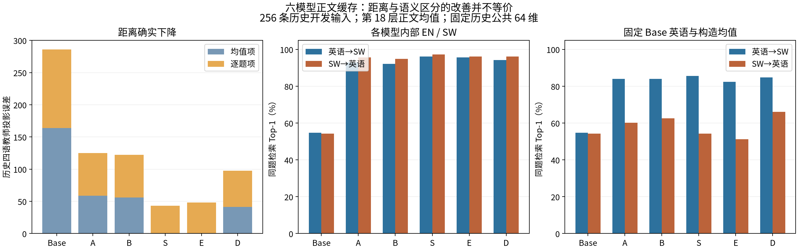
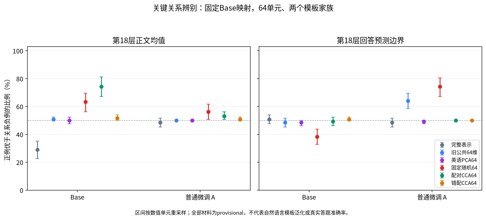
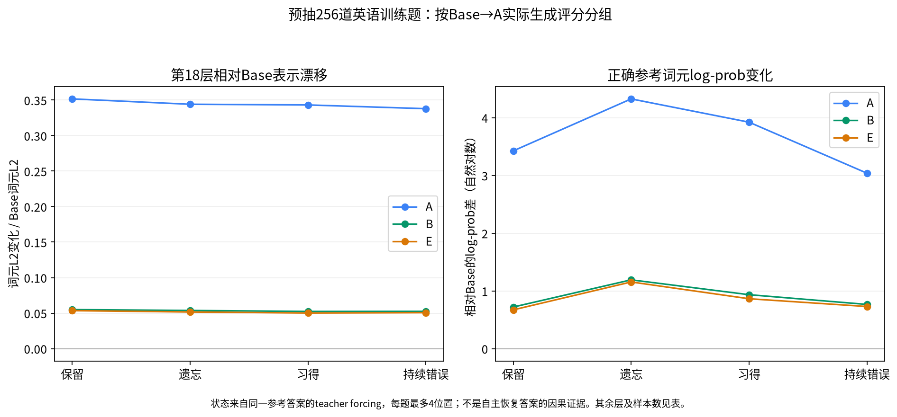

> 公开归档副本：服务器路径已替换为占位路径。正文所引用但未随公开副本发布的原始语料、权重、运行记录及逐题文本保留在服务器；本目录 README 为发布范围和状态入口。

# S3-Align：语义区分、英语遗忘与双侧映射训练验证

生成时间：2026-11-16T16:05:09.615664+08:00。固定截止：2026-11-17 10:00 Asia/Tokyo，即北京时间09:00。

**进行中草稿，不能视为最终验收。** 六模型语义比较、受控关系诊断和英语数学分析已完成；T0/T1完整65k训练与共同核心评测已核验。统一坐标T1降低了SW阅读成绩，未显示明确英语补偿收益；T2尚在训练，不能提前判断双侧映射是否超过匹配基线。

## 1. 问题、范围与模型身份

本轮检验三件事：历史S3的距离下降是否伴随更多样本内容区分；双侧CCA是否保留改变答案的关系；相同英语保持下，两侧映射是否带来正式任务收益。没有重跑上一轮9,600条Belebele干预，没有恢复MathOctopus数学SFT或FFT，也没有在本轮T0/T1/T2中搜索层、rank或新的语言。

报告范围是2026-11-16附件所定义的三组FULL-65K实验。用户随后批准的五任务、六方法SCREEN-8K研究另有独立目录s3_functional_space_20261116，其层位定位、G00/G10等训练和结果不纳入本轮预算或完成声明。两条研究线的数据、模型和结论不能互相补填。

所有模型属于Qwen3-4B。SW指斯瓦希里语，EN指英语。历史65k模型：Base为原模型；A为普通SW LoRA；B为英语表示保持；S为共享对齐；E为共享对齐加保持；D为随机对齐加保持。历史A与其余组存在梯度检查点实现差异，S−A因此保留混杂说明。本轮新T0/T1/T2使用同一实现、初始化、训练顺序与终点，另表报告。历史8k/500步轨道不混入新表。

层号按decoder block从1开始计数，第18层对应代码索引17。正文均值是完整用户正文所占词元的原始块输出平均，不包含聊天标记。回答边界是非thinking聊天模板中最后一个真实输入词元的状态，不等于正文末词元，也不是输入参考答案后的状态。

历史输入实际包含instruction及非空input；旧教师是EN/ZH/FR/DE四语原始表示均值。新训练改为冻结Base英语单一教师。不能把新T2与历史E的全部差异归因于CCA。

### 1.1 阅读本报告需要的术语

**Base**是微调前的初始模型；**基线方法**是用于比较的方法，例如T0本身已经完成训练。**SFT（监督微调）**用输入及参考回答更新模型；本轮通过**LoRA**附加低秩参数实施，基础模型权重固定。**隐藏状态**是模型各层处理文本得到的数值向量，本模型每个词元的向量为2,560维。

**子空间**是从这些向量中选出的若干线性方向。**SVD（奇异值分解）**在本项目中用于提取主要变化方向；统计上变化大或跨语言重合，不自动等于对答案关键。**CCA（典型相关分析）**利用同内容的双语配对，分别学习英语和斯瓦希里语两套线性映射，使映射后的坐标相关。它允许两个语言采用不同的原始方向，因此“坐标可对应”不等于“原始方向相同”。

**英语表示保持（T0）**是在斯瓦希里语SFT之外，限制英语输入的指定内部状态偏离冻结Base；它既不是英语答案交叉熵回放，也不是完全禁止目标语言内部表示改变。**统一坐标对齐（T1新增项）**让两种语言使用同一个固定64维投影，分别中心化、标准化后靠近。**双侧CCA对齐（T2新增项）**让两种语言使用各自的固定映射，再让斯瓦希里语坐标接近同题Base英语坐标。三者的具体公式和权重在第6节。

**MSE**是对应坐标误差平方的平均，下降只表示更符合指定表示目标。**ACC**是答对样本的比例。**百分点（pp）**表示两个百分数直接相减：例如准确率40%变成43%，增加3个百分点，相对增幅才是7.5%。本报告的95%配对区间衡量固定模型下的样本不确定性，不包含训练种子方差；跨零不证明两方法等价。


## 2. 数据用途、隔离与暴露情况

以下表的数量指源样本或语义单元，不能把多模型、多方向或多个随机基当成新增独立样本。完整ID清单、实际文本和编码随交接包保存。

| 集合 | 数量 | 语言与任务 | 用途 | 暴露及限制 | ID清单或协议 |
|---|---|---|---|---|---|
| 历史主SFT | 65415 | SW及同ID来源 | 历史训练，现有A/B/S/E/D | 已用于训练，不能称未见集 | inputs/main_sft_ids.json |
| 新三组主SFT | 65415 | SW | T0/T1/T2同一数据顺序和监督词元 | 统一FULL-65K | inputs/main_sft_ids.json |
| 英语保持池 | 128 | EN数学64/指令64 | 原B保持及新三组每步1条 | 历史Base正确筛选，含参考答案 | inputs/english_keep_ids.json |
| 映射构造 | 1024 | EN/SW；旧公共V另含ZH/FR/DE | 原共享构造与新T1/T2固定映射 | 均在主训练池，构造集 | inputs/alignment.jsonl |
| 梯度校准 | 32 | SW同一1024中的固定源ID | 仅初始梯度尺度，无优化更新 | 不使用任务成绩 | assets/mapping_metadata.json |
| 历史语义开发 | 256 | 五语缓存，本轮EN/SW | 六模型语义检索 | 已暴露历史开发，不是新确认 | previous cache manifest |
| 关系诊断拟合 | 981 | EN/SW | 排除43个数学/排序家族后仅任务二拟合 | 与实际训练1024映射明确分开 | records/RELATION_DATA_FROZEN.json |
| 关系开发 | 32 | EN/SW排序模板 | 预先固定语义正负对，不调参 | provisional，无母语审校 | inputs/relations64.jsonl |
| 关系确认 | 32 | EN/SW减法顺序模板 | 模板家族与关系开发分开 | provisional；来源模板历史主SFT见过，非完整未见集 | inputs/relations64.jsonl |
| 数学新诊断 | 256 | EN GSM8K train | 四模型生成与参考前缀表示分析 | 排除全部历史5-shot演示4,375题及已知旧池/SFT精确重叠，合计4,631；余2,842中预抽256。v3于任何诊断输出前重抽，逐题上游提示核验；不声称预训练未见。 | records/MATH_DATA_FROZEN.json |
| 正式核心 | 900/1319/541 | SW阅读/EN数学/EN指令 | 全部三组同一协议正式终点 | 历史测试已暴露，不用于调参 | EVALUATION_LOCK.json |


## 3. 六模型缓存分析：计算口径

复用256条历史开发输入和六模型第18层正文缓存，不重新提取五语全部层。四个表示为历史公共64维、历史固定随机64维、Base英语PCA64维及完整2560维。PCA即主成分分析；基底固定后不在开发集重新拟合。

口径一：Base英语参考和Base语言均值固定，衡量学生相对同一参考的变化。口径二：每个模型自身EN/SW表示，各自减去该模型构造侧均值，衡量内部对应。正文均值只取512条已有构造缓存；实际回答边界只复用Base/A现有1,024条构造缓存，另外四个模型没有以正文末词元冒充回答边界。

Top-1为正确配对在256个候选中排第一的比例；MRR为正确项排名倒数的平均。正配对与全部错误配对平均值、最强错误项的相似度间隔，以及线性CKA关系相似度均保存。CKA的Gram矩阵中心化是指标定义，不用于拟合检索坐标。区间在固定256项候选库和固定投影下，按查询源ID做4,000次配对重采样，不重新拟合投影或重采候选库，不代表跨训练种子稳定性，也未进行多重比较校正。

历史误差分解忠实保留四语教师和原公共基：总误差=误差均值向量的平方范数+去均值后的逐题平方误差。表中为逐坐标平方和的样本平均，不是新训练的标准化loss。开发集上的均值项仅用于描述性分解，不反馈给投影拟合或检索中心化。


### 3.1 模型内部对应及历史距离

背景：同一256条输入、固定历史公共64维。距离列的教师为历史四语均值；检索列是各模型自身英语与SW，二者不可当成同一目标。普通SFT已经达到很高的检索水平。

| 模型 | 总误差 | 均值项 | 逐题项 | EN→SW Top-1 % | SW→EN Top-1 % | EN→SW MRR | 线性CKA |
|---|---|---|---|---|---|---|---|
| Base | 286.02 | 163.97 | 122.04 | 54.69 | 54.30 | 0.652 | 0.612 |
| A | 125.02 | 58.95 | 66.07 | 92.97 | 95.70 | 0.952 | 0.363 |
| B | 122.14 | 56.15 | 65.99 | 92.19 | 94.92 | 0.949 | 0.790 |
| S | 43.08 | 0.28 | 42.80 | 96.09 | 97.27 | 0.979 | 0.868 |
| E | 48.13 | 0.32 | 47.81 | 95.70 | 96.09 | 0.972 | 0.845 |
| D | 97.70 | 41.23 | 56.48 | 94.14 | 96.09 | 0.965 | 0.824 |


### 3.2 固定Base参考不能与内部检索混用

背景：仍为相同256条输入，但英语一侧及两语言构造均值都固定在Base。双向差异反映固定参考、均值移动与检索归一化共同作用，不能将其当作因果遗忘量。

| 模型 | EN→SW Top-1 % | SW→EN Top-1 % | 正配对−错误平均 | SW检索正例−最强负例 |
|---|---|---|---|---|
| Base | 54.69 | 54.30 | 0.543 | -0.021 |
| A | 83.98 | 60.16 | 0.570 | 0.013 |
| B | 83.98 | 62.50 | 0.586 | 0.025 |
| S | 85.55 | 54.30 | 0.568 | 0.000 |
| E | 82.42 | 51.17 | 0.553 | -0.013 |
| D | 84.77 | 66.02 | 0.606 | 0.036 |


内部EN→SW的核心配对比较如下；差值和区间单位均为百分点。

| 后者 | 前者 | 差值 | 95%下界 | 95%上界 |
|---|---|---|---|---|
| S | A | 3.12 | 0.39 | 5.86 |
| E | B | 3.52 | 0.78 | 6.64 |
| E | D | 1.56 | -0.78 | 4.30 |

这不支持“S3仅仅平移均值、没有任何额外区分改善”的绝对说法。但改进幅度远小于距离变化，固定Base参考口径并未一致改善，且同题检索仍不能说明决定答案的关系被保留。



## 4. 关键关系诊断：先说明材料边界

采用64个程序构造数值单元，每个含英语原文、SW对应输入、同义英语改写、关键关系负例及可核验答案。排序方向32个单元为开发材料；减法操作数顺序32个单元为预设的provisional确认材料。两类在模板家族上分开，数值实例不同；但来源家族可能已在历史SFT中出现，不能称模型完整未见的任务。64个数值实例也不等于64种独立语言结构。

模板来自Bactrian-X实际EN/SW配对来源，只作显式数值、顺序变换。没有调用付费服务，没有把自动生成或回译称为母语人工审校。全部材料标记provisional；答案算术可核验，但不据此宣称已确认自然语言语义泛化。

诊断CCA仅在原1,024条构造池中按预设英语关键词规则排除43条相关数学/排序输入后，余下981条上拟合；这里的“家族隔离”是规则定义的筛除，不保证穷尽所有语义近似模板，完整正则及排除ID见协议。PCA128、岭系数0.1×平均方差、输出64维均固定。正文与边界分别拟合。主比较使用Base固定映射应用于Base/A；A重拟合只是信息可读出诊断。额外单列原1,024条训练池上实际T1/T2标准化公式，不把它冒称家族隔离的拟合。

每个单元有两个方向平衡的查询：SW原输入应更接近英语同义正例；改变关系后的SW输入应更接近原英语负例。相似度差为正例余弦减负例余弦。按原始单元配对重采样，不把两次查询算成两倍独立样本。完整表示、旧公共64维、英语PCA64、固定随机64、CCA及打乱配对CCA均报告；历史正文公共基应用于边界时明确沿用原基，不叫同位置重拟合。


### 4.1 实际输入例：sorting

```text
sw_original:
Panga nambari ulizopewa kwa mpangilio wa kupanda.

315, 319, 750, 514

en_positive:
Sort these numbers from smallest to largest.

315, 319, 750, 514

en_negative:
Sort these numbers from largest to smallest.

315, 319, 750, 514

sw_negative:
Panga upya orodha ifuatayo kwa mpangilio wa kushuka.

315, 319, 750, 514
```

答案：{"positive": [315, 319, 514, 750], "negative": [750, 514, 319, 315]}。来源ID：alpaca-54, alpaca-897, alpaca-845。

### 4.1 实际输入例：subtraction_order

```text
sw_original:
Kwa kuzingatia nambari mbili, toa nambari ya pili kutoka kwa ile ya kwanza na toa matokeo.

410, 484

en_positive:
What is the result of subtracting 484 from 410?

en_negative:
What is the result of subtracting 410 from 484?

sw_negative:
Kwa kuzingatia nambari mbili, toa nambari ya pili kutoka kwa ile ya kwanza na toa matokeo.

484, 410
```

答案：{"positive": -74, "negative": 74}。来源ID：alpaca-36729。

### 4.2 关系辨别结果

下表条件于两个模板家族；正确率是正例排在负例之前的比例，非模型真实答题准确率。正文和边界、固定映射和重拟合结果分别保存在结果CSV。

| 模型 | 位置 | 表示 | 单元数 | 关系区分 % | 95%下界 % | 95%上界 % | 正负余弦差 |
|---|---|---|---|---|---|---|---|
| A | 正文均值 | 配对CCA64（家族隔离） | 64 | 53.12 | 50.78 | 56.25 | 0.000 |
| A | 正文均值 | 错配CCA64 | 64 | 50.78 | 50.00 | 52.34 | 0.003 |
| A | 正文均值 | 英语主成分64维 | 64 | 50.00 | 50.00 | 50.00 | 0.000 |
| A | 正文均值 | 完整2560维 | 64 | 48.44 | 45.31 | 51.56 | -0.000 |
| A | 正文均值 | 历史正文公共64维 | 64 | 50.00 | 50.00 | 50.00 | 0.000 |
| A | 正文均值 | 固定随机64维 | 64 | 56.25 | 50.78 | 61.72 | 0.005 |
| A | 回答预测边界 | 配对CCA64（家族隔离） | 64 | 50.00 | 50.00 | 50.00 | 0.001 |
| A | 回答预测边界 | 错配CCA64 | 64 | 50.00 | 50.00 | 50.00 | -0.000 |
| A | 回答预测边界 | 英语主成分64维 | 64 | 49.22 | 47.66 | 50.00 | 0.000 |
| A | 回答预测边界 | 完整2560维 | 64 | 48.44 | 45.31 | 51.56 | 0.001 |
| A | 回答预测边界 | 历史正文公共64维 | 64 | 64.06 | 58.59 | 69.53 | 0.001 |
| A | 回答预测边界 | 固定随机64维 | 64 | 74.22 | 67.19 | 80.47 | 0.002 |
| Base | 正文均值 | 配对CCA64（家族隔离） | 64 | 74.22 | 67.19 | 81.25 | 0.004 |
| Base | 正文均值 | 错配CCA64 | 64 | 51.56 | 50.00 | 53.91 | -0.001 |
| Base | 正文均值 | 英语主成分64维 | 64 | 50.00 | 47.66 | 52.34 | -0.000 |
| Base | 正文均值 | 完整2560维 | 64 | 28.91 | 22.66 | 35.16 | -0.003 |
| Base | 正文均值 | 历史正文公共64维 | 64 | 50.78 | 50.00 | 52.34 | -0.000 |
| Base | 正文均值 | 固定随机64维 | 64 | 63.28 | 56.25 | 69.53 | 0.001 |
| Base | 回答预测边界 | 配对CCA64（家族隔离） | 64 | 49.22 | 46.09 | 52.34 | 0.000 |
| Base | 回答预测边界 | 错配CCA64 | 64 | 50.78 | 50.00 | 52.34 | 0.001 |
| Base | 回答预测边界 | 英语主成分64维 | 64 | 48.44 | 46.09 | 50.00 | 0.001 |
| Base | 回答预测边界 | 完整2560维 | 64 | 50.78 | 47.66 | 53.91 | 0.001 |
| Base | 回答预测边界 | 历史正文公共64维 | 64 | 48.44 | 45.31 | 51.56 | 0.000 |
| Base | 回答预测边界 | 固定随机64维 | 64 | 38.28 | 32.81 | 43.75 | -0.002 |


### 4.3 实际失败样例：关系变化后仍偏向错误候选

以下只读已有逐题比较结果，按模型和家族选ID顺序最早的失败项；不是随机抽样比例估计，也没有新增输入、重拟合或前向。固定Base家族隔离CCA、正文均值读出。Base排序家族没有失败项，如实保留这一正结果，不强行补一个反例。全部译文仍为provisional。

**Base，subtraction_order-00，关系反转输入。**

```text
SW查询：
Kwa kuzingatia nambari mbili, toa nambari ya pili kutoka kwa ile ya kwanza na toa matokeo.

484, 410

按语义应对应的英语候选：
What is the result of subtracting 410 from 484?

实际上更相近的错误英语候选：
What is the result of subtracting 484 from 410?
```

正例余弦0.534，负例余弦0.538，正减负差-0.004140；查询应对应答案74，错误候选对应-74。这说明该读出未正确区分本次关系变化，**不表示模型实际生成了错误候选的答案**。双方向及Base/A同单元的完整比较见relation_failure_examples.jsonl，来源ID为alpaca-36729。

**A，sorting-00，关系反转输入。**

```text
SW查询：
Panga upya orodha ifuatayo kwa mpangilio wa kushuka.

315, 319, 750, 514

按语义应对应的英语候选：
Sort these numbers from largest to smallest.

315, 319, 750, 514

实际上更相近的错误英语候选：
Sort these numbers from smallest to largest.

315, 319, 750, 514
```

正例余弦0.843，负例余弦0.847，正减负差-0.003907；查询应对应答案[750, 514, 319, 315]，错误候选对应[315, 319, 514, 750]。这说明该读出未正确区分本次关系变化，**不表示模型实际生成了错误候选的答案**。双方向及Base/A同单元的完整比较见relation_failure_examples.jsonl，来源ID为alpaca-54, alpaca-897, alpaca-845。

**A，subtraction_order-00，原方向输入。**

```text
SW查询：
Kwa kuzingatia nambari mbili, toa nambari ya pili kutoka kwa ile ya kwanza na toa matokeo.

410, 484

按语义应对应的英语候选：
What is the result of subtracting 484 from 410?

实际上更相近的错误英语候选：
What is the result of subtracting 410 from 484?
```

正例余弦0.616，负例余弦0.618，正减负差-0.002418；查询应对应答案-74，错误候选对应74。这说明该读出未正确区分本次关系变化，**不表示模型实际生成了错误候选的答案**。双方向及Base/A同单元的完整比较见relation_failure_examples.jsonl，来源ID为alpaca-36729。

## 5. GSM8K（英语）与训练侧数学诊断：实际错误、保持与格式问题

先复核历史正式GSM8K的1,319条逐题结果，四模型题目、提示和目标身份一致。保留=前后均正确；遗忘=原先正确后来错误；习得=原先错误后来正确；持续错误=前后均错。这里的“正确”始终使用原上游flexible-extract主评分器，不追溯修分。B/E相对于A的修复和损坏同时保留。
| 前者 | 后者 | 题数 | 保留 | 遗忘 | 习得 | 持续错误 |
|---|---|---|---|---|---|---|
| Base | A | 1319 | 943 | 171 | 75 | 130 |
| Base | B | 1319 | 1051 | 63 | 51 | 154 |
| Base | E | 1319 | 1044 | 70 | 57 | 148 |
| A | B | 1319 | 937 | 81 | 165 | 136 |
| A | E | 1319 | 941 | 77 | 160 | 141 |
| B | E | 1319 | 1073 | 29 | 28 | 189 |


B修复Base→A丢失171题中的141题，E修复138题；它们分别又在Base/A原本均正确的题中引入33/37个错误。保持策略有明显作用，但并非单向修复所有题。

### 5.1 不能把所有评分下降称为推理能力丢失

下表仅识别“已提取数值与参考数值相等，但原字符串评分为错”的保守子集；不重新提取答案，也不形成替代主分数。严格与宽松过滤器不同不自动表示内容正确。

| 模型 | 题数 | 主评分答对 | 数值等价但判错 | 两过滤器不一致 | 171遗忘题中的数值格式项 |
|---|---|---|---|---|---|
| Base | 1319 | 1114 | 36 | 311 | 0 |
| A | 1319 | 1018 | 29 | 156 | 6 |
| B | 1319 | 1102 | 43 | 149 | 3 |
| E | 1319 | 1101 | 43 | 131 | 4 |


按源顺序检查最早16道Base正确、A被评分为错的题，得到12个内容错误、2个末尾数字提取错误、2个小数格式错误。这是确定顺序的案例复核，不是随机抽样的总体比例估计，也没有独立人工标注。例：题5的64美元被末句“16个杯子”覆盖；题8的45英里被末句“4小时”覆盖；题24的26.00与26数值等价。内容错误则包括漏减原有数量、颠倒上下层关系、混淆每份与整袋、遗漏工作日重复次数等。完整输入、输出及解释见逐题文件。

### 5.2 新训练侧256题与表示分析

先排除已知旧保持、方向构建、历史候选筛选、全部历史1,319题所用的4,375个不同5-shot示例及精确SFT问题重叠，共4,631个源ID，从余下2,842题以seed20261116均匀抽256题。没有按Base是否答对或A是否遗忘筛选。已知排除不等于穷尽所有历史或预训练重叠。

在任何新诊断前向或出分之前，纠正了早期草稿把第一题5-shot示例套用到全部题目的问题，并按扩大后的排除清单重抽源ID；旧草稿保留。每题提示由原上游框架实际构造，并逐题核对历史对应索引的示例顺序和多轮聊天模板。Base/A/B/E使用同一冻结5-shot、greedy、最多1,280新词元和原评分器。另将相同参考答案接在相同实际5-shot输入后，在预设L12/L18/L24、最多4个均匀参考答案预测位置提取原始块输出，计算相对Base的漂移与正确参考词元log-prob变化。输入长度、参考答案长度、参考步骤数及Base参考NLL作为基本混杂记录。这里的参考NLL只覆盖预选的至多4个参考词元，属于稀疏难度代理，不是整段答案NLL或困惑度。参考答案teacher forcing与自由生成准确率分开；后者不能由前者替代。没有进行数学方向搜索或新的大规模激活恢复。
| 前者 | 后者 | 题数 | 保留 | 遗忘 | 习得 | 持续错误 |
|---|---|---|---|---|---|---|
| Base | A | 256 | 198 | 30 | 14 | 14 |
| Base | B | 256 | 218 | 10 | 12 | 16 |
| Base | E | 256 | 218 | 10 | 9 | 19 |
| A | B | 256 | 203 | 9 | 27 | 17 |
| A | E | 256 | 201 | 11 | 26 | 18 |


新诊断集的自由生成成绩如下。全部256题均保留，使用原数值提取器；这不是正式GSM8K测试集，也没有按遗忘与否筛选。

| 模型 | 题数 | 答对数 | ACC % |
|---|---|---|---|
| Base | 256 | 228 | 89.06 |
| A | 256 | 212 | 82.81 |
| B | 256 | 230 | 89.84 |
| E | 256 | 227 | 88.67 |

| 前者 | 后者 | 差值pp | 95%下界 | 95%上界 | 修复 | 损坏 |
|---|---|---|---|---|---|---|
| Base | A | -6.25 | -11.33 | -1.17 | 14 | 30 |
| Base | B | 0.78 | -2.73 | 4.30 | 12 | 10 |
| Base | E | -0.39 | -3.91 | 2.73 | 9 | 10 |
| A | B | 7.03 | 2.34 | 11.72 | 27 | 9 |
| A | E | 5.86 | 1.17 | 10.16 | 26 | 11 |
| B | E | -1.17 | -3.12 | 0.78 | 2 | 5 |

表示分组结果按Base→A的评分转移分组，不能排除格式因素。漂移和正确参考词元概率只是辅助解释，长度控制后的相关也不建立因果。log-prob变化取自最终输出头，同一题在三层表中重复用于对照各层漂移；它不是在各中间层独立解码得到的概率，不能将三层行数视作三倍样本。

| 模型 | 层 | Base→A分组 | 题数 | 相对漂移 | 参考log-prob变化 | 平均输入词元 | 平均答案词元 |
|---|---|---|---|---|---|---|---|
| A | 12 | retained | 198 | 0.186 | 3.425 | 1041.566 | 108.884 |
| A | 12 | forgotten | 30 | 0.186 | 4.325 | 1084.433 | 140.533 |
| A | 12 | acquired | 14 | 0.176 | 3.922 | 1024.500 | 134.071 |
| A | 12 | persistent_error | 14 | 0.183 | 3.038 | 1083.857 | 168.714 |
| A | 18 | retained | 198 | 0.352 | 3.425 | 1041.566 | 108.884 |
| A | 18 | forgotten | 30 | 0.344 | 4.325 | 1084.433 | 140.533 |
| A | 18 | acquired | 14 | 0.343 | 3.922 | 1024.500 | 134.071 |
| A | 18 | persistent_error | 14 | 0.338 | 3.038 | 1083.857 | 168.714 |
| A | 24 | retained | 198 | 0.463 | 3.425 | 1041.566 | 108.884 |
| A | 24 | forgotten | 30 | 0.454 | 4.325 | 1084.433 | 140.533 |
| A | 24 | acquired | 14 | 0.454 | 3.922 | 1024.500 | 134.071 |
| A | 24 | persistent_error | 14 | 0.447 | 3.038 | 1083.857 | 168.714 |
| B | 12 | retained | 198 | 0.025 | 0.720 | 1041.566 | 108.884 |
| B | 12 | forgotten | 30 | 0.026 | 1.191 | 1084.433 | 140.533 |
| B | 12 | acquired | 14 | 0.024 | 0.934 | 1024.500 | 134.071 |
| B | 12 | persistent_error | 14 | 0.025 | 0.765 | 1083.857 | 168.714 |
| B | 18 | retained | 198 | 0.055 | 0.720 | 1041.566 | 108.884 |
| B | 18 | forgotten | 30 | 0.054 | 1.191 | 1084.433 | 140.533 |
| B | 18 | acquired | 14 | 0.052 | 0.934 | 1024.500 | 134.071 |
| B | 18 | persistent_error | 14 | 0.052 | 0.765 | 1083.857 | 168.714 |
| B | 24 | retained | 198 | 0.097 | 0.720 | 1041.566 | 108.884 |
| B | 24 | forgotten | 30 | 0.095 | 1.191 | 1084.433 | 140.533 |
| B | 24 | acquired | 14 | 0.096 | 0.934 | 1024.500 | 134.071 |
| B | 24 | persistent_error | 14 | 0.097 | 0.765 | 1083.857 | 168.714 |
| E | 12 | retained | 198 | 0.025 | 0.671 | 1041.566 | 108.884 |
| E | 12 | forgotten | 30 | 0.026 | 1.154 | 1084.433 | 140.533 |
| E | 12 | acquired | 14 | 0.023 | 0.864 | 1024.500 | 134.071 |
| E | 12 | persistent_error | 14 | 0.025 | 0.729 | 1083.857 | 168.714 |
| E | 18 | retained | 198 | 0.053 | 0.671 | 1041.566 | 108.884 |
| E | 18 | forgotten | 30 | 0.052 | 1.154 | 1084.433 | 140.533 |
| E | 18 | acquired | 14 | 0.050 | 0.864 | 1024.500 | 134.071 |
| E | 18 | persistent_error | 14 | 0.051 | 0.729 | 1083.857 | 168.714 |
| E | 24 | retained | 198 | 0.093 | 0.671 | 1041.566 | 108.884 |
| E | 24 | forgotten | 30 | 0.091 | 1.154 | 1084.433 | 140.533 |
| E | 24 | acquired | 14 | 0.092 | 0.864 | 1024.500 | 134.071 |
| E | 24 | persistent_error | 14 | 0.094 | 0.729 | 1083.857 | 168.714 |


### 5.3 代码能力的补充描述

只复用164道HumanEval+的历史实际执行结果，核对数据清单和提示词元身份；没有新增代码hook或重新评分。历史EvalPlus适配说明原样保留。

| 前者 | 后者 | 题数 | 保留 | 遗忘 | 习得 | 持续错误 |
|---|---|---|---|---|---|---|
| Base | A | 164 | 93 | 32 | 7 | 32 |
| Base | B | 164 | 110 | 15 | 10 | 29 |
| Base | E | 164 | 109 | 16 | 10 | 29 |
| A | B | 164 | 95 | 5 | 25 | 39 |
| A | E | 164 | 95 | 5 | 24 | 40 |


## 6. 新训练：预算、损失与公平性

三组均独立从同一Base初始化，LoRA rank16、alpha32、dropout0.05、36层七类投影，33,030,144可训练参数；LR1e-4，AdamW，cosine，warmup5%，BF16+SDPA，非重入梯度检查点，max_length2048，microbatch2×累计8，seed42，不packing，仅assistant词元CE。每组65,415条、1epoch、4,089步，19,135,489输入词元和14,314,363移位后assistant监督词元。初始Adapter逐字节一致。历史B采用microbatch1×累计16，本轮三组统一为2×8；有效batch相同不保证随机数消耗和数值轨迹相同，因此重跑T0而不将旧B直接搬入新表。

T0=SW SFT+原审计英语表示保持。T1=T0+统一坐标对齐。T2=T0+双侧CCA对齐。保持项为36个原始块输出、每条至多4个参考答案预测位置的相对平方误差，再除以固定能力尺度；mu=1，数学尺度0.13853428785915772，指令尺度0.21183144826953915。保持池固定128条，每optimizer step一条，三组相同。没有悄悄替换为CE回放、KL或72点版本。11月15日8k轨道采用过不同保持尺度，因此不能复用其模型当T0。

对齐公式（英语教师stop-gradient，所有映射及统计固定）：

```text
z_EN = ((h_EN_Base - mu_EN) @ P_EN) / std_EN
z_SW = ((h_SW_student - mu_SW) @ P_SW) / std_SW
L_align = mean((z_SW - z_EN)^2)
L_total = L_CE + 1.0 * L_keep + lambda * L_align
T1: P_EN = P_SW = historical_shared64
T2: P_EN / P_SW = regularized CCA64 bilateral maps
```

均值和逐坐标标准差仅用1,024条构造数据，标准差采用n−1分母，下限1e−6。CCA在每语言PCA128内使用0.1×平均方差岭正则，再取64维。CCA不是正交基，没有用P×P.T回写激活。T1复用历史四参考语言公共V，T2使用EN/SW配对信息；构造信息的差异属于方法定义，不能称信息预算完全相同。T1/T2都使用相同额外SW辅助池、顺序和曝光。已核验1,024个辅助源ID全部包含于65,415条主SW训练集，因此没有新增唯一SW主样本，但增加了重复前向、英语教师信息和配对约束；不能说与T0计算/信息预算完全相同。

32条固定构造源ID进行初始无更新、无dropout梯度校准。全部LoRA参数上CE梯度中位L2范数5.595933；T1/T2原辅助梯度中位数3.078680/2.037473，lambda分别冻结为0.18176401888818577/0.27465067681450456，初始加权辅助/CE中位范数比0.1。保持系数不动。正式运行重新初始化，不接着短测优化；这不保证整个训练期间梯度或AdamW更新相等。训练中固定步数记录辅助梯度；T1/T2终点另用相同32条测相对CE尺度，绝不动态改lambda。

预算在读取新正式成绩前冻结。最重T2的8步短测处理39,483输入词元，用58.53秒；估算三组单卡串行23.64小时，另留10%训练余量及4小时评测、分析和打包，共30小时，小于冻结时剩余32.11小时。实际计算成本以作业日志与曝光记录为准，不将预计耗时冒充实际耗时。


## 7. 新训练的共同正式评测

所有完整终点至少共同评测SW Belebele900（0-shot候选似然ACC）、EN GSM8K1319（5-shot、greedy、最多1280新词元、上游flexible-extract）及EN IFEval541（官方prompt strict为主，834条指令strict为补充）。不混成任意综合分，不按正式测试选择checkpoint或lambda。实际完整聊天输入、生成停止信息、逐题输出和评分配置随包提供。本轮生成统一使用max_num_seqs=32、gpu_memory_utilization=0.82、max_num_batched_tokens=8192；历史65k生成采用8和0.65。任务提示、few-shot、多轮聊天、停止条件、1280词元上限与评分规则保持一致，但执行批量身份不同。新Base数学复测为84.08%，历史为84.46%，其中41题评分发生变化（净少5题）；新IFEval提示strict为79.11%。因此所有新训练对比均使用本轮新Base，绝不拼接旧Base分数，也不把这次重复测评差异称为算法收益。相同seed不保证不同批量下生成逐字相同。

训练采用LLaMA-Factory0.9.6.dev0，源commit47d407d2aabbd52e11d4f34c7a06b9de3e2f0a77；Harness0.4.14.dev0，源commitd6de81643928d653435c431bae19945d41d32520。当前安装的233/751个Python文件已再次与历史干净源码核验记录逐文件对应。阅读直接调用未修改的上游HF；生成使用已有vLLM包装并调用上游任务和评分。隐藏状态诊断为本地自写，未据此重新实现正式评分器。训练环境torch2.6.0+cu118/Transformers4.57.6/PEFT0.18.1；生成环境torch2.7.0+cu118/Transformers4.53.2/vLLM0.9.2+cu118。

核心比较T2−T0、T2−T1、T1−T0。预先登记“Belebele（斯瓦希里语）+2个百分点且GSM8K/IFEval分别不低于T0−1个百分点”为值得复核的工程标记，不是统计显著或论文成功标准。区间沿用2,000次配对重采样：Belebele按篇章聚类、GSM8K按题、IFEval按提示聚类。一个训练seed的区间不代表种子稳定性。


本草稿正式成绩来自阶段审计目录 formal-progress-T1-core-v1；缺失终点仍为待完成，不能视为三组共同最终表。

| 模型 | 预算 | 语言 | 任务/指标 | 样本数 | 分数 % | 状态 |
|---|---|---|---|---|---|---|
| Base | BASE | sw | Belebele | 900 | 27.33 | RAW_UPSTREAM_SCORE_VERIFIED |
| Base | BASE | en | GSM8K | 1319 | 84.08 | RAW_UPSTREAM_SCORE_VERIFIED |
| Base | BASE | en | IFEval-prompt | 541 | 79.11 | RAW_UPSTREAM_SCORE_VERIFIED |
| Base | BASE | en | IFEval-instruction | 834 | 85.25 | RAW_UPSTREAM_SCORE_VERIFIED |
| T0 | FULL-65K | sw | Belebele | 900 | 65.56 | RAW_UPSTREAM_SCORE_VERIFIED |
| T0 | FULL-65K | en | GSM8K | 1319 | 83.09 | RAW_UPSTREAM_SCORE_VERIFIED |
| T0 | FULL-65K | en | IFEval-prompt | 541 | 79.48 | RAW_UPSTREAM_SCORE_VERIFIED |
| T0 | FULL-65K | en | IFEval-instruction | 834 | 85.13 | RAW_UPSTREAM_SCORE_VERIFIED |
| T1 | FULL-65K | sw | Belebele | 900 | 59.22 | RAW_UPSTREAM_SCORE_VERIFIED |
| T1 | FULL-65K | en | GSM8K | 1319 | 83.78 | RAW_UPSTREAM_SCORE_VERIFIED |
| T1 | FULL-65K | en | IFEval-prompt | 541 | 78.93 | RAW_UPSTREAM_SCORE_VERIFIED |
| T1 | FULL-65K | en | IFEval-instruction | 834 | 84.65 | RAW_UPSTREAM_SCORE_VERIFIED |


固定阅读协议的选项偏好必须一起解释：Base在900题中选择A达825次，而正确答案为A仅206题。T0的大幅相对Base增益包含回答偏好变化，不能全部归因为语义阅读提升；本轮T1/T2的主要比较仍是同协议下的T0。以下只是原有逐题输出的事后分解，没有调换选项或重新生成，因此不能给出纯位置偏好的因果大小。正式提示和分数保持原样。

| 模型 | 选项 | 选择次数 | 正确答案次数 | 该位置答对 | 该位置ACC % |
|---|---|---|---|---|---|
| Base | A | 825 | 206 | 199.0 | 96.60 |
| Base | B | 32 | 251 | 19.0 | 7.57 |
| Base | C | 28 | 246 | 16.0 | 6.50 |
| Base | D | 15 | 197 | 12.0 | 6.09 |
| T0 | A | 325 | 206 | 163.0 | 79.13 |
| T0 | B | 194 | 251 | 148.0 | 58.96 |
| T0 | C | 190 | 246 | 144.0 | 58.54 |
| T0 | D | 191 | 197 | 135.0 | 68.53 |
| T1 | A | 340 | 206 | 155.0 | 75.24 |
| T1 | B | 202 | 251 | 142.0 | 56.57 |
| T1 | C | 174 | 246 | 119.0 | 48.37 |
| T1 | D | 184 | 197 | 117.0 | 59.39 |

| 前者 | 后者 | 题数 | 前后均对 | 丢失 | 修复 | 前后均错 |
|---|---|---|---|---|---|---|
| Base | T0 | 900 | 199 | 47 | 391 | 263 |
| Base | T1 | 900 | 190 | 56 | 343 | 311 |
| T0 | T1 | 900 | 489 | 101 | 44 | 266 |


### 7.1 实际训练完成与计算成本

前文训练数量为预设协议；以此表核验实际终点。小时数为单卡运行墙钟，不包含所有缓存、校准和评测成本；完整作业成本记录保留。

| 组 | 状态 | 实际步数 | 实际主样本 | 训练小时 | 峰值已分配显存GiB |
|---|---|---|---|---|---|
| T0 | TRAINING_DONE | 4089 | 65415 | 7.60 | 15.71 |
| T1 | TRAINING_DONE | 4089 | 65415 | 7.60 | 15.71 |
| T2 | TRAINING_PARTIAL/NOT_STARTED | 未达到已核验终点 | — | — | — |


相同32条训练侧样本上的终点无更新梯度检查如下。lambda保持初始冻结值；表中是加权辅助梯度中位数除以CE梯度中位数，不是AdamW参数更新比，也不是整个训练期间持续匹配的证据。

| 组 | 终点步数 | CE梯度中位L2 | 加权辅助梯度中位L2 | 初始比值 | 终点比值 |
|---|---|---|---|---|---|
| T1 | 4089 | 7.221 | 0.306 | 0.100 | 0.042 |


### 7.2 实际完整提示示例：SW Belebele

来自本轮Base逐题输出首个源ID；MMLU取文件名字典序首个子任务。均不按成败挑例。所有模型实际提示身份在配对审计中核对。

```text
<|im_start|>user
P: Hakikisha mkono wako umetulia iwezekanavyo huku ukicheza sauti zote kwa usahihi - pia jaribu usifanye misogeo yoyote isiyo muhimu kwa vidole vyako. Hivi, utajisumbua kidogo iwezekanavyo. Kumbuka hakuna haja ya kugonga vibonye kwa nguvu nyingi ili kutoa sauti kubwakama kwenye piano. Kwenye kodiani, kupata sauti ya ziada, unatumia viriba na shinikizo au kasi zaidi.
Q: Kwa mujibu wa kifungu hiki, ni kipi ambacho hakiwezi kuchukuliwa kama kidokezo sahihi cha kufaulu katika kucheza kodiani?
A: Ili kutoa sauti kubwa, ongeza nguvu ya kugonga vibonye
B: Punguza kabisa misogeo ili udumishe uthabiti wako
C: Kuwa makini unapocheza sauti huku mkono wako ukiwa umetulia
D: Ongeza kasi unapotumia viriba ili kupata sauti ya ziada
Answer:<|im_end|>
<|im_start|>assistant
<think>

</think>


```

```json
"A"
```

### 7.2 实际完整提示示例：EN GSM8K

来自本轮Base逐题输出首个源ID；MMLU取文件名字典序首个子任务。均不按成败挑例。所有模型实际提示身份在配对审计中核对。

```text
<|im_start|>user
Question: For every 12 cans you recycle, you receive $0.50, and for every 5 kilograms of newspapers, you receive $1.50. If your family collected 144 cans and 20 kilograms of newspapers, how much money would you receive?
Answer:<|im_end|>
<|im_start|>assistant
There are 144/12 = <<144/12=12>>12 sets of 12 cans that the family collected.
So, the family would receive $0.50 x 12 = $<<0.50*12=6>>6 for the cans.
There are 20/5 = <<20/5=4>>4 sets of 5 kilograms of newspapers that the family collected.
So, the family would receive $1.50 x 4 = $<<1.50*4=6>>6 for the newspapers.
Therefore, the family would receive a total of $6 + $6 = $<<6+6=12>>12.
#### 12<|im_end|>
<|im_start|>user
Question: Betty picked 16 strawberries. Matthew picked 20 more strawberries than Betty and twice as many as Natalie. They used their strawberries to make jam. One jar of jam used 7 strawberries and they sold each jar at $4. How much money were they able to make from the strawberries they picked?
Answer:<|im_end|>
<|im_start|>assistant
Matthew picked 16 + 20 = <<16+20=36>>36 strawberries.
Natalie picked 36/2 = <<36/2=18>>18 strawberries.
All together, they have 16 + 36 + 18 = <<16+36+18=70>>70 strawberries.
They can make 70/7 = <<70/7=10>>10 jars of strawberries.
They earn 10 x $4 = $<<10*4=40>>40 from the strawberries they picked.
#### 40<|im_end|>
<|im_start|>user
Question: Jack has a stack of books that is 12 inches thick. He knows from experience that 80 pages is one inch thick. If he has 6 books, how many pages is each one on average?
Answer:<|im_end|>
<|im_start|>assistant
There are 960 pages because 80 x 12 = <<80*12=960>>960
Each book is 160 pages because 960 / 6 = <<960/6=160>>160
#### 160<|im_end|>
<|im_start|>user
Question: James dumps his whole collection of 500 Legos on the floor and starts building a castle out of them.  He uses half the pieces before finishing and is told to put the rest away.  He puts all of the leftover pieces back in the box they came from, except for 5 missing pieces that he can't find.  How many Legos are in the box at the end?
Answer:<|im_end|>
<|im_start|>assistant
James starts with 500 Legos and uses half of them, leaving 500/2=<<500/2=250>>250 Legos unused.
He puts those unused Legos away but since he's missing 5 he only puts 250-5=<<250-5=245>>245 Legos away.
#### 245<|im_end|>
<|im_start|>user
Question: Ines had $20 in her purse. She bought 3 pounds of peaches, which are $2 per pound at the local farmers’ market. How much did she have left?
Answer:<|im_end|>
<|im_start|>assistant
Ines bought 3 pounds of peaches for 3 peaches * $2/peach = $<<3*2=6>>6.
Ines has $20 - $6 = $<<20-6=14>>14 left.
#### 14<|im_end|>
<|im_start|>user
Question: Janet’s ducks lay 16 eggs per day. She eats three for breakfast every morning and bakes muffins for her friends every day with four. She sells the remainder at the farmers' market daily for $2 per fresh duck egg. How much in dollars does she make every day at the farmers' market?
Answer:<|im_end|>
<|im_start|>assistant
<think>

</think>


```

```json
{
  "until": [
    "Question:",
    "</s>",
    "<|im_end|>"
  ],
  "do_sample": false,
  "temperature": 0.0,
  "max_gen_toks": 1280
}
```

### 7.2 实际完整提示示例：EN IFEval

来自本轮Base逐题输出首个源ID；MMLU取文件名字典序首个子任务。均不按成败挑例。所有模型实际提示身份在配对审计中核对。

```text
<|im_start|>user
Write a 300+ word summary of the wikipedia page "https://en.wikipedia.org/wiki/Raymond_III,_Count_of_Tripoli". Do not use any commas and highlight at least 3 sections that has titles in markdown format, for example *highlighted section part 1*, *highlighted section part 2*, *highlighted section part 3*.<|im_end|>
<|im_start|>assistant
<think>

</think>


```

```json
{
  "until": [],
  "do_sample": false,
  "temperature": 0.0,
  "max_gen_toks": 1280
}
```

### 7.3 正式任务的配对变化

差值为后者减前者，单位百分点。数学按题、阅读按篇章、指令遵循按提示配对重采样。所有比较保留，不以区间是否跨零筛表；单训练种子的样本区间不包含训练随机性。

| 前者 | 后者 | 指标 | 差值 | 95%下界 | 95%上界 |
|---|---|---|---|---|---|
| Base | T0 | Belebele | 38.22 | 34.73 | 41.94 |
| Base | T0 | GSM8K | -0.99 | -2.58 | 0.53 |
| Base | T0 | IFEval-prompt | 0.37 | -2.40 | 3.14 |
| Base | T0 | IFEval-instruction | -0.12 | -2.10 | 1.80 |
| Base | T1 | Belebele | 31.89 | 28.12 | 35.59 |
| Base | T1 | GSM8K | -0.30 | -1.97 | 1.36 |
| Base | T1 | IFEval-prompt | -0.18 | -3.14 | 2.59 |
| Base | T1 | IFEval-instruction | -0.60 | -2.68 | 1.28 |
| T0 | T1 | Belebele | -6.33 | -8.81 | -3.77 |
| T0 | T1 | GSM8K | 0.68 | -0.76 | 2.05 |
| T0 | T1 | IFEval-prompt | -0.55 | -2.96 | 1.85 |
| T0 | T1 | IFEval-instruction | -0.48 | -2.26 | 1.28 |

T0：SW阅读65.56%、GSM8K83.09%、IFEval提示strict79.48%。T1分别为59.22%、83.78%、78.93%。T1−T0阅读−6.33pp，配对95%区间[−8.81,−3.77]；数学+0.68pp，区间[−0.76,2.05]；指令−0.55pp，区间[−2.96,1.85]。这支持当前统一坐标配方损害固定协议下的目标阅读收益，但英语区间跨零不是等价或非劣证明。T2仍待完整终点，不以训练损失填入正式分数。

## 8. 补充结果与全部口径

以下表用于检查结论是否依赖读取位置、固定参考或特定投影，不作为额外方法搜索。

### 8.1 四种表示的完整语义比较

每行仍为同一256条历史开发输入。reference列区分固定Base参考和各模型内部对应；L18_body为正文均值，L18_boundary为真实回答预测边界；Top-1单位百分数，MRR、CKA和余弦差无百分数单位。

| 模型 | 位置 | 参考口径 | 表示 | EN→SW Top-1 % | SW→EN Top-1 % | EN→SW MRR | SW→EN MRR | 正例−最强负例 | CKA |
|---|---|---|---|---|---|---|---|---|---|
| Base | L18_body | fixed_Base_English_and_means | historical_shared64 | 54.69 | 54.30 | 0.652 | 0.641 | -0.011 | 0.612 |
| Base | L18_body | fixed_Base_English_and_means | historical_random64 | 33.98 | 36.72 | 0.439 | 0.456 | -0.075 | 0.467 |
| Base | L18_body | fixed_Base_English_and_means | base_english_pca64 | 53.52 | 54.69 | 0.646 | 0.641 | -0.014 | 0.617 |
| Base | L18_body | fixed_Base_English_and_means | full2560 | 62.11 | 70.31 | 0.702 | 0.763 | 0.033 | 0.634 |
| Base | L18_body | within_model_own_build_means | historical_shared64 | 54.69 | 54.30 | 0.652 | 0.641 | -0.011 | 0.612 |
| Base | L18_body | within_model_own_build_means | historical_random64 | 33.98 | 36.72 | 0.439 | 0.456 | -0.075 | 0.467 |
| Base | L18_body | within_model_own_build_means | base_english_pca64 | 53.52 | 54.69 | 0.646 | 0.641 | -0.014 | 0.617 |
| Base | L18_body | within_model_own_build_means | full2560 | 62.11 | 70.31 | 0.702 | 0.763 | 0.033 | 0.634 |
| A | L18_body | fixed_Base_English_and_means | historical_shared64 | 83.98 | 60.16 | 0.899 | 0.702 | 0.086 | 0.769 |
| A | L18_body | fixed_Base_English_and_means | historical_random64 | 77.34 | 54.69 | 0.849 | 0.667 | 0.078 | 0.659 |
| A | L18_body | fixed_Base_English_and_means | base_english_pca64 | 81.64 | 59.38 | 0.888 | 0.702 | 0.081 | 0.778 |
| A | L18_body | fixed_Base_English_and_means | full2560 | 92.58 | 84.77 | 0.954 | 0.897 | 0.135 | 0.798 |
| A | L18_body | within_model_own_build_means | historical_shared64 | 92.97 | 95.70 | 0.952 | 0.966 | 0.189 | 0.363 |
| A | L18_body | within_model_own_build_means | historical_random64 | 87.11 | 87.89 | 0.915 | 0.919 | 0.154 | 0.438 |
| A | L18_body | within_model_own_build_means | base_english_pca64 | 93.36 | 94.53 | 0.953 | 0.959 | 0.182 | 0.374 |
| A | L18_body | within_model_own_build_means | full2560 | 96.48 | 96.88 | 0.976 | 0.976 | 0.228 | 0.416 |
| B | L18_body | fixed_Base_English_and_means | historical_shared64 | 83.98 | 62.50 | 0.896 | 0.728 | 0.088 | 0.776 |
| B | L18_body | fixed_Base_English_and_means | historical_random64 | 75.78 | 56.25 | 0.841 | 0.681 | 0.075 | 0.657 |
| B | L18_body | fixed_Base_English_and_means | base_english_pca64 | 83.59 | 61.72 | 0.897 | 0.723 | 0.084 | 0.785 |
| B | L18_body | fixed_Base_English_and_means | full2560 | 93.36 | 88.28 | 0.956 | 0.918 | 0.134 | 0.796 |
| B | L18_body | within_model_own_build_means | historical_shared64 | 92.19 | 94.92 | 0.949 | 0.965 | 0.179 | 0.790 |
| B | L18_body | within_model_own_build_means | historical_random64 | 85.16 | 87.11 | 0.897 | 0.910 | 0.139 | 0.671 |
| B | L18_body | within_model_own_build_means | base_english_pca64 | 93.36 | 94.92 | 0.955 | 0.965 | 0.172 | 0.798 |
| B | L18_body | within_model_own_build_means | full2560 | 96.09 | 97.66 | 0.975 | 0.982 | 0.214 | 0.809 |
| S | L18_body | fixed_Base_English_and_means | historical_shared64 | 85.55 | 54.30 | 0.914 | 0.657 | 0.085 | 0.827 |
| S | L18_body | fixed_Base_English_and_means | historical_random64 | 82.81 | 58.20 | 0.891 | 0.697 | 0.092 | 0.713 |
| S | L18_body | fixed_Base_English_and_means | base_english_pca64 | 84.38 | 53.12 | 0.906 | 0.657 | 0.080 | 0.831 |
| S | L18_body | fixed_Base_English_and_means | full2560 | 94.92 | 81.64 | 0.971 | 0.882 | 0.135 | 0.840 |
| S | L18_body | within_model_own_build_means | historical_shared64 | 96.09 | 97.27 | 0.979 | 0.979 | 0.199 | 0.868 |
| S | L18_body | within_model_own_build_means | historical_random64 | 92.97 | 93.75 | 0.956 | 0.960 | 0.182 | 0.755 |
| S | L18_body | within_model_own_build_means | base_english_pca64 | 94.92 | 97.27 | 0.971 | 0.979 | 0.190 | 0.870 |
| S | L18_body | within_model_own_build_means | full2560 | 97.27 | 98.05 | 0.985 | 0.984 | 0.243 | 0.876 |
| E | L18_body | fixed_Base_English_and_means | historical_shared64 | 82.42 | 51.17 | 0.898 | 0.627 | 0.076 | 0.822 |
| E | L18_body | fixed_Base_English_and_means | historical_random64 | 80.47 | 56.25 | 0.877 | 0.671 | 0.084 | 0.709 |
| E | L18_body | fixed_Base_English_and_means | base_english_pca64 | 82.03 | 50.00 | 0.890 | 0.626 | 0.069 | 0.828 |
| E | L18_body | fixed_Base_English_and_means | full2560 | 93.75 | 81.25 | 0.966 | 0.873 | 0.126 | 0.835 |
| E | L18_body | within_model_own_build_means | historical_shared64 | 95.70 | 96.09 | 0.972 | 0.972 | 0.186 | 0.845 |
| E | L18_body | within_model_own_build_means | historical_random64 | 91.80 | 90.23 | 0.947 | 0.935 | 0.164 | 0.733 |
| E | L18_body | within_model_own_build_means | base_english_pca64 | 94.14 | 95.70 | 0.963 | 0.969 | 0.179 | 0.849 |
| E | L18_body | within_model_own_build_means | full2560 | 96.09 | 97.27 | 0.978 | 0.980 | 0.225 | 0.856 |
| D | L18_body | fixed_Base_English_and_means | historical_shared64 | 84.77 | 66.02 | 0.907 | 0.762 | 0.098 | 0.798 |
| D | L18_body | fixed_Base_English_and_means | historical_random64 | 83.98 | 46.09 | 0.899 | 0.586 | 0.077 | 0.755 |
| D | L18_body | fixed_Base_English_and_means | base_english_pca64 | 85.55 | 67.19 | 0.914 | 0.770 | 0.094 | 0.804 |
| D | L18_body | fixed_Base_English_and_means | full2560 | 94.92 | 89.45 | 0.971 | 0.930 | 0.146 | 0.814 |
| D | L18_body | within_model_own_build_means | historical_shared64 | 94.14 | 96.09 | 0.965 | 0.973 | 0.194 | 0.824 |
| D | L18_body | within_model_own_build_means | historical_random64 | 95.70 | 94.53 | 0.974 | 0.966 | 0.191 | 0.798 |
| D | L18_body | within_model_own_build_means | base_english_pca64 | 94.14 | 95.70 | 0.964 | 0.970 | 0.187 | 0.828 |
| D | L18_body | within_model_own_build_means | full2560 | 97.66 | 97.66 | 0.987 | 0.983 | 0.238 | 0.837 |
| Base | L18_boundary | fixed_Base_English_and_means | base_shared64 | 19.53 | 18.36 | 0.302 | 0.294 | -0.177 | 0.502 |
| Base | L18_boundary | fixed_Base_English_and_means | base_random64 | 14.45 | 16.02 | 0.244 | 0.260 | -0.179 | 0.484 |
| Base | L18_boundary | fixed_Base_English_and_means | base_english_pca64 | 19.92 | 18.75 | 0.303 | 0.296 | -0.176 | 0.513 |
| Base | L18_boundary | fixed_Base_English_and_means | full2560 | 21.88 | 25.78 | 0.320 | 0.356 | -0.115 | 0.536 |
| Base | L18_boundary | within_model_own_build_means | base_shared64 | 19.53 | 18.36 | 0.302 | 0.294 | -0.177 | 0.502 |
| Base | L18_boundary | within_model_own_build_means | base_random64 | 14.45 | 16.02 | 0.244 | 0.260 | -0.179 | 0.484 |
| Base | L18_boundary | within_model_own_build_means | base_english_pca64 | 19.92 | 18.75 | 0.303 | 0.296 | -0.176 | 0.513 |
| Base | L18_boundary | within_model_own_build_means | full2560 | 21.88 | 25.78 | 0.320 | 0.356 | -0.115 | 0.536 |
| A | L18_boundary | fixed_Base_English_and_means | base_shared64 | 21.88 | 1.56 | 0.377 | 0.043 | -0.035 | 0.721 |
| A | L18_boundary | fixed_Base_English_and_means | base_random64 | 12.89 | 0.78 | 0.216 | 0.039 | -0.058 | 0.644 |
| A | L18_boundary | fixed_Base_English_and_means | base_english_pca64 | 22.27 | 1.56 | 0.387 | 0.043 | -0.031 | 0.740 |
| A | L18_boundary | fixed_Base_English_and_means | full2560 | 34.38 | 1.95 | 0.493 | 0.050 | -0.011 | 0.752 |
| A | L18_boundary | within_model_own_build_means | base_shared64 | 76.17 | 80.08 | 0.838 | 0.856 | 0.058 | 0.860 |
| A | L18_boundary | within_model_own_build_means | base_random64 | 80.47 | 84.38 | 0.868 | 0.893 | 0.079 | 0.855 |
| A | L18_boundary | within_model_own_build_means | base_english_pca64 | 75.00 | 79.30 | 0.824 | 0.849 | 0.050 | 0.855 |
| A | L18_boundary | within_model_own_build_means | full2560 | 86.33 | 88.28 | 0.906 | 0.919 | 0.100 | 0.877 |


### 8.2 关系辨别分家族与拟合口径

family列的all是两个模板家族合并；sorting为32个排序单元，subtraction_order为32个操作数顺序单元。fixed_Base_family_filtered为固定Base、981条家族隔离构造数据；refitted_A_family_filtered为A上重拟合的信息读出诊断；fixed_Base_original1024_training_formula为实际训练使用的1,024条构造池及标准化公式。两次查询按单元聚类，不是独立128题。

| 模型 | 位置 | 拟合口径 | 表示 | 家族 | 单元数 | 关系区分 % | 95%下界 % | 95%上界 % | 正负余弦差 |
|---|---|---|---|---|---|---|---|---|---|
| A | body | fixed_Base_family_filtered | cca64_family_filtered | all | 64 | 53.12 | 50.78 | 56.25 | 0.000 |
| A | body | fixed_Base_family_filtered | cca64_family_filtered | sorting | 32 | 56.25 | 51.56 | 62.50 | 0.001 |
| A | body | fixed_Base_family_filtered | cca64_family_filtered | subtraction_order | 32 | 50.00 | 50.00 | 50.00 | -0.000 |
| A | body | fixed_Base_family_filtered | cca64_shuffled | all | 64 | 50.78 | 50.00 | 52.34 | 0.003 |
| A | body | fixed_Base_family_filtered | cca64_shuffled | sorting | 32 | 51.56 | 50.00 | 54.69 | 0.005 |
| A | body | fixed_Base_family_filtered | cca64_shuffled | subtraction_order | 32 | 50.00 | 50.00 | 50.00 | -0.000 |
| A | body | fixed_Base_family_filtered | english_pca64 | all | 64 | 50.00 | 50.00 | 50.00 | 0.000 |
| A | body | fixed_Base_family_filtered | english_pca64 | sorting | 32 | 50.00 | 50.00 | 50.00 | 0.000 |
| A | body | fixed_Base_family_filtered | english_pca64 | subtraction_order | 32 | 50.00 | 50.00 | 50.00 | -0.000 |
| A | body | fixed_Base_family_filtered | full2560 | all | 64 | 48.44 | 45.31 | 51.56 | -0.000 |
| A | body | fixed_Base_family_filtered | full2560 | sorting | 32 | 51.56 | 50.00 | 54.69 | 0.001 |
| A | body | fixed_Base_family_filtered | full2560 | subtraction_order | 32 | 45.31 | 39.06 | 50.00 | -0.002 |
| A | body | fixed_Base_family_filtered | historical_body_shared64 | all | 64 | 50.00 | 50.00 | 50.00 | 0.000 |
| A | body | fixed_Base_family_filtered | historical_body_shared64 | sorting | 32 | 50.00 | 50.00 | 50.00 | 0.001 |
| A | body | fixed_Base_family_filtered | historical_body_shared64 | subtraction_order | 32 | 50.00 | 50.00 | 50.00 | -0.000 |
| A | body | fixed_Base_family_filtered | random64 | all | 64 | 56.25 | 50.78 | 61.72 | 0.005 |
| A | body | fixed_Base_family_filtered | random64 | sorting | 32 | 67.19 | 59.38 | 75.00 | 0.011 |
| A | body | fixed_Base_family_filtered | random64 | subtraction_order | 32 | 45.31 | 40.62 | 50.00 | -0.002 |
| A | body | fixed_Base_original1024_training_formula | T1_actual_training_standardized | all | 64 | 50.00 | 50.00 | 50.00 | 0.001 |
| A | body | fixed_Base_original1024_training_formula | T1_actual_training_standardized | sorting | 32 | 50.00 | 50.00 | 50.00 | 0.002 |
| A | body | fixed_Base_original1024_training_formula | T1_actual_training_standardized | subtraction_order | 32 | 50.00 | 50.00 | 50.00 | -0.000 |
| A | body | fixed_Base_original1024_training_formula | T2_actual_training_standardized | all | 64 | 50.00 | 50.00 | 50.00 | -0.000 |
| A | body | fixed_Base_original1024_training_formula | T2_actual_training_standardized | sorting | 32 | 50.00 | 50.00 | 50.00 | -0.001 |
| A | body | fixed_Base_original1024_training_formula | T2_actual_training_standardized | subtraction_order | 32 | 50.00 | 50.00 | 50.00 | -0.000 |
| A | body | refitted_A_family_filtered | cca64_family_filtered | all | 64 | 60.94 | 56.25 | 66.41 | 0.001 |
| A | body | refitted_A_family_filtered | cca64_family_filtered | sorting | 32 | 71.88 | 64.06 | 79.69 | 0.002 |
| A | body | refitted_A_family_filtered | cca64_family_filtered | subtraction_order | 32 | 50.00 | 50.00 | 50.00 | -0.001 |
| A | body | refitted_A_family_filtered | cca64_shuffled | all | 64 | 51.56 | 50.00 | 53.91 | 0.000 |
| A | body | refitted_A_family_filtered | cca64_shuffled | sorting | 32 | 53.12 | 50.00 | 57.81 | 0.000 |
| A | body | refitted_A_family_filtered | cca64_shuffled | subtraction_order | 32 | 50.00 | 50.00 | 50.00 | 0.000 |
| A | body | refitted_A_family_filtered | english_pca64 | all | 64 | 48.44 | 46.09 | 50.00 | -0.000 |
| A | body | refitted_A_family_filtered | english_pca64 | sorting | 32 | 50.00 | 50.00 | 50.00 | -0.000 |
| A | body | refitted_A_family_filtered | english_pca64 | subtraction_order | 32 | 46.88 | 42.19 | 50.00 | -0.000 |
| A | body | refitted_A_family_filtered | full2560 | all | 64 | 50.00 | 44.53 | 55.47 | -0.001 |
| A | body | refitted_A_family_filtered | full2560 | sorting | 32 | 60.94 | 54.69 | 68.75 | 0.001 |
| A | body | refitted_A_family_filtered | full2560 | subtraction_order | 32 | 39.06 | 31.25 | 45.31 | -0.003 |
| A | body | refitted_A_family_filtered | historical_body_shared64 | all | 64 | 47.66 | 44.53 | 50.00 | -0.000 |
| A | body | refitted_A_family_filtered | historical_body_shared64 | sorting | 32 | 50.00 | 50.00 | 50.00 | 0.000 |
| A | body | refitted_A_family_filtered | historical_body_shared64 | subtraction_order | 32 | 45.31 | 39.06 | 50.00 | -0.000 |
| A | body | refitted_A_family_filtered | random64 | all | 64 | 43.75 | 38.28 | 48.44 | 0.006 |
| A | body | refitted_A_family_filtered | random64 | sorting | 32 | 53.12 | 50.00 | 57.81 | 0.015 |
| A | body | refitted_A_family_filtered | random64 | subtraction_order | 32 | 34.38 | 26.56 | 42.19 | -0.003 |
| A | boundary | fixed_Base_family_filtered | cca64_family_filtered | all | 64 | 50.00 | 50.00 | 50.00 | 0.001 |
| A | boundary | fixed_Base_family_filtered | cca64_family_filtered | sorting | 32 | 50.00 | 50.00 | 50.00 | 0.002 |
| A | boundary | fixed_Base_family_filtered | cca64_family_filtered | subtraction_order | 32 | 50.00 | 50.00 | 50.00 | -0.000 |
| A | boundary | fixed_Base_family_filtered | cca64_shuffled | all | 64 | 50.00 | 50.00 | 50.00 | -0.000 |
| A | boundary | fixed_Base_family_filtered | cca64_shuffled | sorting | 32 | 50.00 | 50.00 | 50.00 | -0.001 |
| A | boundary | fixed_Base_family_filtered | cca64_shuffled | subtraction_order | 32 | 50.00 | 50.00 | 50.00 | 0.000 |
| A | boundary | fixed_Base_family_filtered | english_pca64 | all | 64 | 49.22 | 47.66 | 50.00 | 0.000 |
| A | boundary | fixed_Base_family_filtered | english_pca64 | sorting | 32 | 50.00 | 50.00 | 50.00 | 0.001 |
| A | boundary | fixed_Base_family_filtered | english_pca64 | subtraction_order | 32 | 48.44 | 45.31 | 50.00 | -0.000 |
| A | boundary | fixed_Base_family_filtered | full2560 | all | 64 | 48.44 | 45.31 | 51.56 | 0.001 |
| A | boundary | fixed_Base_family_filtered | full2560 | sorting | 32 | 51.56 | 50.00 | 54.69 | 0.002 |
| A | boundary | fixed_Base_family_filtered | full2560 | subtraction_order | 32 | 45.31 | 39.06 | 50.00 | -0.000 |
| A | boundary | fixed_Base_family_filtered | historical_body_shared64 | all | 64 | 64.06 | 58.59 | 69.53 | 0.001 |
| A | boundary | fixed_Base_family_filtered | historical_body_shared64 | sorting | 32 | 78.12 | 68.75 | 85.94 | 0.001 |
| A | boundary | fixed_Base_family_filtered | historical_body_shared64 | subtraction_order | 32 | 50.00 | 50.00 | 50.00 | -0.000 |
| A | boundary | fixed_Base_family_filtered | random64 | all | 64 | 74.22 | 67.19 | 80.47 | 0.002 |
| A | boundary | fixed_Base_family_filtered | random64 | sorting | 32 | 100.00 | 100.00 | 100.00 | 0.003 |
| A | boundary | fixed_Base_family_filtered | random64 | subtraction_order | 32 | 48.44 | 45.31 | 50.00 | -0.000 |
| A | boundary | refitted_A_family_filtered | cca64_family_filtered | all | 64 | 72.66 | 65.62 | 79.69 | 0.006 |
| A | boundary | refitted_A_family_filtered | cca64_family_filtered | sorting | 32 | 100.00 | 100.00 | 100.00 | 0.012 |
| A | boundary | refitted_A_family_filtered | cca64_family_filtered | subtraction_order | 32 | 45.31 | 39.06 | 50.00 | -0.000 |
| A | boundary | refitted_A_family_filtered | cca64_shuffled | all | 64 | 28.91 | 22.64 | 35.16 | -0.003 |
| A | boundary | refitted_A_family_filtered | cca64_shuffled | sorting | 32 | 6.25 | 1.56 | 12.50 | -0.006 |
| A | boundary | refitted_A_family_filtered | cca64_shuffled | subtraction_order | 32 | 51.56 | 50.00 | 54.69 | 0.000 |
| A | boundary | refitted_A_family_filtered | english_pca64 | all | 64 | 68.75 | 61.72 | 75.00 | 0.004 |
| A | boundary | refitted_A_family_filtered | english_pca64 | sorting | 32 | 90.62 | 82.81 | 96.88 | 0.008 |
| A | boundary | refitted_A_family_filtered | english_pca64 | subtraction_order | 32 | 46.88 | 42.19 | 50.00 | -0.000 |
| A | boundary | refitted_A_family_filtered | full2560 | all | 64 | 49.22 | 43.75 | 54.69 | 0.004 |
| A | boundary | refitted_A_family_filtered | full2560 | sorting | 32 | 59.38 | 53.12 | 67.19 | 0.009 |
| A | boundary | refitted_A_family_filtered | full2560 | subtraction_order | 32 | 39.06 | 31.25 | 45.31 | -0.001 |
| A | boundary | refitted_A_family_filtered | historical_body_shared64 | all | 64 | 67.97 | 60.94 | 75.00 | 0.002 |
| A | boundary | refitted_A_family_filtered | historical_body_shared64 | sorting | 32 | 90.62 | 82.81 | 96.88 | 0.005 |
| A | boundary | refitted_A_family_filtered | historical_body_shared64 | subtraction_order | 32 | 45.31 | 39.06 | 50.00 | -0.000 |
| A | boundary | refitted_A_family_filtered | random64 | all | 64 | 73.44 | 67.19 | 79.69 | 0.007 |
| A | boundary | refitted_A_family_filtered | random64 | sorting | 32 | 98.44 | 95.31 | 100.00 | 0.014 |
| A | boundary | refitted_A_family_filtered | random64 | subtraction_order | 32 | 48.44 | 45.31 | 50.00 | -0.001 |
| Base | body | fixed_Base_family_filtered | cca64_family_filtered | all | 64 | 74.22 | 67.19 | 81.25 | 0.004 |
| Base | body | fixed_Base_family_filtered | cca64_family_filtered | sorting | 32 | 100.00 | 100.00 | 100.00 | 0.008 |
| Base | body | fixed_Base_family_filtered | cca64_family_filtered | subtraction_order | 32 | 48.44 | 45.31 | 50.00 | -0.001 |
| Base | body | fixed_Base_family_filtered | cca64_shuffled | all | 64 | 51.56 | 50.00 | 53.91 | -0.001 |
| Base | body | fixed_Base_family_filtered | cca64_shuffled | sorting | 32 | 53.12 | 50.00 | 57.81 | -0.001 |
| Base | body | fixed_Base_family_filtered | cca64_shuffled | subtraction_order | 32 | 50.00 | 50.00 | 50.00 | -0.000 |
| Base | body | fixed_Base_family_filtered | english_pca64 | all | 64 | 50.00 | 47.66 | 52.34 | -0.000 |
| Base | body | fixed_Base_family_filtered | english_pca64 | sorting | 32 | 51.56 | 50.00 | 54.69 | 0.000 |
| Base | body | fixed_Base_family_filtered | english_pca64 | subtraction_order | 32 | 48.44 | 45.31 | 50.00 | -0.000 |
| Base | body | fixed_Base_family_filtered | full2560 | all | 64 | 28.91 | 22.66 | 35.16 | -0.003 |
| Base | body | fixed_Base_family_filtered | full2560 | sorting | 32 | 23.44 | 14.06 | 31.25 | -0.003 |
| Base | body | fixed_Base_family_filtered | full2560 | subtraction_order | 32 | 34.38 | 25.00 | 42.19 | -0.003 |
| Base | body | fixed_Base_family_filtered | historical_body_shared64 | all | 64 | 50.78 | 50.00 | 52.34 | -0.000 |
| Base | body | fixed_Base_family_filtered | historical_body_shared64 | sorting | 32 | 51.56 | 50.00 | 54.69 | -0.000 |
| Base | body | fixed_Base_family_filtered | historical_body_shared64 | subtraction_order | 32 | 50.00 | 50.00 | 50.00 | -0.000 |
| Base | body | fixed_Base_family_filtered | random64 | all | 64 | 63.28 | 56.25 | 69.53 | 0.001 |
| Base | body | fixed_Base_family_filtered | random64 | sorting | 32 | 79.69 | 70.31 | 89.06 | 0.006 |
| Base | body | fixed_Base_family_filtered | random64 | subtraction_order | 32 | 46.88 | 42.19 | 50.00 | -0.003 |
| Base | body | fixed_Base_original1024_training_formula | T1_actual_training_standardized | all | 64 | 49.22 | 45.31 | 53.12 | -0.001 |
| Base | body | fixed_Base_original1024_training_formula | T1_actual_training_standardized | sorting | 32 | 51.56 | 45.31 | 59.38 | -0.001 |
| Base | body | fixed_Base_original1024_training_formula | T1_actual_training_standardized | subtraction_order | 32 | 46.88 | 42.19 | 50.00 | -0.001 |
| Base | body | fixed_Base_original1024_training_formula | T2_actual_training_standardized | all | 64 | 70.31 | 64.06 | 76.56 | 0.003 |
| Base | body | fixed_Base_original1024_training_formula | T2_actual_training_standardized | sorting | 32 | 92.19 | 85.94 | 98.44 | 0.006 |
| Base | body | fixed_Base_original1024_training_formula | T2_actual_training_standardized | subtraction_order | 32 | 48.44 | 45.31 | 50.00 | -0.000 |
| Base | boundary | fixed_Base_family_filtered | cca64_family_filtered | all | 64 | 49.22 | 46.09 | 52.34 | 0.000 |
| Base | boundary | fixed_Base_family_filtered | cca64_family_filtered | sorting | 32 | 46.88 | 40.62 | 53.12 | 0.000 |
| Base | boundary | fixed_Base_family_filtered | cca64_family_filtered | subtraction_order | 32 | 51.56 | 50.00 | 54.69 | -0.000 |
| Base | boundary | fixed_Base_family_filtered | cca64_shuffled | all | 64 | 50.78 | 50.00 | 52.34 | 0.001 |
| Base | boundary | fixed_Base_family_filtered | cca64_shuffled | sorting | 32 | 50.00 | 50.00 | 50.00 | 0.001 |
| Base | boundary | fixed_Base_family_filtered | cca64_shuffled | subtraction_order | 32 | 51.56 | 50.00 | 54.69 | 0.000 |
| Base | boundary | fixed_Base_family_filtered | english_pca64 | all | 64 | 48.44 | 46.09 | 50.00 | 0.001 |
| Base | boundary | fixed_Base_family_filtered | english_pca64 | sorting | 32 | 50.00 | 50.00 | 50.00 | 0.003 |
| Base | boundary | fixed_Base_family_filtered | english_pca64 | subtraction_order | 32 | 46.88 | 42.19 | 50.00 | -0.000 |
| Base | boundary | fixed_Base_family_filtered | full2560 | all | 64 | 50.78 | 47.66 | 53.91 | 0.001 |
| Base | boundary | fixed_Base_family_filtered | full2560 | sorting | 32 | 54.69 | 50.00 | 60.94 | 0.002 |
| Base | boundary | fixed_Base_family_filtered | full2560 | subtraction_order | 32 | 46.88 | 42.19 | 50.00 | -0.000 |
| Base | boundary | fixed_Base_family_filtered | historical_body_shared64 | all | 64 | 48.44 | 45.31 | 51.56 | 0.000 |
| Base | boundary | fixed_Base_family_filtered | historical_body_shared64 | sorting | 32 | 48.44 | 45.31 | 50.00 | 0.001 |
| Base | boundary | fixed_Base_family_filtered | historical_body_shared64 | subtraction_order | 32 | 48.44 | 42.19 | 53.12 | -0.000 |
| Base | boundary | fixed_Base_family_filtered | random64 | all | 64 | 38.28 | 32.81 | 43.75 | -0.002 |
| Base | boundary | fixed_Base_family_filtered | random64 | sorting | 32 | 25.00 | 15.62 | 34.38 | -0.004 |
| Base | boundary | fixed_Base_family_filtered | random64 | subtraction_order | 32 | 51.56 | 50.00 | 54.69 | 0.000 |

Base正文CCA的64单元平均关系区分为74.22%，公共64维为50.78%，差23.44pp，条件于当前两模板的95%区间[17.19,29.69]。这一提升集中于排序：CCA排序100%，减法操作数顺序48.44%。应用同一Base映射到A后，排序仅56.25%，减法50%；原方向排序虽100%，反方向仅12.5%，表明只看原方向会被固定候选偏好误导。实际训练标准化T2/T1坐标在Base上分别70.31%/49.22%，在A上均50%。A边界的固定随机对照优于固定Base CCA，A重拟合CCA对排序可达100%但属于另一个读出诊断；这些结果不支持CCA已获得稳定、独有、跨微调的任务内容表征。所有结果限于provisional材料，不是自然语言任务正确率。

同一材料的身份检索另表展示，候选数为64；不能以身份检索代替上表的关键关系辨别。

| 模型 | 位置 | 拟合口径 | 表示 | 候选数 | EN→SW Top-1 % | MRR |
|---|---|---|---|---|---|---|
| Base | body | fixed_Base_family_filtered | full2560 | 64 | 46.88 | 0.606 |
| Base | body | fixed_Base_family_filtered | historical_body_shared64 | 64 | 4.69 | 0.185 |
| Base | body | fixed_Base_family_filtered | english_pca64 | 64 | 4.69 | 0.138 |
| Base | body | fixed_Base_family_filtered | random64 | 64 | 9.38 | 0.196 |
| Base | body | fixed_Base_family_filtered | cca64_family_filtered | 64 | 4.69 | 0.160 |
| Base | body | fixed_Base_family_filtered | cca64_shuffled | 64 | 0.00 | 0.023 |
| Base | body | fixed_Base_original1024_training_formula | T1_actual_training_standardized | 64 | 7.81 | 0.199 |
| Base | body | fixed_Base_original1024_training_formula | T2_actual_training_standardized | 64 | 9.38 | 0.204 |
| Base | boundary | fixed_Base_family_filtered | full2560 | 64 | 1.56 | 0.076 |
| Base | boundary | fixed_Base_family_filtered | historical_body_shared64 | 64 | 1.56 | 0.081 |
| Base | boundary | fixed_Base_family_filtered | english_pca64 | 64 | 3.12 | 0.082 |
| Base | boundary | fixed_Base_family_filtered | random64 | 64 | 3.12 | 0.111 |
| Base | boundary | fixed_Base_family_filtered | cca64_family_filtered | 64 | 1.56 | 0.082 |
| Base | boundary | fixed_Base_family_filtered | cca64_shuffled | 64 | 1.56 | 0.072 |
| A | body | fixed_Base_family_filtered | full2560 | 64 | 54.69 | 0.697 |
| A | body | fixed_Base_family_filtered | historical_body_shared64 | 64 | 4.69 | 0.174 |
| A | body | fixed_Base_family_filtered | english_pca64 | 64 | 1.56 | 0.097 |
| A | body | fixed_Base_family_filtered | random64 | 64 | 9.38 | 0.263 |
| A | body | fixed_Base_family_filtered | cca64_family_filtered | 64 | 4.69 | 0.173 |
| A | body | fixed_Base_family_filtered | cca64_shuffled | 64 | 1.56 | 0.057 |
| A | body | fixed_Base_original1024_training_formula | T1_actual_training_standardized | 64 | 10.94 | 0.252 |
| A | body | fixed_Base_original1024_training_formula | T2_actual_training_standardized | 64 | 9.38 | 0.211 |
| A | body | refitted_A_family_filtered | full2560 | 64 | 64.06 | 0.768 |
| A | body | refitted_A_family_filtered | historical_body_shared64 | 64 | 17.19 | 0.285 |
| A | body | refitted_A_family_filtered | english_pca64 | 64 | 14.06 | 0.280 |
| A | body | refitted_A_family_filtered | random64 | 64 | 9.38 | 0.279 |
| A | body | refitted_A_family_filtered | cca64_family_filtered | 64 | 6.25 | 0.199 |
| A | body | refitted_A_family_filtered | cca64_shuffled | 64 | 3.12 | 0.084 |
| A | boundary | fixed_Base_family_filtered | full2560 | 64 | 4.69 | 0.144 |
| A | boundary | fixed_Base_family_filtered | historical_body_shared64 | 64 | 3.12 | 0.132 |
| A | boundary | fixed_Base_family_filtered | english_pca64 | 64 | 3.12 | 0.133 |
| A | boundary | fixed_Base_family_filtered | random64 | 64 | 3.12 | 0.136 |
| A | boundary | fixed_Base_family_filtered | cca64_family_filtered | 64 | 1.56 | 0.074 |
| A | boundary | fixed_Base_family_filtered | cca64_shuffled | 64 | 1.56 | 0.074 |
| A | boundary | refitted_A_family_filtered | full2560 | 64 | 3.12 | 0.145 |
| A | boundary | refitted_A_family_filtered | historical_body_shared64 | 64 | 3.12 | 0.135 |
| A | boundary | refitted_A_family_filtered | english_pca64 | 64 | 3.12 | 0.133 |
| A | boundary | refitted_A_family_filtered | random64 | 64 | 6.25 | 0.160 |
| A | boundary | refitted_A_family_filtered | cca64_family_filtered | 64 | 3.12 | 0.134 |
| A | boundary | refitted_A_family_filtered | cca64_shuffled | 64 | 0.00 | 0.038 |


### 8.3 已冻结同义改写的补充控制

只复用原始数据中已编码的SW同义字段，不新增前向或重拟合。排序使用来源模板改写；减法只改分隔符，并非语法改写。两者分表，全部provisional。same_decision表示原文/改写的正负排序相同，both_correct要求两者均选同义正例；高一致率也可能是稳定地选错。

| 模型 | 位置 | 表示 | 家族 | 单元数 | 原文正确 % | 改写正确 % | 判定一致 % | 同时正确 % |
|---|---|---|---|---|---|---|---|---|
| Base | body | full2560 | sorting | 32 | 0.00 | 9.38 | 90.62 | 0.00 |
| Base | body | full2560 | subtraction_order | 32 | 25.00 | 31.25 | 93.75 | 25.00 |
| Base | body | historical_body_shared64 | sorting | 32 | 100.00 | 90.62 | 90.62 | 90.62 |
| Base | body | historical_body_shared64 | subtraction_order | 32 | 31.25 | 31.25 | 100.00 | 31.25 |
| Base | body | english_pca64 | sorting | 32 | 100.00 | 90.62 | 90.62 | 90.62 |
| Base | body | english_pca64 | subtraction_order | 32 | 31.25 | 34.38 | 96.88 | 31.25 |
| Base | body | random64 | sorting | 32 | 90.62 | 96.88 | 87.50 | 87.50 |
| Base | body | random64 | subtraction_order | 32 | 40.62 | 37.50 | 90.62 | 34.38 |
| Base | body | cca64_family_filtered | sorting | 32 | 100.00 | 100.00 | 100.00 | 100.00 |
| Base | body | cca64_family_filtered | subtraction_order | 32 | 46.88 | 46.88 | 100.00 | 46.88 |
| Base | body | cca64_shuffled | sorting | 32 | 100.00 | 93.75 | 93.75 | 93.75 |
| Base | body | cca64_shuffled | subtraction_order | 32 | 65.62 | 62.50 | 96.88 | 62.50 |
| Base | boundary | full2560 | sorting | 32 | 9.38 | 62.50 | 46.88 | 9.38 |
| Base | boundary | full2560 | subtraction_order | 32 | 31.25 | 37.50 | 87.50 | 28.12 |
| Base | boundary | historical_body_shared64 | sorting | 32 | 9.38 | 18.75 | 90.62 | 9.38 |
| Base | boundary | historical_body_shared64 | subtraction_order | 32 | 40.62 | 43.75 | 90.62 | 37.50 |
| Base | boundary | english_pca64 | sorting | 32 | 0.00 | 15.62 | 84.38 | 0.00 |
| Base | boundary | english_pca64 | subtraction_order | 32 | 40.62 | 43.75 | 96.88 | 40.62 |
| Base | boundary | random64 | sorting | 32 | 34.38 | 50.00 | 65.62 | 25.00 |
| Base | boundary | random64 | subtraction_order | 32 | 43.75 | 46.88 | 96.88 | 43.75 |
| Base | boundary | cca64_family_filtered | sorting | 32 | 84.38 | 100.00 | 84.38 | 84.38 |
| Base | boundary | cca64_family_filtered | subtraction_order | 32 | 53.12 | 56.25 | 84.38 | 46.88 |
| Base | boundary | cca64_shuffled | sorting | 32 | 0.00 | 0.00 | 100.00 | 0.00 |
| Base | boundary | cca64_shuffled | subtraction_order | 32 | 59.38 | 56.25 | 96.88 | 56.25 |
| A | body | full2560 | sorting | 32 | 100.00 | 100.00 | 100.00 | 100.00 |
| A | body | full2560 | subtraction_order | 32 | 31.25 | 31.25 | 100.00 | 31.25 |
| A | body | historical_body_shared64 | sorting | 32 | 100.00 | 100.00 | 100.00 | 100.00 |
| A | body | historical_body_shared64 | subtraction_order | 32 | 34.38 | 34.38 | 100.00 | 34.38 |
| A | body | english_pca64 | sorting | 32 | 100.00 | 100.00 | 100.00 | 100.00 |
| A | body | english_pca64 | subtraction_order | 32 | 34.38 | 34.38 | 100.00 | 34.38 |
| A | body | random64 | sorting | 32 | 100.00 | 100.00 | 100.00 | 100.00 |
| A | body | random64 | subtraction_order | 32 | 46.88 | 46.88 | 100.00 | 46.88 |
| A | body | cca64_family_filtered | sorting | 32 | 100.00 | 100.00 | 100.00 | 100.00 |
| A | body | cca64_family_filtered | subtraction_order | 32 | 43.75 | 40.62 | 96.88 | 40.62 |
| A | body | cca64_shuffled | sorting | 32 | 100.00 | 100.00 | 100.00 | 100.00 |
| A | body | cca64_shuffled | subtraction_order | 32 | 68.75 | 68.75 | 100.00 | 68.75 |
| A | boundary | full2560 | sorting | 32 | 3.12 | 12.50 | 90.62 | 3.12 |
| A | boundary | full2560 | subtraction_order | 32 | 43.75 | 43.75 | 100.00 | 43.75 |
| A | boundary | historical_body_shared64 | sorting | 32 | 62.50 | 62.50 | 81.25 | 53.12 |
| A | boundary | historical_body_shared64 | subtraction_order | 32 | 34.38 | 31.25 | 96.88 | 31.25 |
| A | boundary | english_pca64 | sorting | 32 | 0.00 | 0.00 | 100.00 | 0.00 |
| A | boundary | english_pca64 | subtraction_order | 32 | 43.75 | 46.88 | 96.88 | 43.75 |
| A | boundary | random64 | sorting | 32 | 100.00 | 100.00 | 100.00 | 100.00 |
| A | boundary | random64 | subtraction_order | 32 | 43.75 | 43.75 | 87.50 | 37.50 |
| A | boundary | cca64_family_filtered | sorting | 32 | 100.00 | 100.00 | 100.00 | 100.00 |
| A | boundary | cca64_family_filtered | subtraction_order | 32 | 34.38 | 34.38 | 100.00 | 34.38 |
| A | boundary | cca64_shuffled | sorting | 32 | 100.00 | 100.00 | 100.00 | 100.00 |
| A | boundary | cca64_shuffled | subtraction_order | 32 | 43.75 | 43.75 | 100.00 | 43.75 |


关系反转的逐方向审计：下表是出分后的描述性分解，使用原先已经冻结的双向查询，没有新增材料或重拟合。原方向单独高分可能来自一直选择同一个英语候选；both_directions要求同一数值单元在关系翻转前后均选对，unchanged_english_choice表示关系翻转后仍选原候选。

| 模型 | 位置 | 家族 | 单元数 | 原方向正确 % | 反方向正确 % | 两方向均正确 % | 候选选择未变 % |
|---|---|---|---|---|---|---|---|
| A | body | sorting | 32 | 100.00 | 12.50 | 12.50 | 87.50 |
| A | body | subtraction_order | 32 | 43.75 | 56.25 | 0.00 | 100.00 |
| A | boundary | sorting | 32 | 100.00 | 0.00 | 0.00 | 100.00 |
| A | boundary | subtraction_order | 32 | 34.38 | 65.62 | 0.00 | 100.00 |
| Base | body | sorting | 32 | 100.00 | 100.00 | 100.00 | 0.00 |
| Base | body | subtraction_order | 32 | 46.88 | 50.00 | 0.00 | 96.88 |
| Base | boundary | sorting | 32 | 84.38 | 9.38 | 3.12 | 87.50 |
| Base | boundary | subtraction_order | 32 | 53.12 | 50.00 | 3.12 | 96.88 |


### 8.4 数学混杂与真实生成停止情况

相关系数以256个源题的均值为单位；调整项包含输入长度、参考长度、参考步骤数和Base参考NLL。它是描述性线性控制，既不是因果效应，也不等于所有难度差异均已消除。

| 模型 | 层 | 题数 | 漂移与参考概率变化相关 | 控制长度/难度后相关 |
|---|---|---|---|---|
| A | 12 | 256 | -0.055 | -0.076 |
| A | 18 | 256 | -0.131 | -0.058 |
| A | 24 | 256 | -0.049 | -0.030 |
| B | 12 | 256 | 0.058 | 0.082 |
| B | 18 | 256 | -0.093 | -0.053 |
| B | 24 | 256 | -0.029 | -0.048 |
| E | 12 | 256 | 0.056 | 0.076 |
| E | 18 | 256 | -0.123 | -0.068 |
| E | 24 | 256 | -0.055 | -0.074 |

新256题上A较Base下降6.25pp，配对区间[−11.33,−1.17]；B/E较A分别提高7.03/5.86pp，修复了多数实际内容错误。L18中A在保留/遗忘组的总相对漂移分别0.352/0.344，B/E约0.05，显示保持限制整体漂移，但没有逐题定位遗忘。参考词元log-prob在A上反而改善更多，说明此稀疏teacher-forcing代理与自由生成能力可以分离；控制基本长度/难度后漂移与概率变化的相关普遍很弱。未进行数学激活恢复，因此不作因果恢复结论。

训练侧256题：下表来自实际生成trace，长度上限是finish_reason=length；重复指输出中至少20字符的完全相同行重复，不覆盖所有语义重复。数值格式项不追溯修分。

| 模型 | 任务 | 样本数 | 平均生成词元 | 触及长度上限 | 空输出 | 数值等价判错 | 有重复长行 |
|---|---|---|---|---|---|---|---|
| Base | GSM8K | 256 | 133.83 | 0 | 0 | 5 | 0 |
| A | GSM8K | 256 | 117.77 | 1 | 0 | 5 | 1 |
| B | GSM8K | 256 | 129.82 | 0 | 0 | 3 | 0 |
| E | GSM8K | 256 | 127.38 | 0 | 0 | 3 | 0 |


新训练共同正式评测：下表来自实际生成trace，长度上限是finish_reason=length；重复指输出中至少20字符的完全相同行重复，不覆盖所有语义重复。数值格式项不追溯修分。

尚未出分，见完成状态；不以损失或检索代理补填。


新增数学诊断中，Base正确、A错误的30题全部完成事后内容复核，没有只挑代表性错误：27题有明确内容错误，1题因“2/5 times less”措辞存在歧义而单列，2题是15.00/15和9.00/9数值格式差异。分类由助手复核，并非独立人工标注，也不修改主评分。B/E分别修复这30题中的24/25题，却在Base与A都正确的198题中新增4/5个错误。逐题完整问题、参考答案、四模型输出与判断保存在math256_forgotten_review.jsonl。

典型内容错误包括：math-train-6223已将每周节省2美元乘三周得到6，又乘一次3得到18；math-train-6219把8瓶汽水直接当作8美元，漏乘2美元单价；math-train-1105正确列出400−100−50−80，却算成270。它们分别体现重复运算、数量与成本关系遗漏、算术执行错误，不能统一归为输出格式问题。

教师强制路径的额外核对：1,024个预选位置的target_id均与input_ids[position+1]一致；第一预测位置均为真实提示末位置。其argmax与实际自由生成首词元在Base/A/B/E上分别匹配248/253/253/250题（各256题）。不同框架内核和批量存在差异，因此这只排查明显的提示/位置错位，不宣称生成逐字等价或证明所有中间位置数值完全一致。

### 8.5 新数学诊断的完整输入例

预抽清单首题math-train-2214，未按成败选例。下列第一块是实际5-shot多轮聊天输入；自由生成从其结尾开始。教师强制仅在同一输入后接第二块参考文本，位置按从0开始的词元索引记录为[930, 966, 1002, 1038]；每个位置预测其后一个参考词元。

```text
<|im_start|>user
Question: For every 12 cans you recycle, you receive $0.50, and for every 5 kilograms of newspapers, you receive $1.50. If your family collected 144 cans and 20 kilograms of newspapers, how much money would you receive?
Answer:<|im_end|>
<|im_start|>assistant
There are 144/12 = <<144/12=12>>12 sets of 12 cans that the family collected.
So, the family would receive $0.50 x 12 = $<<0.50*12=6>>6 for the cans.
There are 20/5 = <<20/5=4>>4 sets of 5 kilograms of newspapers that the family collected.
So, the family would receive $1.50 x 4 = $<<1.50*4=6>>6 for the newspapers.
Therefore, the family would receive a total of $6 + $6 = $<<6+6=12>>12.
#### 12<|im_end|>
<|im_start|>user
Question: Betty picked 16 strawberries. Matthew picked 20 more strawberries than Betty and twice as many as Natalie. They used their strawberries to make jam. One jar of jam used 7 strawberries and they sold each jar at $4. How much money were they able to make from the strawberries they picked?
Answer:<|im_end|>
<|im_start|>assistant
Matthew picked 16 + 20 = <<16+20=36>>36 strawberries.
Natalie picked 36/2 = <<36/2=18>>18 strawberries.
All together, they have 16 + 36 + 18 = <<16+36+18=70>>70 strawberries.
They can make 70/7 = <<70/7=10>>10 jars of strawberries.
They earn 10 x $4 = $<<10*4=40>>40 from the strawberries they picked.
#### 40<|im_end|>
<|im_start|>user
Question: Jack has a stack of books that is 12 inches thick. He knows from experience that 80 pages is one inch thick. If he has 6 books, how many pages is each one on average?
Answer:<|im_end|>
<|im_start|>assistant
There are 960 pages because 80 x 12 = <<80*12=960>>960
Each book is 160 pages because 960 / 6 = <<960/6=160>>160
#### 160<|im_end|>
<|im_start|>user
Question: James dumps his whole collection of 500 Legos on the floor and starts building a castle out of them.  He uses half the pieces before finishing and is told to put the rest away.  He puts all of the leftover pieces back in the box they came from, except for 5 missing pieces that he can't find.  How many Legos are in the box at the end?
Answer:<|im_end|>
<|im_start|>assistant
James starts with 500 Legos and uses half of them, leaving 500/2=<<500/2=250>>250 Legos unused.
He puts those unused Legos away but since he's missing 5 he only puts 250-5=<<250-5=245>>245 Legos away.
#### 245<|im_end|>
<|im_start|>user
Question: Ines had $20 in her purse. She bought 3 pounds of peaches, which are $2 per pound at the local farmers’ market. How much did she have left?
Answer:<|im_end|>
<|im_start|>assistant
Ines bought 3 pounds of peaches for 3 peaches * $2/peach = $<<3*2=6>>6.
Ines has $20 - $6 = $<<20-6=14>>14 left.
#### 14<|im_end|>
<|im_start|>user
Question: Matt did his homework for 150 minutes. He spent 30% of that time on math and 40% on science. He spent the remaining time on other subjects. How much time did Matt spend on homework in other subjects?
Answer:<|im_end|>
<|im_start|>assistant
<think>

</think>


```

教师强制追加的参考文本：

```text
Matt spent on math and science 30% + 40% = 70% of the time.
This means he did homework from these two subjects for 70/100 * 150 minutes = <<70/100*150=105>>105 minutes.
So Matt spent 150 minutes - 105 minutes = <<150-105=45>>45 minutes doing homework from other subjects.
#### 45
```

### 8.6 实际计算与异常记录

主监督、英语保持和辅助对齐曝光分别记账；词元数是逻辑输入/监督量，不是FLOPs，不能忽略额外教师缓存和重复计算。训练墙钟受硬件与共享服务器负载影响，尤其T2初段明显慢于T0/T1且原因未明确，不能把耗时比直接解释为CCA算法开销。

尚未出分，见完成状态；不以损失或检索代理补填。


生成请求的prompt计数未扣除vLLM前缀缓存复用。候选似然评测保存实际题数与墙钟，本轮没有额外插桩统计其全部词元运算。历史缓存的旧成本不计入新增成本。

| 范围 | 模型 | 请求数 | 逻辑输入词元 | 生成词元 | 触及上限 |
|---|---|---|---|---|---|
| formal | Base | 1860 | 1420439 | 383783 | 29 |
| math256 | A | 256 | 268280 | 30150 | 1 |


逐GPU作业的秒数包含加载与命令开销，也保留失败作业；不是GPU核函数实际忙碌时间。CPU分析命令另在records/cpu_jobs记录，部分早期交互准备未完整计时，不宣称覆盖所有人工/CPU成本。

| 作业 | 状态 | 墙钟秒 | 退出码 |
|---|---|---|---|
| calibration-v1 | COMPLETE | 58.38 | 0 |
| eval-Base-core-v1 | COMPLETE | 581.60 | 0 |
| eval-Base-reading-v1 | COMPLETE | 78.59 | 0 |
| extract-A-diagnostic-v1 | FAILED | 14.26 | 1 |
| extract-B-diagnostic-v1 | FAILED | 15.53 | 1 |
| extract-Base-diagnostic-recovery-v2 | FAILED | 0.00 | 1 |
| extract-Base-diagnostic-v1 | FAILED | 11.94 | 1 |
| extract-E-diagnostic-v1 | FAILED | 14.68 | 1 |
| generate-A-math256-v1 | COMPLETE | 190.54 | 0 |
| smoke-T2-v1 | COMPLETE | 81.96 | 0 |
| smoke-reload-v1 | COMPLETE | 12.19 | 0 |
| train-T0-full-v1 | RUNNING_OR_EXIT_NOT_RECORDED |  |  |
| train-T1-full-v1 | RUNNING_OR_EXIT_NOT_RECORDED |  |  |
| train-T2-full-v1 | RUNNING_OR_EXIT_NOT_RECORDED |  |  |

四次初版表示提取在任何前向之前失败：合法JSON字符串中的Unicode行分隔符U+2028被通用splitlines错误切开。保留原失败日志、输入和版本，改用物理LF行读取后，使用独立v2特征目录恢复；数学题ID、文本、提示和位置均未修改。一次恢复启动因其他用户已取得GPU而被资源预检拒绝，没有启动GPU计算。训练与正式评分代码不受该读取修复影响。最终实际恢复状态以上表、DONE及验收记录为准。

### 8.7 三个核心研究问题：实验完成不等于命题已被证明

**是否存在关键共享子空间？** 现有历史几何与同题对应结果支持可提取的跨语言共同表示成分；本轮六模型检索与关系诊断补充其内容边界。它们尚未确立一个模型实际依赖的、对任务起关键作用的功能共享空间，更未证明其唯一性。上一轮128题阅读干预未优于等幅随机方向，也不能据此否定所有层、位置和子空间方法。本轮没有重复该干预或声称完成数学因果恢复。

**对齐是否促进高资源能力迁移到低资源语言？** 第7节共同正式任务及其配对结果用于判断本轮具体训练配方是否增加目标收益。即使某项正式任务改善，也不能仅凭这组三臂实验识别全部迁移机制：教师英语内容、额外信息与一般正则化作用尚未完全分离。降低表示MSE、提高同题检索或提高受控关系辨别，均不能替代实际下游收益。

**第18层、SVD、64维是否已经得到合理定位？** 旧公共基先对EN/ZH/FR/DE各自中心化表示提取128维主空间，再将四个基拼接并除以2，提取64个左奇异方向。这等价于平均投影矩阵的主要特征方向，不是严格子空间交集，也没有直接优化答案相关性。第18层是历史固定候选，64维是受控低秩预算；本轮没有证明最优层、固有维数或唯一功能位置。T2改用两个PCA128／岭CCA64映射，仍固定层、正文读出和秩以控制变量，不能称为已经完成自适应功能定位。

本轮所能支持的推断按“几何共同性—语义对应性—实际功能作用”分开。上一轮发现普通微调可同时增强跨语言对应并损伤英语能力，正文与回答边界的空间变化也明显不同；本轮进一步发现CCA的正向关系辨别主要集中在排序开发家族，暂定确认的减法顺序仍接近机会水平。因此，公共方差、同题身份信息与决定答案的关系不能混为一种已验证的能力。

用户于11月16日要求复核的本周发现及其原始来源记录在records/RESEARCH_CLAIMS_20261116.json；该记录是当时的阶段判断，最终训练判断以本报告第7节和结论为准。前序跨语言混合任务、历史65k模型与本轮三组匹配训练不合并为同一实验表。


## 9. 完成、限制与下一步

六模型语义比较、受控关系诊断和英语数学分析已完成；T0/T1完整65k训练与共同核心评测已核验。统一坐标T1降低了SW阅读成绩，未显示明确英语补偿收益；T2尚在训练，不能提前判断双侧映射是否超过匹配基线。

已完成：

- 六模型缓存比较与配对区间；S/E存在小幅内部身份检索改善，但固定Base参考并未一致改善。
- 64个provisional语义单元的平衡关系诊断、同义改写与方向偏好审计。
- 新数学256题四模型生成、参考位置表示与全部30道评分遗忘题复核。
- T0完整65k训练；SW阅读65.56%、英语GSM8K83.09%、IFEval提示strict79.48%。
- T1完整65k训练与核心评测：SW阅读59.22%、英语GSM8K83.78%、IFEval提示strict78.93%；保留全部负结果。

未完成或有限制：

- T2训练、重载、共同正式测评及终点梯度尺度。
- 可选知识测评仍须满足预先登记的剩余时间条件。
- 最终合并结果表、完整验收与交接打包。

**最值得继续的一项方向：** 先用T2共同终点检验固定双侧映射训练；若仍不超过T0，则优先任务相关内容定位，而非继续加大同一几何对齐权重。新阶段另有用户批准的多任务实验，但不替代本轮固定三组比较。

所有正负结果和失败记录保留。详细数据包括semantic_comparison.csv、error_vs_retrieval.csv、relation_checks.csv、forgetting_transitions.csv及training_results.csv；完整命令、进程、GPU、退出码见records/jobs。轻量包不含模型权重、优化器和无关大缓存。




