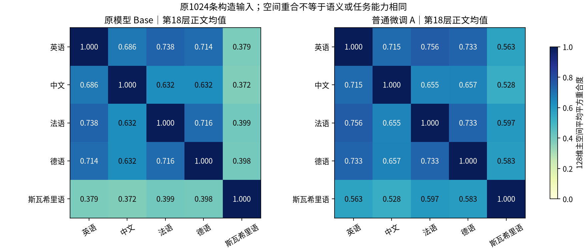
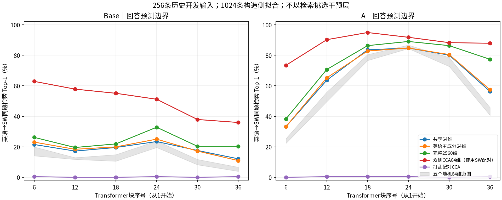
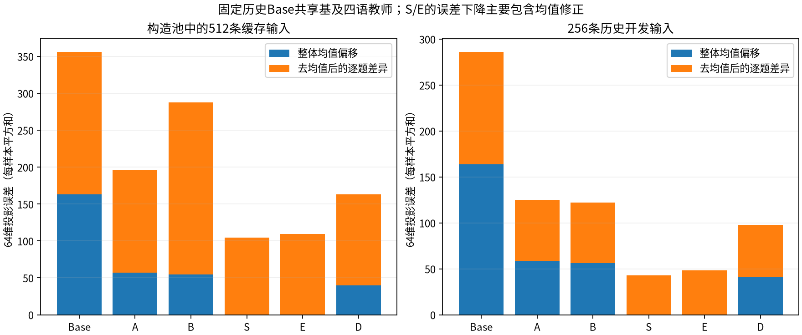
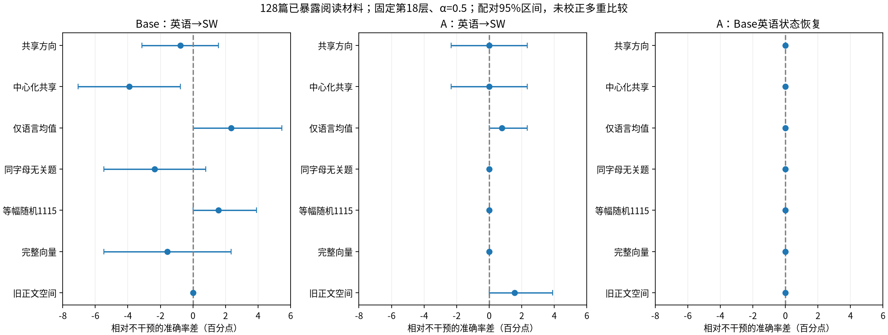

> 公开归档副本：服务器路径已替换为占位路径。正文所引用但未随公开副本发布的原始语料、权重、运行记录及逐题文本保留在服务器；本目录 README 为发布范围和状态入口。

# S3 Align 共享方向与功能作用分析

本报告研究 Qwen3-4B 的 Bactrian-X 全量 SW 微调及其 S3-Align 对照：几何共享是否包含跨语言对应信息，普通微调怎样改变它，以及恢复候选方向是否改变实际阅读选择题的答案。这里的 A/B/S/E/D 来自 65,415 条、4,089 步的历史实验；不混入今天另一个 8,000 条、500 步的功能保持实验。

## 研究问题与数据用途

模型定义：Base 是原模型；A 是普通 SW LoRA；B 仅加英语保持；S 仅加共享对齐；E 是共享对齐加保持；D 是随机对齐加保持。A 与新增组有历史梯度检查点实现差异，跨组差异不能全部归因于单个损失。本轮不更新模型参数。

以下是实际执行范围。构造侧与开发侧按源 ID 分开，但历史开发集和阅读题已被使用，均不称为全新确认集。新前向使用 Base/A；B/S/E/D 复用已完成的正文表示缓存。

| 材料 | 样本与语言 | 用途与限制 |
|---|---|---|
| 原辅助池 | 1,024 个源ID；EN/ZH/FR/DE/SW | 重建历史基底、拟合均值/PCA/CCA；属于训练侧 |
| 历史指令开发 | 256 个源ID；相同五语 | 检索与空间能量；不参与当前拟合，结果已暴露 |
| 已有缓存 | 512构造＋256开发＋128 FLORES dev；六模型 | 固定教师误差分解；FLORES是探索性跨领域材料 |
| Belebele解释子集 | 128篇不同英语段落，每篇一题；EN/SW严格配对 | 预先固定抽样，已暴露测试；受控干预，不能当新正式成绩 |

训练来源仍是 Bactrian-X revision `3698480a001cb3f62c61c314d4acb181eb31e983`。本轮覆盖 EN/ZH/FR/DE/SW，不新增其他语言，不更换训练数据。256条开发材料与构造池没有英语文本规范化后的精确重复，也没有仅数字变化的重复；这不等于完成了人工语义近重复审查。所有平行版本共同保留同一源 ID。

## 实际输入与表示定义

附件关于“旧辅助池只包含 instruction、不包含 input”的说法与实际产物不符。逐条复核原1,024条五语输入后，保存文本及聊天编码都与 `instruction + 非空 input` 一致。EN/SW各364条含非空input，ZH364条、FR/DE各363条。历史说明中的 instruction-only 实际表示不带参考答案的用户输入，不能把它解释成删除input。

例如源ID `alpaca-33921` 的实际英语用户输入是：

```
Select the most appropriate conjunctive adjectives from the following list to complete the sentence: affordable, reliable, durable

We should look for an _____ and _____ laptop.
```

答案没有进入上述表示。完整聊天模板、token ID、正文位置和每个真实阅读提示分别保存在 `inputs/representation.jsonl` 与 `records/*_actual_prompts.json`。

本轮区分两种表示：正文均值只平均完整用户正文词元，排除角色/模板/答案；回答预测边界取非思考聊天模板末尾、即下一步预测回答的位置，它不是正文最后一个词元。读取第6/12/18/24/30/36个Transformer块的原始输出，层号从1开始；第36块取最终RMSNorm之前。正文均值的新增前向只缓存第18层，其他正文层位复用旧分析；没有声称新缓存了全部36层。

## 计算方法与控制变量

对构造侧每种语言的表示减去各自构造均值，PCA/SVD取128个右奇异向量作为语言基Q。将EN/ZH/FR/DE的Q拼接后除以2，再做SVD取64维共同基V；SW不参与共同基构造。子空间重合为 `||Q_a.T Q_b||_F²/128`；共享支持为 `||Q_s.T V||_F²/64`；开发能量为固定构造均值中心化后 `||X_dev V||_F²/||X_dev||_F²`。它们分别是方向重合、对候选方向的支持和能量捕获，不能互换。

语义检索固定256条候选，使用中心化表示的余弦，双向报告Top-1和MRR；随机猜测Top-1为0.39%。比较共享64维、英语PCA64维、五个随机正交64维、完整2560维。CCA先在构造侧分别PCA到128维，协方差加固定`0.1×平均特征方差`的岭项，求两侧64维映射；另做固定种子的配对打乱。CCA使用了EN/SW平行信息，并产生两个映射，不能把它当作单一正交投影，也没有将CCA直接用于激活干预。

所有六个预设层都报告；本轮没有根据这些开发结果挑选最佳干预层，始终固定历史第18层。语言基的分半稳定性使用两个512条子集；四个参考语言逐一留出，检查留出语及SW，结果都保留在JSON。五个随机基使用1115—1119种子。

历史空间重建的投影重合为 0.999796，SW表示相对差为 1.78%。这验证了空间身份高度一致；它不是逐位相等复现，BF16与批量差异仍保留。

## 几何共享与微调变化

下图是原1,024条构造输入的第18层正文均值，两个语言各自128维主空间的平均平方重合。对角线恒为1；非对角线越高代表子空间越接近，并不直接代表任务正确率。



下表把SW对共同基的支持与未参与拟合的开发能量分开。均值和基底均在构造侧估计；Base/A各自重估基底用于描述模型空间变化，不用不同基底中的坐标直接相减。

| 模型 | 语言 | 共享64维支持 | 开发能量捕获% | 分半128维重合 |
|---|---|---|---|---|
| Base | en | 0.9656 | 62.34 | 0.5400 |
| Base | sw | 0.5213 | 37.47 | 0.5657 |
| A | en | 0.9708 | 70.08 | 0.5553 |
| A | sw | 0.7805 | 50.07 | 0.5897 |

SW的支持和开发能量在普通微调后都增加。因此，现有结果不支持“普通微调整体摧毁跨语言共同表示”这个简单解释。另一方面，同语言换半批样本后的基底重合也明显低于1，说明定位依赖样本，不能把某个确定64维基当成唯一不变的语言能力空间。完整各层主角度和留出结果见原始JSON。

## 共享空间包含什么信息

下表全部使用同一256条历史开发输入和固定256条候选。Top-1单位为%，两个方向分别为英语找SW及SW找英语。正文与回答边界是不同读出，不应合并平均。CCA消耗SW构造信息，属于有目标语言信息的诊断上限之一。

| 模型 | 读出 | 表示 | EN→SW Top-1 | SW→EN Top-1 |
|---|---|---|---|---|
| Base | 正文均值 | 共同投影64维 | 55.08 | 53.91 |
| Base | 正文均值 | 英语PCA64维 | 55.47 | 53.91 |
| Base | 正文均值 | 完整2560维 | 63.28 | 69.53 |
| Base | 正文均值 | 双侧CCA64维 | 83.59 | 88.67 |
| Base | 正文均值 | 打乱配对CCA | 0.78 | 0.78 |
| Base | 回答边界 | 共同投影64维 | 19.53 | 18.36 |
| Base | 回答边界 | 英语PCA64维 | 19.92 | 18.75 |
| Base | 回答边界 | 完整2560维 | 21.88 | 25.78 |
| Base | 回答边界 | 双侧CCA64维 | 55.08 | 52.73 |
| Base | 回答边界 | 打乱配对CCA | 0.00 | 0.78 |
| A | 正文均值 | 共同投影64维 | 92.97 | 95.70 |
| A | 正文均值 | 英语PCA64维 | 93.75 | 95.31 |
| A | 正文均值 | 完整2560维 | 96.48 | 96.88 |
| A | 正文均值 | 双侧CCA64维 | 99.61 | 99.22 |
| A | 正文均值 | 打乱配对CCA | 0.00 | 0.00 |
| A | 回答边界 | 共同投影64维 | 83.59 | 82.03 |
| A | 回答边界 | 英语PCA64维 | 82.81 | 82.03 |
| A | 回答边界 | 完整2560维 | 86.33 | 88.28 |
| A | 回答边界 | 双侧CCA64维 | 94.92 | 95.70 |
| A | 回答边界 | 打乱配对CCA | 0.39 | 0.00 |

Base的双侧映射检索明显高于同一个共同投影，打乱配对后接近机会水平，说明配对内容提供了可泛化到这些开发样本的对应信息。这支持研究两侧坐标映射，但不证明CCA训练约束能提升任务表现。普通微调已经大幅提高了正文和回答边界的跨语言对应；继续强制几何接近可能存在监督冗余。正文检索与回答边界检索的差距也提示，不能用正文均值上的高对齐替代生成位置的功能证据。



曲线显示六个预设边界位置的EN→SW检索；灰带是五个随机基的最小到最大值，不是置信区间。没有用曲线最高点回选阅读干预层。检索只能说明信息可读出，不能单独决定采用哪种训练方法。

## 固定空间与重新定位的区别

新增几何比较显示，Base→A的共同64维基底重合度，正文均值为0.9170，回答预测边界为0.2576。相同模型在两个512条子集上定位的共同基重合度，正文Base/A为0.6244/0.6319，回答边界为0.6796/0.6975。正文空间比较稳定，回答边界空间发生了明显重组；这种重组与检索增强并存，不能直接称为损坏。

为了排除“重估空间掩盖变化”，另将Base共同基固定用于A。A在第18层正文的EN→SW检索仍为92.97%（使用A构造均值中心化）或91.41%（连Base构造均值也固定）。回答边界则为76.17%或41.02%，而A自身重估空间为83.59%。因此回答边界的语言均值变化、方向重组和内容对应都应分别分析。这里的均值始终只在构造侧计算，没有用开发样本重新估计。

## S3到底优化了什么

固定历史Base共享基、固定四语原始表示均值教师，在已有六模型的完全相同输入上计算 `e=(h_SW−t_Base)V`。总误差严格分解为 `||mean(e)||² + mean(||e−mean(e)||²)`。第一项是整体均值偏移，第二项是去均值后的逐题差异。下表是256条历史开发输入；数值为每样本64维投影误差平方和，不是能力分数。

| 模型 | 总误差 | 均值偏移 | 逐题差异 | 均值占比% |
|---|---|---|---|---|
| Base | 286.02 | 163.97 | 122.04 | 57.33 |
| A | 125.02 | 58.95 | 66.07 | 47.15 |
| B | 122.14 | 56.15 | 65.99 | 45.97 |
| S | 43.08 | 0.28 | 42.80 | 0.65 |
| E | 48.13 | 0.32 | 47.81 | 0.67 |
| D | 97.70 | 41.23 | 56.48 | 42.19 |

相对普通微调A，S的总误差降低65.5%；其中71.6%的绝对降幅来自均值偏移消除，逐题差异也降低35.2%。所以不能说S3损失没有起作用，也不能说它完全只学会移动均值。更准确的问题是：这些被优化的变化，是否对应额外任务收益。



两面板分别是512条已有构造缓存及256条开发输入，沿用相同历史基和教师。训练日志另外确认S的辅助对齐损失从前100次均值约0.07224降至后100次约0.00373；这说明优化发生，不是下游成效证据。辅助记录未单列每步主CE，报告不补造CE曲线。完整空间及2496维补空间的误差和每维误差另存于`alignment_error_v2.json`；旧v1把补空间每维分母记作环境维数2560，v2已改为有效维数2496，总误差及本表从未改变。

## 真实回答位置的功能干预

从已暴露的900条Belebele中，以固定种子20261116打乱，取前128篇不同英语段落各一题。EN/SW通过原始URL与题号配对，并核对正确选项一致。来源是原官方数据，不生成新翻译。采用零样本、非思考聊天模板，按A/B/C/D候选的条件似然评分ACC，不进行自由生成。提示、候选及ACC评分复用已冻结lm-evaluation-harness任务（历史源码commit `d6de81643928d653435c431bae19945d41d32520`，当前安装版`0.4.14.dev0`）；激活hook为本地机制代码。为访问模型内部层，将LoRA合并后冻结进行BF16推理，所有控制使用同一合并端点并重算不干预基线；不把子集分数拼入历史全量正式表。每个端点先在真实输入上与未修改HFLM进行实际似然和预测交叉核验，不能把它称作未修改框架的端到端正式benchmark。

对第18块的真实回答预测边界实施 `h_new = h_rec + α V V.T (h_src − h_rec)`。V始终是Base在原构造池上定位的边界共同基，A不另换自己的基；中心化控制的均值来自各自模型构造池。Base及A各做同模型英语→SW，A另做同一英语提示的Base→A恢复。主剂量α=0.5；α=0由不干预组表示，α=1作为固定端点。每个问题25种配置，共9,600条逐题结果。英语源没有参考答案或未来生成内容；跨语言干预额外使用英语输入，因此不是正常单语推理成绩。

控制包括五个随机同秩基、各自按共享注入范数放大的等幅随机基、相同答案字母但不同URL的无关源题、只移语言均值、保留接收语言均值的中心化替换、完整向量替换、旧正文空间迁移到边界、等幅补空间。等幅缩放上限固定10，逐题记录截断；完整2560维及2496维补空间并非64维容量匹配对照。中心化所用语言均值来自原指令构造池，不是阅读题上重新拟合。

下表是所有128题上相对不干预的净变化；“修复/损坏”分别计数原错变对、原对变错，不能只报被救回题。95%区间由不同段落为单位进行4,000次配对重采样；未校正多重比较、不含训练种子不确定性。这里选列固定α=0.5，全部25配置在附录CSV。

| 模型 | 干预问题 | 控制 | ACC% | 差值与区间（百分点） | 修复/损坏 |
|---|---|---|---|---|---|
| Base | 英语→SW | 不干预 | 32.81 | +0.00 [+0.00, +0.00] | 0/0 |
| Base | 英语→SW | 共享方向 | 32.03 | -0.78 [-3.12, +1.56] | 1/2 |
| Base | 英语→SW | 中心化共享 | 28.91 | -3.91 [-7.05, -0.78] | 0/5 |
| Base | 英语→SW | 仅均值 | 35.16 | +2.34 [+0.00, +5.47] | 3/0 |
| Base | 英语→SW | 同字母无关题 | 30.47 | -2.34 [-5.47, +0.78] | 1/4 |
| Base | 英语→SW | 完整向量 | 31.25 | -1.56 [-5.47, +2.34] | 2/4 |
| Base | 英语→SW | 旧正文空间 | 32.81 | +0.00 [+0.00, +0.00] | 0/0 |
| Base | 英语→SW | 等幅随机1115 | 34.38 | +1.56 [+0.00, +3.91] | 2/0 |
| A | 英语→SW | 不干预 | 63.28 | +0.00 [+0.00, +0.00] | 0/0 |
| A | 英语→SW | 共享方向 | 63.28 | +0.00 [-2.34, +2.34] | 1/1 |
| A | 英语→SW | 中心化共享 | 63.28 | +0.00 [-2.34, +2.34] | 1/1 |
| A | 英语→SW | 仅均值 | 64.06 | +0.78 [+0.00, +2.34] | 1/0 |
| A | 英语→SW | 同字母无关题 | 63.28 | +0.00 [+0.00, +0.00] | 0/0 |
| A | 英语→SW | 完整向量 | 63.28 | +0.00 [+0.00, +0.00] | 0/0 |
| A | 英语→SW | 旧正文空间 | 64.84 | +1.56 [+0.00, +3.91] | 2/0 |
| A | 英语→SW | 等幅随机1115 | 63.28 | +0.00 [+0.00, +0.00] | 0/0 |
| A | Base英语→A英语 | 不干预 | 91.41 | +0.00 [+0.00, +0.00] | 0/0 |
| A | Base英语→A英语 | 共享方向 | 91.41 | +0.00 [+0.00, +0.00] | 0/0 |
| A | Base英语→A英语 | 中心化共享 | 91.41 | +0.00 [+0.00, +0.00] | 0/0 |
| A | Base英语→A英语 | 仅均值 | 91.41 | +0.00 [+0.00, +0.00] | 0/0 |
| A | Base英语→A英语 | 同字母无关题 | 91.41 | +0.00 [+0.00, +0.00] | 0/0 |
| A | Base英语→A英语 | 完整向量 | 91.41 | +0.00 [+0.00, +0.00] | 0/0 |
| A | Base英语→A英语 | 旧正文空间 | 91.41 | +0.00 [+0.00, +0.00] | 0/0 |
| A | Base英语→A英语 | 等幅随机1115 | 91.41 | +0.00 [+0.00, +0.00] | 0/0 |

Base的共享补入由42/128变成41/128；A由81/128维持81/128。预设主剂量没有带来SW阅读净收益。中心化共享补入使Base降至37/128，差−3.91个百分点，探索性95%区间约[−7.05,−0.78]；这不支持把去均值直接当作改进配方。A的共享补入改变了99题的候选似然，完整向量补入改变了118题的候选似然，说明干预确实改变了计算，只是未转化为更多正确答案。该结论仅适用于这批已暴露材料、固定第18层和所用边界位置，不能否定所有层或所有子空间方法。



共享方向与五个等幅随机方向的平均结果采用逐题配对比较，五个随机基不当成五倍独立样本：

| 模型 | 干预问题 | 共享−五随机均值（百分点） | 配对95%区间 |
|---|---|---|---|
| Base | 英语→SW | -1.88 | [-4.53, +0.16] |
| A | 英语→SW | -0.47 | [-2.50, +1.09] |
| A | Base英语→A英语 | +0.00 | [+0.00, +0.00] |

本子集英语基线Base答对80题、A答对117题：39题由错变对，2题由对变错。后者只有两题，不足以建立稳健的遗忘恢复结论。α=0.5的英语恢复各配置均未改变正确率；α=1的完整向量恢复增加1题，其余该剂量配置仍未改善，不能将这一个样本解释成稳定能力恢复。Base对→A对、Base错→A对、Base错→A错、Base对→A错四组的平均相对平方漂移分别约0.4146、0.4178、0.4192、0.4204，接近的漂移量伴随不同任务变化。该描述未控制长度和初始难度，也不能把“漂移大”直接当损伤。

等幅缩放没有触发10倍上限。无干预的Base SW、A SW、A EN分别有1、4、0道最高候选分数并列题，严格沿用上游第一个最大值规则。BF16和提示形式的影响仍属于当前协议限制；没有为了涨分改用另一套评分精度。

这里的Base→A恢复不等同于“恢复数学或代码遗忘”。报告既保留全体结果，也在JSON中单列源正确而接收错误的子集。即使某些阅读错误被恢复，也不能外推为已经定位GSM8K、IFEval或代码能力的遗忘电路。本轮没有新增人工审校的双语关键关系最小对，也没有执行新数学/代码激活恢复；同题检索不能证明否定、主客体或算术关系已经共享。

## 复核、成本与可追溯性

Base的批量边界表示预检最大相对差0.02629超过原定0.02，保留失败后改为batch1；A的batch8五语检查均通过原阈值。两模型因此存在已记录的BF16批量差异。评分初版与上游实际似然相差0.06242 nat，超过0.05门槛；改用完整输出头仍未解决，继续读取上游代码后确认是自写FP32 softmax与上游默认BF16 softmax/求和的区别。最终版直接调用上游`HFLM._model_call`和相同精度的完整log-softmax，原阈值和科学设置不变。两个失败版本都在预检停止，未产生可采信干预成绩。每题还检查零干预是否改变预测，失败时整题所有配置使用batch1复算。

完整输入、代码、原始数值、空间基底、来源哈希、上游交叉核验和运行日志均保留。模型保持冻结，没有优化器或新SFT。CPU完成小矩阵分析，GPU只做前向及干预。代码没有创建服务、定时任务或自动重启；模型与历史正式成绩保持原样。

| 阶段 | 实际秒数（含加载） | 峰值显存GiB | 所选批量 |
|---|---|---|---|
| Base表示提取 | 325.9 | 7.65 | 1 |
| Base任务干预 | 276.2 | 9.40 | 1 |
| A表示提取 | 285.1 | 7.86 | 8 |
| A任务干预 | 743.0 | 9.40 | 1 |

上述是成功运行耗时，不包含失败预检和CPU分解，不当作训练成本或严格速度基准。实际GPU与PID见阶段记录。数据包不包含模型权重和大规模激活缓存，复核输入/评分/投影需要的文件及服务器入口见文件清单。

## 参考分析逻辑

- [Chang等，EMNLP 2022](https://aclanthology.org/2022.emnlp-main.9/) 区分语言均值与子空间方向；本轮借鉴该区分，不将XLM-R结果直接推广为Qwen推理结论。
- [MidAlign，ACL 2025](https://aclanthology.org/2025.acl-long.778/) 使用跨语言检索考察逐层对应。本轮使用透明的余弦Top-1/MRR，没有声称复现其ratio-margin检索协议。
- [Ravisankar等，EACL 2026](https://aclanthology.org/2026.eacl-long.225/) 通过任务实例的激活替换及控制研究功能作用。本轮借鉴对照逻辑，使用自己的固定第18层与低秩投影；不是其完整复现，也没有计算其DALI指标。

## 后续改进的判断边界

第一，不能再把高几何支持直接称为共享推理能力。空间方向、逐题信息、实际功能分别验证；正文池化与回答边界分别定义。

第二，下一版优先研究“任务相关的配对内容定位”和“两侧映射是否更适合表达对应关系”，而不是直接增强原MSE或机械去均值。CCA检索只提供候选证据，不能直接作为共同正交投影，也不能据此宣布更好算法。中心化干预已经出现负向结果，说明去均值仅可作为受控候选，不能默认有益。对比时固定SW平行信息预算，并加入配对打乱及强度匹配。

第三，英语保护与跨语言迁移应允许使用不同位置和方向。今天8k功能保持实验中的全表示保持可以作为另一条线的候选基线，但其分数不能并入本报告的65k S3因果比较。数学、指令执行与代码的恢复仍需对应任务的独立开发材料。

第四，本轮不根据这批已暴露材料挑选新训练层、rank或系数。若进入下一轮SFT，先建立未用于选择的新开发/确认划分，冻结少量明确候选，再在固定目标benchmark及至少第二个训练种子上验证。当前结果只能支持或排除机制解释，尚未证明一个改进后的训练配方已经涨分。


## 实际完整阅读输入示例

以下是抽样顺序第一题，源行号134。正确选项只在评分时使用，未作为提示额外输入。共享/随机等干预的接收提示完全相同。

### en完整聊天提示

````text
<|im_start|>user
P: The militaristic nature of the Roman empire aided in the development of medical advances. Doctors began to be recruited by Emperor Augustus and even formed the first Roman Medical Corps for use in the aftermath of battles. Surgeons had knowledge of various sedatives including morphine from extracts of poppy seeds and scopolamine from herbane seeds. They became proficient at amputation to save patients from gangrene as well as tourniquets and arterial clamps to stem blood flow. Over multiple centuries, the Roman empire led to great gains in the field of medicine and formed much of the knowledge we know today.
Q: Which medical treatment or procedure is not mentioned as being used by doctors and surgeons during the Roman Empire?
A: Treating post-traumatic stress disorder with various sedatives
B: Using extracts of herbane seeds for scopolamine
C: Stemming blood flow with arterial clamps
D: Performing amputations for gangrene patients
Answer:<|im_end|>
<|im_start|>assistant
<think>

</think>


````

### sw完整聊天提示

````text
<|im_start|>user
P: Tabia za kijeshi za Milki ya Kirumi zilisaidia sana kwa maendeleo ya matibabu. Madaktari walianza kuajiriwa na Mtawala Augustus na hata kuunda kitengo kikubwa cha kwanza cha Matibabu cha Kirumi kwa ajili ya kutumika baada ya vita. Madaktari wa upasuaji walikuwa na uelewa wa vitulizo kadhaa zikiwamo mofini kutoka kwa mbegu za mpopi na scopolamina kutoka kwa mbegu za henbeni. Walipata kuwa na ustadi wa kukata viungo vya mwili ili kuokoa wagonjwa kutokana na gangrini na vile vile mafundo na vibanio vya mishipa ili kutuliza mtiririko wa damu. Katika karne nyingi, milki ya Kirumi ilipelekea faida kubwa katika uga wa tiba na ikaunda mengi ya maarifa tunayoyajua leo.
Q: Ni matibabu au utaratibu gani wa kitiba haujatajwa kuwa unatumiwa na madaktari na madaktari wa upasuaji wakati wa Milki ya Kirumi?
A: Kutibu ugonjwa wa mafadhaiko baada ya mshtuko kwa kutumia vitulizo mbalimbali
B: Kutumia viungo kutoka kwa mbegu za henbeni na skopolamina
C: Kuzuia mtiririko wa damu kwa kubana na mishipa ya ateri
D: Kukata viungo vya wagonjwa wa gangrini
Answer:<|im_end|>
<|im_start|>assistant
<think>

</think>


````

该题无关同字母控制取源行号388，只替换激活来源，不修改接收题文本。原始题号、全文、候选与控制映射均保存在输入JSONL。
