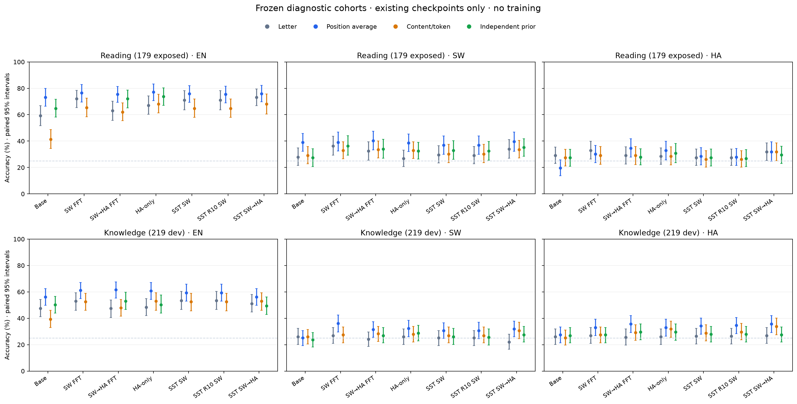

# 答案偏好与跨语言任务能力诊断

2026-11-03完成。基于`75a7130`复用七个已有Final模型；**没有新增训练或My Method**。三个RTX3090并行，主评分303,072个候选分数，合计约**2.434 GPU小时**（进程墙钟代理）。全部任务退出0，六项CPU检查和七模型真实评分oracle通过。

## 先读结论

1. **强A偏好经轮换仍存在**：HA-only阅读95.25%、知识93.26%的预测选择A，金答案在四轮中位置完全平衡。
2. **部分下降受读出影响**：SW→HA FFT的EN阅读原字母下降8.94pp，四轮概率回映射平均仅下降1.12pp；交互区间[2.81,12.97]pp。
3. **不能说语义能力完整**：同阶段EN知识的内容均分ACC仍下降4.57pp [-8.23,-0.91]；去标签与校准并不普遍恢复。
4. **HA收益依赖读出**：SW→HA FFT的HA知识25.57→35.62%（对同一Final更换读出，不是再训练）；HA-only阅读内容均分没有相对原字母收益。不能挑最高评分当作真实能力。
5. **下一步优先跨语言任务决策与读出稳定性**，尚无依据声称发现新方法或因果谱方向。

## 范围与入口

每语言：53题独立校准ID、219题知识诊断、179题阅读补充诊断。阅读已曝光且只有test划分，知识dev亦有历史曝光；**不是全新独立确认集，也不是正式900/14042题结果**。知识为0-shot，不能与旧正式5-shot直接相减。独立指校准与诊断语义ID分开，不意味着历史未曝光。区间固定模型与校准先验，未多重校正。

- [五个研究问题与My Method含义](implications_for_my_method.md)
- [全部模型/语言分数、配对区间、校准与随机对照](results.md)
- [跨语言同语义正确性组合](cross_language_analysis.md)
- [冻结协议、材料暴露和统计定义](protocol.md)
- [复现与公开副本边界](reproduce.md)
- [机器可读汇总](../../results/answer_bias_study/analysis.json)、[CSV](../../results/answer_bias_study/paper_table.csv)、[真实运行回执](../../results/answer_bias_study/inference_receipts.json)、[验证](../../results/answer_bias_study/validation.json)

所有排列与负面结果保留；固定先验不优于随机对照的情况照实报告。24全排列、权重干预、FFT/SST重训、新算法和独立人工语义认证均为NOT_RUN。原有正式分数不覆盖。
