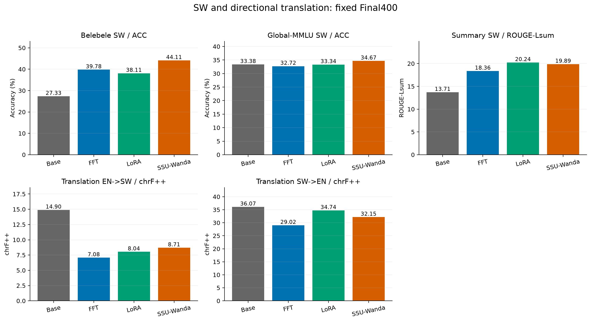
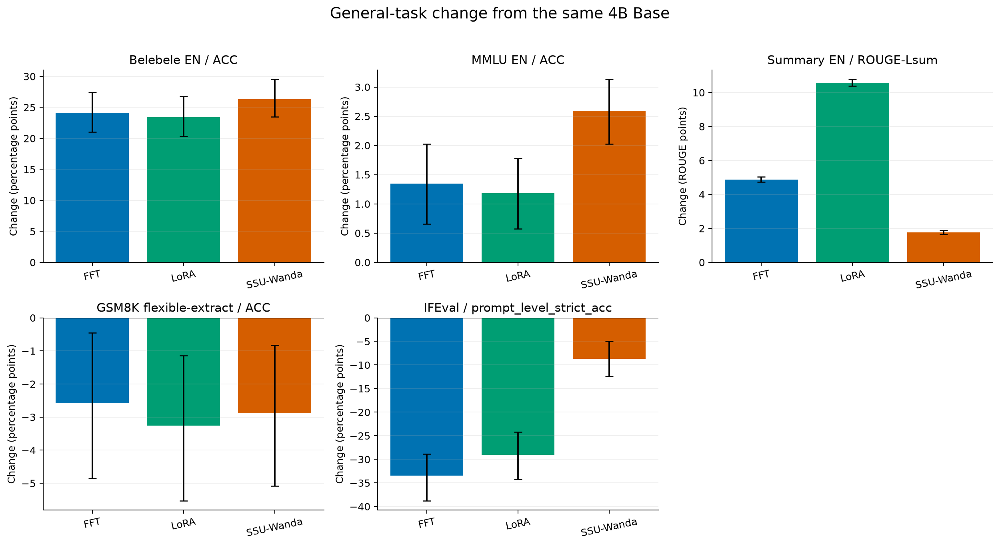

# Qwen3-4B：改进SW指令数据后的固定预算基线

## 研究问题

将原模型换为官方后训练Qwen3-4B，并将此前Aya混合改为阅读、正向摘要、知识/常识和双向翻译，检验SW下游收益与通用能力变化。模型固定revision `1cfa9a7208912126459214e8b04321603b3df60c`；不是Qwen3-4B-Instruct-2507，也不是预训练Base变体。

所有模型均从同一未微调参考初始化，固定Final400，不依英语退化早停，不使用正式测试选择数据、超参数或checkpoint。本轮仅一个seed42。

## 实际结果

|任务／指标|Base|FFT|LoRA|SSU-Wanda|
|---|---:|---:|---:|---:|
|SW阅读 ACC|27.33|39.78|38.11|44.11|
|SW知识 ACC|33.38|32.72|33.34|34.67|
|SW摘要 ROUGE-Lsum|13.71|18.36|20.24|19.89|
|EN→SW chrF++|14.90|7.08|8.04|8.71|
|SW→EN chrF++|36.07|29.02|34.74|32.15|
|EN阅读 ACC|62.89|87.00|86.33|89.22|
|EN知识 ACC|66.74|68.09|67.92|69.33|
|EN摘要 ROUGE-Lsum|12.96|17.84|23.54|14.72|
|GSM8K flexible ACC|84.46|81.88|81.20|81.58|
|GSM8K strict ACC|61.03|47.92|59.74|42.08|
|IFEval prompt strict|78.37|44.92|49.35|69.69|
|IFEval instruction strict|84.65|56.71|62.47|79.02|

- **FFT**相对同一4B Base：SW阅读 ACC +12.44；SW知识 ACC -0.66；SW摘要 ROUGE-Lsum +4.65；EN→SW chrF++ -7.82；SW→EN chrF++ -7.05。通用能力配对区间低于零：GSM8K flexible-extract、IFEval。指标单位和区间见下表；这不是跨种子结论或选模门槛。
- **LoRA**相对同一4B Base：SW阅读 ACC +10.78；SW知识 ACC -0.04；SW摘要 ROUGE-Lsum +6.53；EN→SW chrF++ -6.86；SW→EN chrF++ -1.33。通用能力配对区间低于零：GSM8K flexible-extract、IFEval。指标单位和区间见下表；这不是跨种子结论或选模门槛。
- **SSU-Wanda**相对同一4B Base：SW阅读 ACC +16.78；SW知识 ACC +1.30；SW摘要 ROUGE-Lsum +6.18；EN→SW chrF++ -6.19；SW→EN chrF++ -3.92。通用能力配对区间低于零：GSM8K flexible-extract、IFEval。指标单位和区间见下表；这不是跨种子结论或选模门槛。

完整区间见[逐任务结果](results.md)，输出上限、空输出和文章截断见[生成诊断](generation_diagnostics.md)；全部80项预定主/辅指标和60项配对比较见结果目录。额外的摘要chrF++等原始评分保留，不以单个平均数掩盖方向差异。

## 数据与训练

6400条：原生上下文阅读1920，正向摘要1920（XL-Sum1280、WikiLingua640），知识/常识1280，双向翻译各640。翻译两方向共享640个原始平行句组；不等于1280个独立句对。输入2,373,891 tokens，移位回答监督324,892 tokens；10条阅读上下文采用确定性答案覆盖窗口，入选完整SFT样本无截断。训练指令无规范化重复。

与旧混合相比，去除了标题扩写、反向背景生成、对话和释义判断等来源。旧混合为2,884,423输入、1,078,347回答监督tokens，因此这是任务构成改进，不是监督token完全匹配的因果对照。各任务token占比不等于loss或梯度贡献。

训练1epoch/400optimizer steps，有效batch16，microbatch1×accumulation16，assistant-only、non-thinking、BF16、长度2048、不packing。FFT/SSU LR1e-5；LoRA rank16/alpha32/dropout0.05、LR1e-4。三方法同一6400条实际输入/标签、同一步内配对和全量顺序均经曝光指纹核验。

SSU基于当前4B与同一英语Tulu原文重新校准500×2048tokens；实际保护1,816,796,928/4,022,468,096，即45.1662%唯一元素，不是全模型50%。保存后的受保护元素变化检查单列证据；该工程正确性不等于下游保护效果。校准继承数学偏置，且方法学习率和可更新参数预算不同，不能把所有方法差异归因于保护机制。

## 评测与评分

Belebele EN/SW各900题；EN MMLU和SW Global-MMLU各14042题/57学科/5-shot；FLORES两个方向各1012句/3-shot；XL-Sum SW987、EN11535；GSM8K1319题/5-shot；IFEval541prompt/834instruction。选择题按四个候选答案似然ACC；生成greedy、non-thinking，MT输出上限512、摘要256、数学/IFEval1280。MT/SUM沿用vLLMV1，原Aya core沿用V0，各模型同协议。

选择题从原始四选项分数与gold独立复算；GSM8K按锁定官方strict/flexible提取与exact-match重执行；翻译重算语料级chrF++/BLEU；IFEval核对原运行的官方逐prompt/逐instruction标记与汇总，并重执行确定性检查。官方IFEval对无效参数含随机fallback，语言检测也可能不确定，未凭脱离原RNG状态的事后重评分覆盖主分数。

95%区间为未经多重校正的探索性配对区间，条件于当前seed42权重；不代表训练种子稳定性。英语不同任务可上升也可下降；双向翻译分别解释。正式benchmark已暴露，仅作本轮冻结比较，不按这些分数挑选下一轮配置。

## 数学分数的提取敏感性

同一批1319条GSM8K输出中，flexible判对而strict判错的数量：Base310、FFT448、LoRA283、SSU522。SSU的strict从61.03%降至42.08%，而flexible从84.46%降至81.58%，差异说明输出格式与答案提取规则影响较大；不能把strict全部降幅解释为数学推理能力损失，也不能据此断言推理完全保持。两套官方分数均保留。逐模型交叉统计见`gsm8k_extraction_diagnosis.json`。

## 成本与产物

|方法|步数|实际样本曝光|训练器耗时（分钟）|训练进程耗时（分钟）|
|---|---:|---:|---:|---:|
|FFT|400|6400|180.1|181.6|
|LoRA|400|6400|51.7|51.8|
|SSU-Wanda|400|6400|217.6|220.0|

本机GPU为24GB级显存。FFT/SSU采用CPUAdam offload，仍需对4B模型执行密集前后向和优化器更新；SSU掩码不等于减少相同比例的计算或优化器存储。回答监督虽为324,892 tokens，完整上下文输入仍为2,373,891 tokens。

每个模型另评29,884道选择题（约119,536个候选似然请求）和16,406条生成任务。四模型累计约478,144个候选似然请求、65,624条生成；题目长度不同，不能将条数当作相同计算量。训练器耗时、进程墙钟和GPU显存采样有不同覆盖范围，均不冒充CUDA kernel时间。采样峰值是观测下界；完整计算口径、失败尝试、模型/数据/配置哈希和逐项评分证据在机器可读审计中保留。空间有限，仅导出完整Final及独立smoke权重，不保存optimizer checkpoint，不能宣称从这些权重精确恢复优化器轨迹。

## 后续翻译与知识问题：已完成的有限诊断

SW知识只有SSU的小幅正向变化；FFT和LoRA没有建立收益，不能因为阅读提高就推断知识提高。原数据HotpotQA/PIQA覆盖与Global-MMLU的57学科任务有差异，但当前未用隔离实验验证该差异的因果贡献。

原EN→SW存在大量重复和触及512输出上限的结果。已核验全部6400条训练的终止符、回答mask与non-thinking前缀，没有发现对应错配；这些检查不证明数据质量或训练配方没有其他问题。解码开发对照能缓解部分退化，却不能单独证明训练学到了翻译。

额外正式冻结权重的XNLI/XCOPA补充结果已经完成。XNLI的零样本指令选择题收益对示例格式敏感：192题/语言的开发对照中，Base加入3个均衡示例后大幅改善；FFT相对Base的SW增益由零样本+10.94个百分点变为3-shot的+5.73个百分点，后者区间跨零。因此不将零样本增益解释为已确认的纯语义能力提升。补充任务在训练结束后冻结，属于探索性扩展，不冒充训练前预注册的主要任务。

随后一个数据重平衡LoRA完成相同400步，但监督token变为209925，不能称为与原混合等token预算。固定64组已暴露FLORES dev、官方non-thinking采样下，新LoRA相对同批Base的EN→SW为+1.13 chrF++（95%区间[-2.79,+4.90]），SW→EN为+0.47（[-1.93,+2.74]）。区间均跨零，未达到预定继续投入条件，尚不能声称修复成功。greedy下EN→SW仍落后；完整两种解码均保留。该候选的正式test及各保持任务NOT_RUN；第二个预定LR2e-5候选也已完成，详见[独立结果](translation_lr2e5_candidate_result.md)；原四模型正式表不据此改写。不能把未测保持任务描述为没有遗忘。

[数据重平衡候选详细结果](translation_rebalanced_candidate_result.md)保留额外训练成本和开发判定；原四模型表不覆盖。后续应先确定任务匹配的可靠收益，再决定扩大翻译修正或研究保护方法，不以更换benchmark掩盖原翻译负面结果。

## 可以支持和不能支持的结论

当前证据仅支持上表所示固定模型的逐任务变化。模型规模与训练数据同时变化，不能分别归因；也不能把阅读或摘要改善外推为所有SW任务改善。没有开展MyMethod、额外训练种子或顺序语言训练，旧mCoT路线B保持用户停止。

公开材料包含科学代码、配置、来源ID/输入指纹、评分统计及配对区间；不包含权重、原始训练文本、原始新闻文章或内部服务器运行管理信息。6400条数据已通过按公开来源ID独立重建并逐输入/标签指纹比对，全部7个冻结训练文件也逐字节一致。运行源码和配置以实际SHA为准；GitHub交付快照包含部署路径适配，不与日志中的旧checkout HEAD混同。

## 图与入口

- [逐任务结果和配对区间](results.md)
- [机器可读结果](../../results/aya_4b_20261105/analysis-v1/scores.csv)
- [配对比较](../../results/aya_4b_20261105/analysis-v1/paired_comparisons.csv)
- [输入重建身份](../../results/aya_4b_20261105/reproduction-inputs-v1/reproduction_spec.json)

## 后续有限修正已完成

两组翻译修正均未达到冻结开发条件。全部结果和下一步讨论问题见[最终研究结论](final_decision.md)。

## 补充全量 benchmark：XNLI 与 XCOPA

原四模型均已完成这两类补充任务。指标为选项likelihood ACC（%），0-shot、non-thinking；XNLI EN/SW各5010题，XCOPA SW500题。

|任务|Base|FFT|LoRA|SSU-Wanda|
|---|---:|---:|---:|---:|
|XNLI SW|33.19|49.00|36.97|43.31|
|XNLI EN|49.24|83.41|69.54|78.16|
|XCOPA SW|49.20|49.20|52.00|52.80|

XNLI的零样本收益明确，但Base有明显标签偏好；192题/语言的独立validation格式诊断中，加入3个均衡示例后，Base EN从49.48%升至80.21%，FFT仍为80.21%；SW的FFT相对Base优势从+10.94缩为+5.73个百分点，后者区间跨零。因此不能把零样本全部提升解释为纯语义推理能力增长。该诊断不覆盖上表全量结果。

XCOPA收益较小：LoRA相对Base+2.80个百分点（配对95%区间[+0.20,+5.40]），SSU+3.60（[-3.60,+10.80]），FFT为0。区间未经多重比较校正，仅针对当前seed42模型。

补充任务在训练后、首次补充评分前冻结，属于探索性比较；XNLI指令选择题模板与Harness原completion模板不同。XCOPA没有英语配置，未编造对应分数。完整主线加补充共92项分数、69项配对比较；开发诊断另列。
