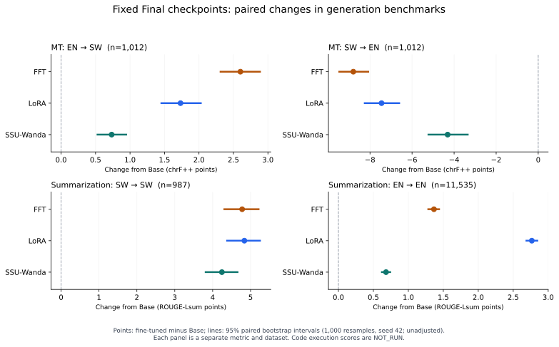

> 2026-11-03更新：代码已完成真实隔离执行，四模型HumanEval/+/MBPP/+的完整成绩见[代码执行报告](code_execution.md)。本文其余正文保留执行前快照；代码NOT_RUN已由该附录替代，原始生成与MT/SUM结果未改。

# SW/EN Benchmark v2 结果报告

核验完成时间：2026-11-02T21:10:30+08:00。四个固定Final，不新增训练，不按测试选checkpoint。

## 完成范围

已完成16个正式评分任务：四模型×双向FLORES full1012、四模型×SW987/EN11535篇XL-Sum。另完成8组完整代码候选生成和官方sanitize/AST检查（HumanEval+164、MBPP+378）；**四种代码pass@1均为null/NOT_RUN**。全量生成共60,352条；固定摘要Pilot 8×128条另列。CrossSum只做数据可行性审计，未作为正式独立成绩。

## 实验设置

Base为官方后训练Qwen3-1.7B revision `70d244cc86ccca08cf5af4e1e306ecf908b1ad5e`；FFT/LoRA r16/SSU-Wanda为既有Aya SW6400、assistant-only、有效batch16、1epoch/400步Final，训练长度2048。本轮所有生成统一Base tokenizer、nonthinking、BF16、vLLM V1、batch32、greedy、seed42。输入最多7168token、上下文8192；MT/SUM/Code输出上限512/256/1024。LoRA原生读取Adapter且哈希包括Base权重与Adapter。

FLORES沿用固定3-shot，完整devtest1012包含旧500句，新增512单列；旧Transformers与新vLLM后端不同，旧分数保持原样。XL-Sum使用官方v2.0.0、0-shot、本地语言指令；EN与SW是不同文章。每语言固定128篇Pilot在查看评分前冻结，且包含于全量test。

[完整协议](benchmark_protocol.md) · [复现命令](reproduce.md) · [限制](limitations.md) · [CrossSum可行性](crosssum_feasibility.md)

## Benchmark v2：Full正式结果

所有分数按0–100显示。NOT_RUN不等于0，运行中的任务不展示部分分数。

| 能力 | Benchmark | 方向 | 指标 | Base | FFT | LoRA | SSU |
|---|---|---|---|---:|---:|---:|---:|
| MT | flores200_en_sw_full_devtest_v2 | EN→SW | chrF++ | 5.40 | 8.00 | 7.13 | 6.13 |
| MT | flores200_en_sw_full_devtest_v2 | EN→SW | BLEU | 0.17 | 0.31 | 0.24 | 0.18 |
| MT | flores200_sw_en_full_devtest_v2 | SW→EN | chrF++ | 23.68 | 14.88 | 16.23 | 19.37 |
| MT | flores200_sw_en_full_devtest_v2 | SW→EN | BLEU | 4.36 | 2.22 | 2.66 | 2.50 |
| SUM | xlsum_sw_v2 | SW→SW | ROUGE-1 | 11.02 | 17.31 | 17.36 | 16.52 |
| SUM | xlsum_sw_v2 | SW→SW | ROUGE-2 | 2.88 | 4.55 | 4.48 | 4.40 |
| SUM | xlsum_sw_v2 | SW→SW | ROUGE-Lsum | 9.22 | 13.99 | 14.05 | 13.46 |
| SUM | xlsum_sw_v2 | SW→SW | chrF++ | 19.55 | 26.54 | 26.47 | 26.34 |
| SUM | xlsum_en_v2 | EN→EN | ROUGE-1 | 14.82 | 16.45 | 18.25 | 15.47 |
| SUM | xlsum_en_v2 | EN→EN | ROUGE-2 | 3.08 | 3.78 | 4.06 | 3.52 |
| SUM | xlsum_en_v2 | EN→EN | ROUGE-Lsum | 12.50 | 13.87 | 15.27 | 13.18 |
| SUM | xlsum_en_v2 | EN→EN | chrF++ | 21.05 | 22.02 | 23.48 | 21.51 |
| Code | humaneval_plus_v2 | EN→Python | pass@1_base | NOT_RUN | NOT_RUN | NOT_RUN | NOT_RUN |
| Code | humaneval_plus_v2 | EN→Python | pass@1_plus | NOT_RUN | NOT_RUN | NOT_RUN | NOT_RUN |
| Code | mbpp_plus_v2 | EN→Python | pass@1_base | NOT_RUN | NOT_RUN | NOT_RUN | NOT_RUN |
| Code | mbpp_plus_v2 | EN→Python | pass@1_plus | NOT_RUN | NOT_RUN | NOT_RUN | NOT_RUN |

## 微调相对Base变化（配对95%区间）

区间未作多重比较校正；只描述同一任务、同一语种、同一组ID的变化。

| Benchmark | 方法 | 指标 | Δ | 95%区间 |
|---|---|---|---:|---|
| flores200_en_sw_full_devtest_v2 | full | chrF++ | +2.60 | [+2.30, +2.90] |
| flores200_en_sw_full_devtest_v2 | full | BLEU | +0.13 | [+0.09, +0.18] |
| flores200_sw_en_full_devtest_v2 | full | chrF++ | -8.79 | [-9.50, -8.04] |
| flores200_sw_en_full_devtest_v2 | full | BLEU | -2.13 | [-2.79, -1.56] |
| xlsum_en_v2 | full | chrF++ | +0.96 | [+0.86, +1.06] |
| xlsum_en_v2 | full | ROUGE-1 | +1.63 | [+1.53, +1.72] |
| xlsum_en_v2 | full | ROUGE-2 | +0.70 | [+0.64, +0.76] |
| xlsum_en_v2 | full | ROUGE-Lsum | +1.37 | [+1.27, +1.45] |
| xlsum_sw_v2 | full | chrF++ | +6.99 | [+6.34, +7.58] |
| xlsum_sw_v2 | full | ROUGE-1 | +6.28 | [+5.69, +6.82] |
| xlsum_sw_v2 | full | ROUGE-2 | +1.67 | [+1.41, +1.93] |
| xlsum_sw_v2 | full | ROUGE-Lsum | +4.78 | [+4.29, +5.24] |
| flores200_en_sw_full_devtest_v2 | lora | chrF++ | +1.73 | [+1.44, +2.04] |
| flores200_en_sw_full_devtest_v2 | lora | BLEU | +0.07 | [+0.03, +0.11] |
| flores200_sw_en_full_devtest_v2 | lora | chrF++ | -7.45 | [-8.29, -6.57] |
| flores200_sw_en_full_devtest_v2 | lora | BLEU | -1.70 | [-2.35, -1.05] |
| xlsum_en_v2 | lora | chrF++ | +2.42 | [+2.33, +2.53] |
| xlsum_en_v2 | lora | ROUGE-1 | +3.43 | [+3.33, +3.54] |
| xlsum_en_v2 | lora | ROUGE-2 | +0.98 | [+0.92, +1.04] |
| xlsum_en_v2 | lora | ROUGE-Lsum | +2.77 | [+2.68, +2.86] |
| xlsum_sw_v2 | lora | chrF++ | +6.92 | [+6.26, +7.57] |
| xlsum_sw_v2 | lora | ROUGE-1 | +6.34 | [+5.78, +6.89] |
| xlsum_sw_v2 | lora | ROUGE-2 | +1.60 | [+1.29, +1.90] |
| xlsum_sw_v2 | lora | ROUGE-Lsum | +4.84 | [+4.36, +5.27] |
| flores200_en_sw_full_devtest_v2 | ssu | chrF++ | +0.73 | [+0.52, +0.96] |
| flores200_en_sw_full_devtest_v2 | ssu | BLEU | +0.01 | [-0.02, +0.04] |
| flores200_sw_en_full_devtest_v2 | ssu | chrF++ | -4.31 | [-5.26, -3.31] |
| flores200_sw_en_full_devtest_v2 | ssu | BLEU | -1.85 | [-2.46, -1.20] |
| xlsum_en_v2 | ssu | chrF++ | +0.46 | [+0.39, +0.53] |
| xlsum_en_v2 | ssu | ROUGE-1 | +0.65 | [+0.58, +0.73] |
| xlsum_en_v2 | ssu | ROUGE-2 | +0.44 | [+0.40, +0.49] |
| xlsum_en_v2 | ssu | ROUGE-Lsum | +0.68 | [+0.61, +0.75] |
| xlsum_sw_v2 | ssu | chrF++ | +6.79 | [+6.14, +7.38] |
| xlsum_sw_v2 | ssu | ROUGE-1 | +5.50 | [+4.96, +5.99] |
| xlsum_sw_v2 | ssu | ROUGE-2 | +1.52 | [+1.23, +1.77] |
| xlsum_sw_v2 | ssu | ROUGE-Lsum | +4.24 | [+3.79, +4.68] |

## 主要观察与研究问题

- FFT：SW摘要ROUGE-Lsum相对Base +4.78；EN摘要 +1.37。
- LoRA：SW摘要ROUGE-Lsum相对Base +4.84；EN摘要 +2.77。
- SSU：SW摘要ROUGE-Lsum相对Base +4.24；EN摘要 +0.68。

**Q1：新增的SW生成收益。** 三种微调均改善SW单语摘要及EN→SW翻译，配对变化详见上表。摘要收益伴随重复减少，不能仅解释为新增语言知识；绝对翻译质量仍低。

**Q2：通用能力变化。** 这轮EN单语摘要没有表现出一致遗忘，不能为了构造遗忘现象把改善写成下降。SW→EN翻译退化明确；它属于跨语言生成失败，不能自动代表全部英语能力下降。代码功能正确性未执行，故不能根据AST或签名结果判断编程能力保留/遗忘；原GSM8K/IFEval成绩和机制诊断结论另见既有报告。

**Q3：方向性。** MT中三种方法均为EN→SW上升、SW→EN下降；错误输出语言和复制源文是重要表现。XL-Sum是SW→SW/EN→EN单语任务，不能拿它推断跨语言摘要方向性；CrossSum尚未正式运行，MT与跨语言摘要方向是否一致仍未验证。

**Q4：方法模式。** 三种方法均获得SW摘要/EN→SW收益、损失SW→EN，保持模式并非所有能力同向变化。对Base的区间不等于三方法互相比优的检验，不据小差值宣称方法排名。

**Q5：新增失败模式。** 生成长度上限命中、重复循环、拒绝切换到英语和整段复制源文，使选择题ACC无法完整反映生成表现。下表保留这些异常；它们不是自动评分解析失败后被删除的样本。

## 输出行为诊断

| Benchmark | 方法 | n | 重复 | 长度上限 | 原文精确复制 | 语言不匹配/已检测 | 未检测 |
|---|---|---:|---:|---:|---:|---:|---:|
| flores200_en_sw_full_devtest_v2 | base | 1012 | 867 | 887 | 3 | 82/997 | 15 |
| flores200_sw_en_full_devtest_v2 | base | 1012 | 4 | 17 | 5 | 14/1000 | 12 |
| xlsum_en_v2 | base | 11535 | 0 | 397 | 0 | 0/11535 | 0 |
| xlsum_sw_v2 | base | 987 | 324 | 980 | 1 | 1/985 | 2 |
| flores200_en_sw_full_devtest_v2 | full | 1012 | 595 | 641 | 4 | 8/999 | 13 |
| flores200_sw_en_full_devtest_v2 | full | 1012 | 8 | 8 | 669 | 994/1006 | 6 |
| xlsum_en_v2 | full | 11535 | 3 | 1781 | 74 | 1/11535 | 0 |
| xlsum_sw_v2 | full | 987 | 23 | 505 | 0 | 0/983 | 4 |
| flores200_en_sw_full_devtest_v2 | lora | 1012 | 694 | 745 | 2 | 20/990 | 22 |
| flores200_sw_en_full_devtest_v2 | lora | 1012 | 16 | 24 | 412 | 810/1002 | 10 |
| xlsum_en_v2 | lora | 11535 | 0 | 975 | 36 | 0/11535 | 0 |
| xlsum_sw_v2 | lora | 987 | 26 | 550 | 0 | 6/981 | 6 |
| flores200_en_sw_full_devtest_v2 | ssu | 1012 | 777 | 835 | 2 | 14/1003 | 9 |
| flores200_sw_en_full_devtest_v2 | ssu | 1012 | 21 | 66 | 52 | 153/992 | 20 |
| xlsum_en_v2 | ssu | 11535 | 1 | 1922 | 73 | 0/11535 | 0 |
| xlsum_sw_v2 | ssu | 987 | 19 | 726 | 2 | 0/981 | 6 |

语言检测仅为辅助分类器，未知未按正确处理；不匹配比例不是人工核验的完整翻译方向错误率。重复规则为1–5词片段连续至少10次；原文复制指strip后整段完全相同，不涵盖部分摘抄。

历史Transformers的Base EN→SW第0题已出现同类重复，完整v2也出现；新旧500重合分析保留旧分数和新生成分数，不能把同一题的两种输出当独立证据。

### 摘要长度分析

| 语言/方法 | 原文token中位数 | P95 | 输入截断篇数 | 原文长度与ROUGE-Lsum Spearman | 长度与配对收益Spearman |
|---|---:|---:|---:|---:|---:|
| xlsum_en_v2/base | 458 | 1210 | 0 | -0.187 | 未测 |
| xlsum_sw_v2/base | 799 | 2025 | 0 | -0.197 | 未测 |
| xlsum_en_v2/full | 458 | 1210 | 0 | -0.187 | -0.059 |
| xlsum_sw_v2/full | 799 | 2025 | 0 | -0.122 | 0.082 |
| xlsum_en_v2/lora | 458 | 1210 | 0 | -0.169 | -0.042 |
| xlsum_sw_v2/lora | 799 | 2025 | 0 | -0.164 | 0.045 |
| xlsum_en_v2/ssu | 458 | 1210 | 0 | -0.166 | -0.006 |
| xlsum_sw_v2/ssu | 799 | 2025 | 0 | -0.092 | 0.142 |

长度关联为描述性诊断，不是长度导致模型退化的因果证据。完整四分位分组、输出长度均值/P50/P95见机器可读诊断。

### Code静态检查（非执行分数）

| Benchmark | 方法 | n | 语法错误 | 参数个数兼容 | 长度上限 | 包含代码围栏 |
|---|---|---:|---:|---:|---:|---:|
| humaneval_plus_v2 | base | 164 | 0 | 164 | 0 | 164 |
| mbpp_plus_v2 | base | 378 | 0 | 326 | 0 | 378 |
| humaneval_plus_v2 | full | 164 | 0 | 162 | 9 | 164 |
| mbpp_plus_v2 | full | 378 | 1 | 350 | 12 | 368 |
| humaneval_plus_v2 | lora | 164 | 0 | 163 | 4 | 162 |
| mbpp_plus_v2 | lora | 378 | 1 | 359 | 7 | 372 |
| humaneval_plus_v2 | ssu | 164 | 0 | 164 | 0 | 164 |
| mbpp_plus_v2 | ssu | 378 | 1 | 348 | 10 | 378 |

官方EvalPlus0.3.1 sanitize后的AST和顶层函数参数个数只检查输出结构。runtime、timeout及四种pass@1全部未测；不能回答“语法正确但测试失败有多少”。Docker权限不足；namespace基础隔离可用，但请求的内存/CPU/pids限制未实际生效，未提升权限，也未执行生成程序。

## 成本、验证与完整性

实际新增落盘：数据约335MiB、结果及审计约498MiB、独立Code静态环境约767MiB；本轮未下载或复制新模型权重。新增产物的存储开销已实测，未重复复制基础模型或checkpoint。

- 所有完成及失败尝试的进程墙钟合计：3.20小时；引擎加载/生成墙钟合计：2.86小时。并行累计量不等于整批历时，也不等于CUDA kernel时间。
- 已记录评分进程墙钟合计：5.0分钟。父进程allocator不覆盖vLLM子进程分配，0值不作为真实显存；采样峰值及覆盖范围见资源表。
- 真实采样的本账号进程显存最大值：23300MiB；定时采样仅为峰值下界。
- 28项定向测试通过；固定四模型真实MT smoke通过；摘要/代码连通检查及正式数据均实际运行。
- 六个全量任务组均核对四模型实际数据ID、提示token哈希、tokenizer、模板、解码、batch及核心代码哈希一致；LoRA包含Adapter身份，完整预测和评分文件SHA匹配。
- 旧4份baseline CSV/JSON、旧FLORES脚本/样本锁和机制报告共8份文件SHA保持不变。
- 失败日志保留：初次spawn UUID兼容缺陷已修复并独立恢复；GPU归属竞争在CUDA加载前安全退出后换经核实空闲卡恢复。没有中断其他用户进程。

原始逐条输出留档；公开交付只包含精选代码、配置、数据/模型身份、机器可读统计、摘要与哈希，不包含模型权重、原始新闻文章、私有任务提示或服务器运行控制文件。

## 结果入口

- [正式汇总与配对区间](../../results/bench_v2/summary/paper_table.md)
- [Pilot表](../../results/bench_v2/summary/pilot_table.md)
- [完整机器可读结果](../../results/bench_v2/summary/results.json)
- [输出诊断](../../results/bench_v2/summary/output_diagnostics.json)
- [新旧FLORES重合比较](../../results/bench_v2/summary/legacy_comparison.json)
- [完整性证据](../../results/bench_v2/summary/verification.json)
- [成本记录](../../results/bench_v2/summary/resource_report.json)

结论限于这些固定Final和已冻结协议。新增结果支持SW摘要收益及MT方向不对称，尚不支持编程功能遗忘结论，也不改变既有机制实验未证明局部功能分离的结论。
