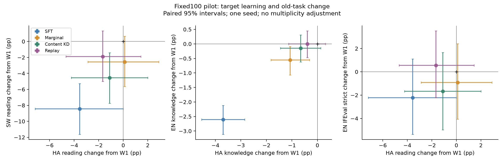

# 跨语言任务决策稳定性：固定100步pilot

**本轮已完成。主要结论：内容决策KD缓解部分普通SFT退化，但未优于标签保持/同题回放；四组均未建立明确的Hausa净学习收益。暂不扩到400步，优先验证HA训练数据与目标任务的对齐。**

本轮A/B/C/D均从相同SW FFT Final400出发，HA阶段固定100步/1600样本，使用原400步scheduler。A=普通SFT（复用原100检查点）；B=标签边际KL；C=内容ID决策KD；D=同题答案token全词表CE回放。B/C/D匹配旧任务输入、四轮提示与教师预算，均为seed42，C不作为My Method。

| 核心指标 | W1起点 | A SFT | B边际 | C内容KD | D回放 |
|---|---:|---:|---:|---:|---:|
| HA阅读ACC |28.44|24.89|28.56|27.33|26.78|
| HA知识ACC |29.72|26.02|28.65|29.06|29.32|
| SW阅读ACC |36.67|28.22|34.11|32.11|34.78|
| EN知识ACC |58.45|55.84|57.89|58.30|58.45|
| GSM8K flexible |61.26|58.15|61.64|57.32|59.59|

新建400个EN/SW/HA共同原题ID：160辅助/120开发/120留出，官方专业人类翻译来源；教师只用训练辅助EN/SW，53题可靠池、100步实际50题。新留出在所有训练结束后评分。原正式任务有历史曝光，仅作固定预算补充比较。主成效按用户目标benchmark报告，新科学题用于读出诊断。

## 交给ChatGPT的阅读顺序

1. [完整报告：设置、全部发现、置信区间、限制](results.md)
2. [全部主要对照与配对区间、六种留出读出、计算量](../../results/decision_stability/comparison_tables.md)
3. [下一阶段研究决策与一个可检验假设](next_method_decision.md)
4. [冻结协议](protocol.md)、[P0读出检查](p0_readout.md)、[复现说明](reproduce.md)

## 结果与代码

- [完整25项原生正式指标](../../results/decision_stability/formal_table.md)及[机器可读统计](../../results/decision_stability/formal_benchmarks.json)
- [新留出统计](../../results/decision_stability/fresh_holdout.json)、[新开发统计](../../results/decision_stability/fresh_dev.json)
- [实际曝光、模型角色哈希和计算量](../../results/decision_stability/cost_and_validation.json)、[验证回执](../../results/decision_stability/validation.json)
- [科学实现](../../scripts/decision_stability)、[公共配置](../../configs/decision_stability)、[六项CPU测试](../../tests/decision_stability)

原始逐题结果、数据编码、模型/原生优化器状态和完整启动记录保留在本地；公开科学实现、配置与汇总。模型主训练数据/标签/顺序均已与A100核验，辅助日程三组一致。所有科学训练与评分完成；后续400步、新正对照和My Method均标为NOT_RUN。

