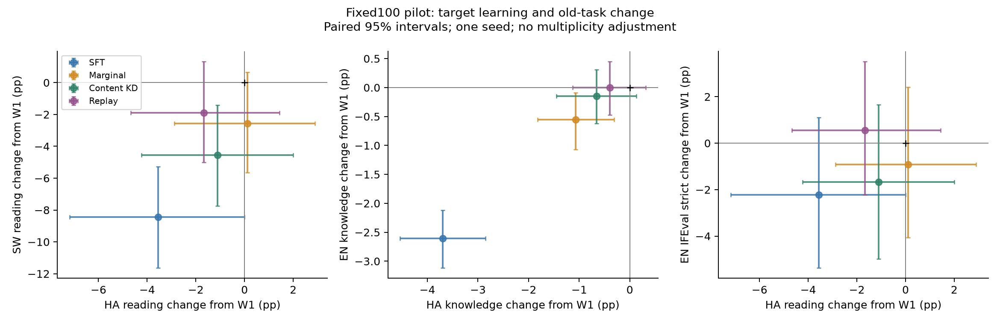
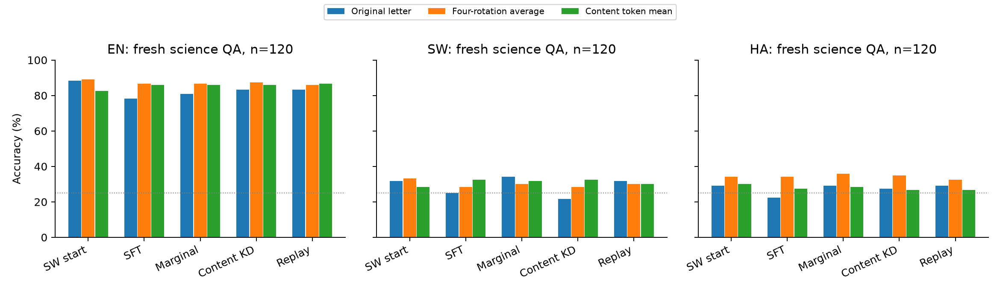

# 决策稳定性100步pilot：完整结果与解释

2026-11-04。本轮全部训练、32组正式测评驱动、新开发/留出评分及配对统计已完成。内容决策KD是诊断用蒸馏baseline，本轮没有提出My Method。

## 1. 设置与参照

共同起点W1是官方后训练Qwen3-1.7B经SW Aya6400全参数SFT400步后的固定导出。A普通HA-SFT、B标签边际保持、C内容ID决策KD、D同题答案token回放，均使用同一HA6400缓存的前100步：1600样本、653205输入token、231035移位assistant监督token。100步是预定pilot终点；保留原400步cosine/20步warmup，没有英语早停或测试选checkpoint。

全参数AdamW1e−5、有效batch16=两GPU×micro1×累积8、seed42、BF16/2048/assistant-only/non-thinking、不packing。A复用已核验原检查点，B/C/D新增训练；三者同lambda1、同EN/SW旧任务输入、四轮旋转和教师预算。160个训练辅助语义ID中53个满足双语共同可靠性规则，固定100步实际使用50个ID、各EN/SW一次。D在全词表上监督正确末字母token，共同聊天空白前缀给定，不另加EOS。

B精确实现是每题四旋转标签均值拟合教师按语言全局边际，属于minibatch控制；C是内容ID对齐后的四旋转均值KL；D是任务均衡权重1的单答案token rehearsal。它们的梯度量级未匹配，本轮也没有搜索lambda。参照是阶段2前W1，英语指标并非相对原始W0的完整保持。

[冻结协议](protocol.md) · [复现与损失细节](reproduce.md) · [完整对照、全部读出与配对区间](../../results/decision_stability/comparison_tables.md) · [全部25项原生正式指标](../../results/decision_stability/formal_table.md)

## 2. 正式主要结果

ACC均为百分数。阅读每语900题；知识每语14042题。正式任务有历史曝光，本轮只作预先固定预算的补充比较。

| 指标 | W1起点 | A SFT | B边际 | C内容KD | D回放 |
|---|---:|---:|---:|---:|---:|
| HA阅读ACC |28.44|24.89|28.56|27.33|26.78|
| HA知识ACC |29.72|26.02|28.65|29.06|29.32|
| SW阅读ACC |36.67|28.22|34.11|32.11|34.78|
| SW知识ACC |31.65|25.95|29.47|29.53|30.36|
| EN阅读ACC |77.11|69.44|74.22|74.00|73.78|
| EN知识ACC |58.45|55.84|57.89|58.30|58.45|
| GSM8K flexible |61.26|58.15|61.64|57.32|59.59|
| IFEval prompt strict |27.17|24.95|26.25|25.51|27.73|

双向FLORES完整1012句/方向、3-shot/vLLM V1：EN→SW chrF++为8.00/4.22/4.62/4.69/4.87，SW→EN为14.88/13.46/14.81/14.61/15.98（依次W1/A/B/C/D）。GSM strict、IFEval指令级及loose、SW MGSM/X-IFEval等均见完整表，未按有利指标筛选。

### Hausa没有得到明确的净学习收益

各模型相对共同W1的变化，单位pp，括号内95%配对区间：

| 任务 | A−W1 | B−W1 | C−W1 | D−W1 |
|---|---|---|---|---|
| HA阅读 |−3.56 [−7.18,0.00]|+0.11 [−2.89,+2.90]|−1.11 [−4.23,+2.00]|−1.67 [−4.67,+1.44]|
| HA知识 |−3.70 [−4.54,−2.85]|−1.07 [−1.82,−0.31]|−0.66 [−1.45,+0.13]|−0.40 [−1.13,+0.31]|

C比A的HA知识高3.04pp [2.35,3.70]，体现减少A的退化；C相对W1仍是−0.66pp，不能写成新语言学习提高3.04pp。区间跨0也不证明与W1或D严格等价。本结论限定于当前初始化、数据/配方与100步，不宣称Hausa普遍无法学习。

### C改善部分选择题保持，但没有超过两个额外数据对照

相对A，C的SW阅读+3.89pp [1.12,6.58]、SW知识+3.58pp [2.85,4.37]、EN阅读+4.56pp [2.70,6.40]、EN知识+2.46pp [1.92,3.01]。这支持辅助约束能缓解部分退化，但A没有相同旧数据/教师计算，不能据此判定内容KD机制有独特优势。

相对B，C的EN知识+0.41pp [0.04,0.78]，但GSM8K flexible−4.32pp [−6.52,−2.20]；阅读与HA指标没有稳定优势。相对D，C的SW阅读−2.67pp [−4.98,−0.56]、SW知识−0.83pp [−1.33,−0.32]、GSM8K flexible−2.27pp [−4.32,−0.30]、SW→EN chrF++−1.38 [−2.10,−0.66]。C与D的HA阅读/知识差异区间均跨0，尚未建立“相同有效HA学习水平下C更优”的证据。

因此，本轮不支持把C升级为My Method，也不支持自动扩到400步。D是有用的简单保持对照，但D同样没有明确HA净收益，不能称已取得成功的持续学习权衡。

## 3. 新平行材料：读出偏好复现，Hausa收益仍不足

采用Uhura ARC-Easy官方train的人类专业翻译，400个EN/SW/HA共同原题ID，分为160训练辅助/120开发/120留出。排除必要直接重叠与不可旋转/无图不可答材料；没有全语义去重、基础模型预训练去污染或新的母语者逐题认证。新的留出题在四组训练结束后才评分，未用于调参。

开发P0中，A在SW/HA的16交叉标签/位置提示上，候选字母A预测份额97.34%/93.65%，第一个物理位置仅24.48%/24.38%，支持字母token偏好。新留出EN中，W1→A原字母ACC 88.33→78.33（−10.00pp [−16.67,−3.33]），四轮内容ID概率平均89.17→86.67（−2.50pp [−6.67,+0.83]），完整内容token均值82.50→85.83（+3.33pp [−0.83,+7.50]）。原字母下降不能直接等同于全部语义能力丢失。

但读出修正没有建立HA学习：HA四轮ACC依次34.17/34.17/35.83/35.00/32.50，完整内容token均值30.00/27.50/28.33/26.67/26.67（W1/A/B/C/D）。C的HA内容原始LP读出甚至从W1的30.83降至21.67，变化−9.17pp [−16.67,−2.50]；长度均值读出的变化区间跨0。不同读出并非语义真值估计器，必须同时保留，不能选最有利的一种。

留出SW原字母C为21.67，B为34.17、D为31.67；C−B −12.50pp [−20.83,−4.17]、C−D −10.00pp [−17.50,−2.50]，对应轮换/内容读出差异多跨0。更复杂的内容目标没有自动解决回答通道漂移或带来广泛旧任务优势。

新材料是科学选择题，不能替代正式Belebele/MMLU或生成能力。GSM/IFEval/翻译也不能仅由A/B/C/D字母偏好解释；其分数变化只证明对应任务表现变化，不直接定位内部知识丢失的因果机制。

## 4. 验证、实际计算与限制

- 6项CPU损失/映射/梯度检查通过；共享训练扩展及全词表回放各有一次双卡两步预检。A100参数与400步scheduler已核验。
- 三组新训练的两rank HA输入、标签、步/微步及顺序全字段匹配A100；B/C/D辅助问题与四旋转日程也全部相同。实际HF loss-kwargs分支factor=1已记录，附加loss一更新只加入一次。所有新导出各310个BF16张量，保留原生优化器状态。
- 正式评分按逐样本记录复核，9组模型对比的doc/prompt精确一致；阅读按来源段落链接、指令按prompt聚类保留指令数，其他ACC按原题bootstrap2000次。新题4000次语义IDbootstrap；翻译1000次corpus chrF++，充分统计量求和与原corpus scorer及重复重采样oracle误差0。
- B/C/D训练分别40.26/38.90/40.99分钟、各两GPU；新训练共4.005 GPU墙钟代理小时，正式测评7.709，新读出0.732，教师0.020，工程预检0.119，总计12.585。教师物理计算一次，各辅助臂预算相同；A当前新增训练0。墙钟代理含加载/保存等CPU阶段，不是实测FLOPs或kernel时间，GPU拓扑/输出长度也不同，不能据此排名算法速度。
- 一个训练seed、一个lambda和一个小规模辅助池；区间未多重校正，不能代表训练随机性。B是minibatch边际控制；D是无额外EOS的单答案token回放，尚未覆盖调优后的全序列replay。新题human来源不等于本次重新认证；完整内容似然也非纯语义oracle。

[验证回执](../../results/decision_stability/validation.json) · [预算与曝光](../../results/decision_stability/cost_and_validation.json) · [下一阶段决策](next_method_decision.md)
