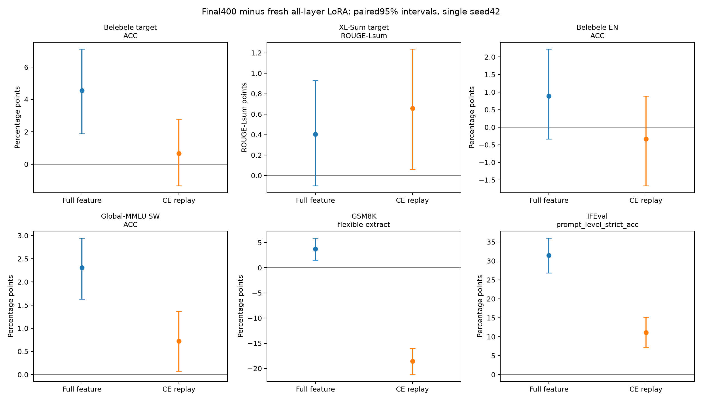
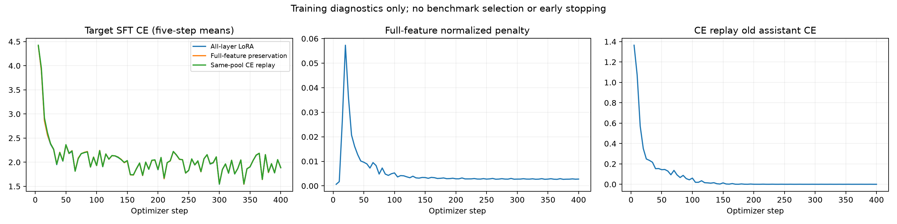

# P2正式报告：训练中的全表示约束及同池英语回放

## 结论与完成状态

三项新训练均完成固定Final400、六个保存节点与四阶段全量端点。共40条绝对分数、48条预定配对比较，原Base/旧Full及以前三语言消融结果保留。

本轮获得了**训练中普通全表示保持有用的直接下游证据**：相较新普通LoRA，SW阅读、知识、数学及指令指标提高，摘要点估计略高而差值区间跨零。它没有采用只训练末尾层的策略；全部36层LoRA仍可更新。

这是普通特征保持对照的有效结果，**不是功能敏感方向或动态控制的新方法已获验证，也没有新颖性证明**。同池回放在本配方下出现数学负结果，不能推广成所有回放无效。

## 1. 全部模型的主要成绩

除摘要为ROUGE-Lsum，其他为百分比。旧Full是历史batch1旁证；主要比较使用三项新的共同batch2训练。严格提取和指令级分数、全部区间另见[完整结果](results.md)。

|模型|SW阅读|SW摘要|EN阅读|SW知识|GSM8K flexible|IFEval prompt strict|
|---|---:|---:|---:|---:|---:|---:|
|适配前|27.33|13.71|62.89|33.38|84.46|78.37|
|旧Full LoRA（batch1）|38.11|20.24|86.33|33.34|81.20|49.35|
|新普通LoRA（batch2）|36.33|20.18|87.56|33.03|81.05|48.43|
|全表示保持|40.89|20.58|88.44|35.34|84.76|79.85|
|同池CE回放|37.00|20.84|87.22|33.75|62.47|59.52|

普通LoRA相对适配前的GSM8K灵活提取和IFEval提示strict下降，英语阅读上升。因此这里研究的是部分通用任务退化，不能概括为英语能力全面下降。

表示保持组的数学、指令分数接近适配前，但相对Base的区间跨零不能证明等价或不遗忘保证。SW知识使用全14042题/57学科加权ACC，不是挑选学科子集。

## 2. 配对比较

差值为模型减参考；摘要为ROUGE分，其余为百分点。2000次同题bootstrap；指令级按541个提示聚类。单训练seed、未做多重校正，区间反映题目抽样变化，不代表训练稳定性。未设非劣效容忍度；跨零不等于两方法相同。

### 表示保持减新普通LoRA（batch2）

|指标|差值|配对95%区间|
|---|---:|---|
|SW阅读|+4.56|[+1.89, +7.11]|
|SW摘要|+0.40|[-0.10, +0.93]|
|EN阅读|+0.89|[-0.33, +2.22]|
|SW知识|+2.31|[+1.63, +2.95]|
|GSM8K flexible|+3.71|[+1.52, +5.91]|
|IFEval prompt strict|+31.42|[+26.80, +36.04]|

### 表示保持减同池CE回放

|指标|差值|配对95%区间|
|---|---:|---|
|SW阅读|+3.89|[+1.56, +6.22]|
|SW摘要|-0.25|[-0.79, +0.28]|
|EN阅读|+1.22|[-0.22, +2.67]|
|SW知识|+1.59|[+1.00, +2.16]|
|GSM8K flexible|+22.29|[+19.41, +25.17]|
|IFEval prompt strict|+20.33|[+16.08, +24.58]|

全8指标的48项比较全部保留，不只展示有利任务。同池回放的摘要点估计略高于表示保持，差异区间跨零；英语阅读差异也不明确。结论应关注已观察到的任务权衡，不宣称所有任务严格支配。

## 3. 从消融走到训练约束

此前三语言移除中部LoRA增量时，部分通用能力恢复，但摘要收益也可能损失；这支持研究更新代价，不能认定功能已局部分离。P0/P1的rank8敏感漂移额外解释力不稳定，且数学校准标签混有答案提取因素；阴性结果见[前阶段诊断](../diagnosis.md)，没有被覆盖。

本轮先验证普通全表示保持及同池回放。复杂敏感子空间、动态预算没有启动。训练每个目标microbatch之后增加一个旧样本目标，持续施加监督；系数固定1，不是自适应控制器。

令P为每例最多4个参考回答预测位置，h0为冻结适配前模型的缓存。表示损失为：

`mean_over_36_layers(sum_P,features((h-h0)^2)/max(sum_P,features(h0^2),1e-12)) / capability_scale`。

数学尺度0.13853428785915772，指令尺度0.21183144826953915，来自先前未保护Full模型在build上的漂移，未由本轮正式成绩选择。所有层均可更新；没有层门控、梯度投影或敏感rank8约束。它是普通参考特征保持，而非已经定位旧功能方向。

目标反传仍由原LLaMA-Factory/HF Trainer执行。旧目标在目标反传结束后单独前后向，旧均值按实际梯度累积8除一次；旧前向关闭dropout但保留梯度。12项tiny-Qwen/PEFT CPU梯度对照及真实4B工程短跑通过。

## 4. 固定数据与预算

官方Qwen/Qwen3-4B revision `1cfa9a7208912126459214e8b04321603b3df60c`，non-thinking，不是Qwen3-4B-Base。原SW6400混合集、顺序与assistant标签全量哈希一致，含原GV翻译部分，不是NLLB替换版。400步、有效batch16、microbatch2/累积8、seed42、长度2048、不packing；全36层七类投影LoRA，r16/alpha32/dropout0.05，LR1e-4、AdamW/cosine/warmup0.05。

microbatch根据吞吐和显存工程短跑冻结，三项新组完全相同。历史batch1 Full与新batch2模型不能视为数值相同，padding/dropout随机数消耗及GPU非逐位复现均可能影响结果。

三条目标CE曲线接近且有重叠；这不表示参数、输出或正式任务能力相同。旧目标曲线采用各自定义的尺度，也不能跨图直接比较强弱。曲线仅作训练诊断，不用于选择方法。

旧池仅用Base正确筛选后的build128：数学64、合成指令64。数学来自GSM8K train，排除正式test和实际few-shot示例；指令是8类原创可核验模板，非官方IFEval。check128没有训练或用于调参数。固定打乱后交替两类，循环25遍，每个保护组3200次额外旧前后向。

两组拥有相同旧参考文本与顺序，但信息量并不相同：表示组额外使用Base中间特征及历史Full漂移尺度，回放组优化参考回答CE。不能将两者称为无旧信息、无回放或等总计算方法。

## 5. 同池回放的数学负结果

回放GSM8K strict为61.03、flexible为62.47；表示组为75.59、84.76，普通LoRA为63.76、81.05。严格/灵活提取的差距明显变化，包含格式因素，不能把任一单项直接等同纯推理能力。

为核查意外下降，在该端点出分后添加[事后输出审查](replay_output_audit.md)，不改正式分数或预定比较。1319条GSM生成按JSON响应哈希唯一连接真实completion元数据，并核查三组题目、提示、金答案身份一致。回放组全部正常终止、0条达到1280上限；下降不能由截断独自解释。

回放组1318/1319条带计算器式`<<...>>`，1309条有`####`；普通LoRA对应916、995，表示组559、1194。它描述风格改变，不能证明风格导致退化。普通LoRA正确而回放错误314题，反向69题。定向查看最前5个失败案例，实际出现错误运算关系、遗漏条件和算术错误，且最终答案明确错误；不能把全部下降归为解析器。

同一旧池数学训练CE首轮1.634降至末轮0.000362，指令0.294降至0.0000665。这说明已见旧池被充分拟合，不是正式能力保持的替代指标。小池重复、旧损失权重或风格学习是否导致泛化下降尚未被因果验证，不通过正式测试继续搜索回放系数。

## 6. 资源与信息成本

|组别|目标样本／监督token|旧输入token|旧CE标签token|记录的训练进程时间|
|---|---|---:|---:|---:|
|新普通LoRA（batch2）|6400／324892|0|0|52.23分钟|
|全表示保持|6400／324892|393750|0|64.75分钟|
|同池CE回放|6400／324892|393750|211250|62.47分钟|

每组目标输入2373891 token；两个保护组额外旧参考回答内容均211250 token，但只有CE回放将它们作为CE标签，表示组使用12775个回答位置×36层的特征保持。表示缓存94199512字节。三个新正式训练进程时间合计2.991小时；进程时间含加载和CPU工作，不是CUDA核时间，平行任务相加也不是总历时。

表示组正式训练较普通LoRA约多24%时间，CE回放约多20%；这不包含从零获得旧池、Base特征及历史Full尺度的全部成本。缓存复用P1，纯缓存构建时间NOT_MEASURED；Full尺度依赖旧未保护400步模型，其历史训练约51.80分钟，本次未新增该训练，但从头部署不能视为免费。P0/P1额外诊断成本另见前阶段记录。

9项工程GPU短跑实际432个目标样本、144个旧样本，记录进程时间286.49秒，未把恢复前缀重复计为新曝光。[成本清单](cost_summary.json)逐项保存额外调用、缓存及评测阶段时间；前向计数不含checkpoint内部重算，不能据此声称等FLOPs。

## 7. 核验与复现边界

三组六节点共18个adapter检查504个LoRA张量及33030144个参数；初始状态一致，正式节点保存optimizer/scheduler/RNG，400节点与Final一致。6400目标输入及标签顺序对齐原运行，保护组旧ID及3200次顺序对齐同一build池。全量20个模型/阶段实际协议记录、物理输入提示哈希和输出聚合核对，未改变官方IFEval评分。

保存0/50/100/200/300/400；固定Final400，不以英语退化早停或选正式测试最高节点。本轮中间节点仅保存，尚未给出它们的正式任务学习曲线。

工程恢复测试的加载时adapter和optimizer精确、恢复样本流一致；初次最终张量逐位一致断言失败，且同初始化/数据/seed的不中断GPU重复也非逐位一致。该限制如实保留，未声称最终张量精确复现。三个正式训练未发生中断恢复。

40分数、48区间由匿名逐题数值在CPU独立复算；公开collector路径适配后对同一原始输入得到相同字节的结果，科学损失实现保持原文件字节一致。公开必要代码、配置、数值矩阵、图、数据及产物哈希，原题、完整回答、模型权重和服务器队列信息保留本地。旧池及Base缓存重建仍需要先前P1资源，公开包不冒充一键独立数据下载复现。

## 8. 可以和不可以得出的结论

可以：在这一次SW固定配方中，连续全表示约束相较无约束LoRA改善了实际任务权衡；它不是事后删除中层，且这次收益不能仅归因于给同池英语文本做CE。

尚不可以：确认特定旧功能方向、动态控制优势、顺序CL有效、跨语言方法泛化或创新性。有效更新整体F范数为普通LoRA8.109、表示组8.022、回放8.814；表示组仅少约1.08%只是辅助描述，不能排除整体更新改变或代替新的等范数控制。

单SW、单seed42；正式材料已被历史研究暴露，本轮冻结后仅用于完整端点比较。样本bootstrap不是训练种子复测。8类旧指令模板与官方能力不等同。两保护组参考信息和损失梯度强度不同，固定lambda1不等于等强度。

### 本轮NOT_RUN

- 功能敏感rank8训练、动态门控、其他语言规则迁移与额外种子。
- SW→AR→RU等顺序CL；这里只是一次单语适配中的持续约束。
- P2等有效更新范数的统一缩放正式端点、从头固定层训练、输出KD等进一步对照。
- 新翻译和XNLI结果；不能声称修复翻译，旧结果完整保留。
- 中间checkpoint正式benchmark学习曲线，未据其选Final。

下一步讨论见[next_method_decision.md](next_method_decision.md)。
