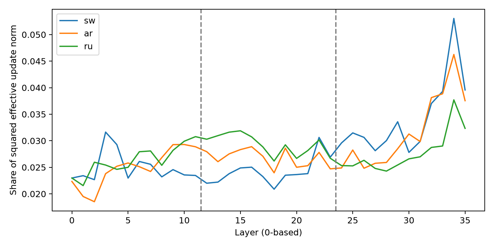

# A1：有效LoRA更新范数

使用alpha/r=2及FP64因子Gram恒等式计算||BA||F，已与显式矩阵乘积小例对照。相对更新以同一Base各矩阵Frobenius norm归一化。有效更新是已训练参数差值，不是梯度。

|语言|分组|模块数|Adapter参数|联合范数|平方范数占比|
|---|---|---:|---:|---:|---:|
|sw|early|84|11010048|4.4428|29.94%|
|sw|middle|84|11010048|4.3765|29.05%|
|sw|late|84|11010048|5.1992|41.00%|
|sw|attention|144|11796480|3.8467|22.45%|
|sw|mlp|108|21233664|7.1503|77.55%|
|ar|early|84|11010048|4.3134|29.87%|
|ar|middle|84|11010048|4.4728|32.12%|
|ar|late|84|11010048|4.8649|38.00%|
|ar|attention|144|11796480|3.9644|25.24%|
|ar|mlp|108|21233664|6.8236|74.76%|
|ru|early|84|11010048|4.2565|31.58%|
|ru|middle|84|11010048|4.4901|35.14%|
|ru|late|84|11010048|4.3694|33.28%|
|ru|attention|144|11796480|3.9488|27.18%|
|ru|mlp|108|21233664|6.4636|72.82%|

## 消融范围

|变体|启用模块|保留Adapter参数|关闭Adapter参数|
|---|---:|---:|---:|
|remove_early|168|22020096|11010048|
|remove_middle|168|22020096|11010048|
|remove_late|168|22020096|11010048|
|keep_late|84|11010048|22020096|
|remove_attention|108|21233664|11796480|
|remove_mlp|144|11796480|21233664|

36层每12层分组；原始每语种252模块/33,030,144个Adapter参数。表中保留参数表示推理增量的范围，不是新的训练参数预算。Attention与MLP的矩阵大小、保留参数数目不同，比较时不能忽略。

范数分布相似不等于功能分布相似；任何层级保护或遗忘因果解释必须结合A2/A3实际任务结果，当前范数本身不支持选择Last-k。

