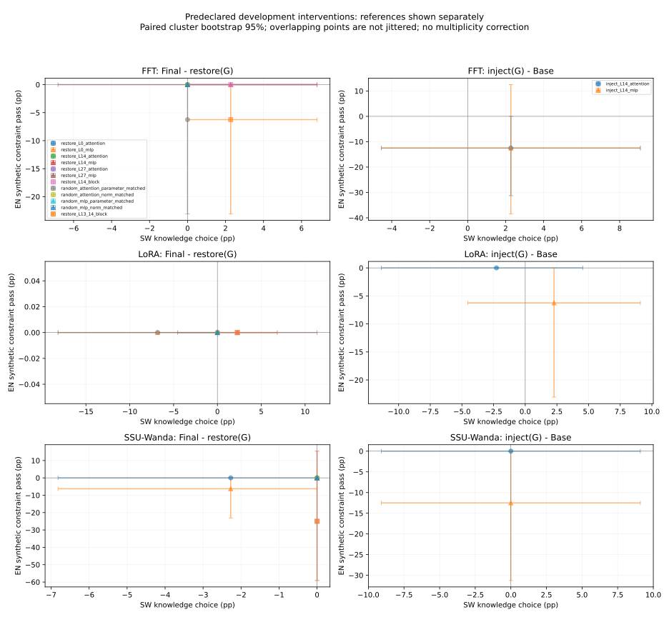

# Qwen3-1.7B 多语言 SFT 内部机制诊断报告

日期：2026-11-02。供 11 月 3 日早间汇报使用。

## 一、可以汇报的结论

1. **已有实验证据支持**：固定预算 SW 微调带来 SW 阅读、知识提升，同时数学、指令遵循等通用任务退化。EN 阅读、知识并没有普遍退化，因此应研究任务功能的选择性变化，不能将其概括为“英语整体遗忘”。
2. **尚需进一步实验**：本轮少量预定模块的恢复与注入没有给出可靠、清晰的语言接口／共享任务功能分离证据。不能据此宣称已找到可直接设计 My Method 的模块，也不能证明所有层都不可分离。
3. **已有实验证据支持（限定于诊断样本）**：数学评分受输出格式和提取规则影响，但 FFT 中也存在明确错误数值；“下降全部来自格式”不符合这批回答。LoRA 大量未解析回答必须保留为未知。
4. **只有相关性**：参数与激活变化图描述了模型变化位置，不等于模块重要性或遗忘原因。激活补丁衡量参考答案对数似然，不能冒充生成准确率恢复。

## 二、固定 baseline 与正式 benchmark

模型为官方后训练 Qwen/Qwen3-1.7B，revision `70d244cc86ccca08cf5af4e1e306ecf908b1ad5e`，不是单独的 Qwen3-Base。Aya Collection SW6400，1 epoch，400 optimizer steps，有效 batch 16，assistant-only SFT、non-thinking、BF16、长度上限 2048，不 packing。主训练输入 2,884,423 tokens，shifted assistant tokens 1,078,347。固定使用 400 步 Final，正式测试不选 checkpoint。

FFT LR 1e-5；LoRA r16/alpha32/dropout0.05、七种投影、LR1e-4；SSU-Wanda 静态保护、LR1e-5，校准材料包含数学偏置。这些训练配方不同，跨方法差异不能单独归因于参数选择机制。当前 SSU 保护约 40.96% 的唯一参数，不是历史 SSU15%。

以下为正式 seed42 结果，百分比为主要指标；翻译为语料级 chrF++。

|正式任务／指标|Base|FFT|LoRA|SSU-Wanda|
|---|---:|---:|---:|---:|
|SW Belebele ACC|28.33|36.67|36.89|35.44|
|SW Global-MMLU ACC|27.87|31.65|31.38|31.24|
|EN Belebele ACC|60.78|77.11|78.22|79.67|
|EN MMLU ACC|57.01|58.45|58.33|58.82|
|EN IFEval prompt strict|66.91|27.17|31.05|47.50|
|EN GSM8K strict|45.03|3.79|7.35|13.80|
|EN GSM8K flexible|73.01|61.26|56.79|65.43|
|EN→SW chrF++|5.11|8.10|7.20|5.96|
|SW→EN chrF++|22.91|14.53|16.20|19.70|

80 项选定正式指标已与 28 份原始结果复核；原始结果、checkpoint 和训练配置保留。本轮不重训 baseline，不继续用户已取消的四组候选方法，不新增训练种子。

## 三、本轮诊断如何设置

### 资产与模型处理

Base、三组 Final 与 100/200/300/400 步 checkpoint 均可访问。FFT/SSU 为完整 HF safetensors；LoRA 为 Adapter，按实际 PEFT scaling 在内存中合并，未新写 merged 权重。唯一参数数目 1,720,574,976，检查 tied embedding/head。所有诊断统一使用 Base tokenizer、chat template、`enable_thinking=False`；tokenizer.json 一致，tokenizer_config 差异已记录。

参数、模块和激活诊断使用 float32、eager，以便检查差分与事务回滚。因此它们不是原 BF16/vLLM 正式测评协议的逐位复现。解码固定 greedy，显式 `use_model_defaults=False`，不继承模型的采样默认值。输入超过 1024 tokens 报错，不静默截断。生成上限：数学 256，阅读和短答 96，复制指令 32，多约束指令 64；各模型和条件相同。

### 独立开发材料

共 232 输入：知识选择 88，四种输入输出语言组合的短答 32，EN 数学 16，EN/SW 阅读 span 各16，复制指令32，多约束指令32。AfriQA 使用 22 个未进入训练的来源实例，知识选择含两次选项轮转；同源实例和相同提示不是独立样本。数学取 GSM8K train，并排除正式测评 few-shot traces 中出现的 4,375 个训练问题。阅读来自 SQuAD train 和 KenSwQuAD train，二者不平行。四种语言组合仅在可配对的短答与明确复制规则上比较。

这些是开发／机制探针：阅读 span 不是 Belebele ACC，合成指令不是官方 IFEval，数学为 0-shot 诊断而不是正式 5-shot 协议。选择题负例的语义唯一性、SW 合成指令措辞未独立人工复核；短答 alias 的严格词面评分可能产生地板效应。输出语言规则只覆盖有明确参考 token 的复制任务，尚无可靠的自由文本 SW 语言正确性评估，不能将该子项当成整体输出语言能力。

### 预定模块干预

每个模型 17 个预定干预，加 Base/Final 共19条件，每条件232输入，三组合计 **13,224 条生成记录**。代表层为0/14/27，分别恢复 Attention/MLP；中层还有完整 Block、连续13–14层 Block、alpha0.5、Base 上仅注入中层更新，以及与中层匹配参数量／更新范数的随机模块对照。实现支持 Q/K/V/O、Gate/Up/Down 细粒度，但本轮不穷举所有子模块。

全部操作在内存事务中，逐条件检查参数哈希回滚，不写原权重。identity 输出完全一致；随机参数量／范数匹配通过，三次运行的 Base 232 条预测逐字一致。三组共 1,224 行条件效应、72 行交互对比。

## 四、独立开发探针的参考结果

表内为成功数／样本数，保留原评分；不与上面的正式 benchmark 混合。

|诊断任务|Base|FFT|LoRA|SSU-Wanda|
|---|---:|---:|---:|---:|
|SW 知识选择|14/44|28/44|27/44|24/44|
|SW 阅读 span|0/16|4/16|1/16|2/16|
|EN 知识选择|36/44|36/44|36/44|37/44|
|EN 阅读 span|5/16|11/16|8/16|9/16|
|EN 合成指令约束|14/16|6/16|6/16|5/16|
|EN 数学：原受限提取|12/16|0/16|0/16|7/16|
|EN 数学：严格格式|12/16|0/16|0/16|10/16|

知识选择44行对应22个语义实例；EN合成约束16行合并相同提示后为13个不确定性簇。SSU 在正式 IFEval 上优于 FFT，但在这16条合成约束中为5/16、FFT为6/16，说明保护效果依赖任务与协议，不能只展示有利任务。

### 事后选项轮转检查

22个SW来源问题中，两次轮转都正确：Base2/22、FFT13/22、LoRA13/22、SSU10/22。说明观测收益并不只出现在某一个排列；但无法区分知识增加、语言理解与选项校准。此诊断不改主指标、不用于挑层，详见[轮转补充分析](choice_rotation_audit.md)。

### 数学：将受限答案提取与数值正确性分开

原评分仅识别明确数字标记或纯数字回复。FFT 的原始0/16不能写作“16题全部答错”。新增的事后保守诊断识别最后一个显式 `####`／answer tag，或 EOS 完成、至多20词且只有一个数值的短回答；其余标记未知，不随意提取最后一个数字。原评分不改变。

|模型|可解析且正确|可解析且错误|未知|此16题的保守正确率范围|
|---|---:|---:|---:|---:|
|Base|12|2|2|75.00%–87.50%|
|FFT|2|11|3|12.50%–31.25%|
|LoRA|0|6|10|0.00%–62.50%|
|SSU-Wanda|7|5|4|43.75%–68.75%|

范围来自把未知全按错／全按对计算，**不是抽样置信区间**，也不验证推理过程。FFT 11题有可解析错误值，不能用格式解释全部退化；LoRA 10题未知，不能称它们全错。达到数学长度上限：FFT0/16、LoRA1/16、SSU3/16；LoRA 未解析主要不是截断，而是多数字、缺少标记等。此诊断规则为事后补充，不用于重选层或改正式分数。

## 五、Q1：微调主要改变了什么？

**已有实验证据支持（参数事实）**：LoRA 在196个投影矩阵形成有效更新，float32 比较得到1,409,277,634个数值改变元素；FFT为1,168,295,567、SSU为696,160,771。LoRA 训练参数仅17,432,576，有效更新可以密集，不能把这些元素数当作可训练参数量。BF16 合并再舍入可能产生不同计数。

**只有相关性（功能解释）**：逐层 Attention、MLP、七种投影和 Block 范数已输出。三组同一60输入的激活审计各产生2,352聚合行，区分 prompt 与 teacher-forced reference；后者不是实际生成 token。相对L2以各层 Base 激活范数为分母，层标度可造成曲线下降，不能据低谷断言中间语义功能被保留。每组 CKA 样本少、任务长度不同，曲线只作描述。

## 六、Q2：哪些更新对 SW 有贡献？

使用 `I = Final − restore(G)`；正值表示移除该更新后本探针下降，是完整模型背景下的条件效应。

FFT 中恢复 L0 Attention 会损失1/16条 SW 阅读，I=+6.25个百分点，配对簇 bootstrap 95%区间[0,18.75]；恢复 L14 MLP 或 L14 Block，SW知识损失1/44，I=+2.27，区间[0,6.82]。这些变化弱，**三组所有字面恢复条件的经验95%区间都包含0**。不能将单个题的变化稳定地归因为某模块。

**尚需进一步实验**：本轮没有确立 SW 必需组件。即使恢复后无变化，也可能是样本少、评分离散、冗余或分布式更新，不能证明该组件无功能。

单独注入必须以 `inject(G) − Base` 判断充分性；`Final − inject(G)` 去掉了其余全部更新，不能当作 G 的贡献。FFT 仅注入 L14 Attention／MLP，SW知识均为15/44，对照Base14/44，SW阅读均0/16；未重现完整 FFT 的大部分收益。其与 Final 的巨大差距不能用于宣称中层模块贡献巨大。

## 七、Q3：哪些更新与 EN 数学／指令退化有关？

**已有实验证据支持（整体模型现象）**：正式 IFEval／GSM8K 下降，以及开发回答中部分真实错误。**尚需进一步实验（组件归因）**：本轮没有可靠地定位局部致损模块。

FFT 恢复13–14层 Block，使 EN 合成指令由6/16变7/16，I=−6.25个百分点，区间约[−23.08,0]；参数匹配随机 Attention 恢复也出现同样变化，不能认定为特定保护结构。FFT/LoRA 数学原受限评分接近地板，零效应不等于数学功能没有改变。

每项使用同题配对 bootstrap 2,000次、seed42，并合并 pair ID 或重复提示的传递等价簇。没有多重比较校正，均为探索性区间；[0,0]只表示当前样本没有观察到差异，不证明总体等价。

交互对比为 `restore(Attention)+restore(MLP)−restore(Block)−Final`。Full/SSU 的 Block 还包含有变化的 LayerNorm，因此不把差值全解释成 Attention–MLP 交互；LoRA 对应额外参数无更新时才是该精确并集的条件非加性。不能由这批小样本确认组件独立可加。

## 八、激活补丁：提供了什么证据？

三组最终 v3 各26样本、368记录：中层与固定随机层 Attention/MLP、同输入 Base 激活替换、同范数高斯扰动、全部26例等长中性语义控制，以及14例同语言等长不同题控制。identity 最大误差0。数学参考为格式有效的 `#### 数字`。v1/v2保留为历史，不与最终v3混算。

**已有实验证据支持（工程）**：对应层输出可受控替换、同形状、可重复。**只有局部机制读数**：读出为 teacher-forced 正确参考答案 LL 变化，未声称生成任务恢复；合成中性控制可能分布外，不同题也不保证语义完全无关。短样本和参考 token 的影响仍在。跨语言无可靠 token 对齐，本轮没有英／SW位置一一替换。

恢复与注入采用不同参考，见分面图；数学原提取地板未作为主散点纵轴，所有数学结果仍保留在完整表中。图中的EN合成约束不是官方IFEval。

**补丁样本覆盖限制**：26样本分属13个任务／输入输出语言组，每组仅2例；中层／随机层与Attention／MLP的重复条件不增加独立样本量。中性语义和真实不同题控制没有匹配扰动范数，不能把它们与同输入补丁的差异单独归因于语义内容。

## 九、Q4：是否存在可用于后续方法的功能分离结构？

**尚需进一步实验**。目前没有足够证据把候选模块可靠归为 A“SW有益且EN损害小”、B“收益小但损害大”、C“二者共同依赖”。本轮弱条件效应和补丁LL不能支持一个新算法；同样不能否定所有更细粒度、其他层或其他预算下的分离可能。

**被本轮回答证据否定的狭义解释**：所有数学下降都只是格式问题。FFT 中有明确错误数值。

**未被证明、不能当成事实的解释**：Attention 专门路由语言、MLP 专门保持任务功能；激活变化较小即语义功能完好；单独注入与完整模型之差即注入模块贡献。已有 CPT 论文动机不自动适用于本次指令 SFT。

## 十、资源、验证与交付边界

最终 CPU 测试37项全部通过（无GPU）；真实三组流水线 smoke 均通过。

模块干预墙钟耗时：FFT 1,995秒、LoRA 3,040秒、SSU 3,151秒，各使用独立单GPU，可并行；不是新增训练。激活审计分别约36/53/33秒，v3补丁约34/46/36秒。双模型float32计算峰值约13.1 GiB CUDA allocated，不等于GPU总显存占用。模型加载、等待与CPU分析另计，原始日志保留。

新增源数据只下载轻量阅读数据约34MB，复用本地 GSM8K 和已有模型，未重复下载大型权重。运行原始命令、环境、UUID、时间和退出码保存在内部记录；公开副本保留科学配置与资源摘要，不暴露运行管理信息。所有三组模块干预逐项复算评分、identity、事务回滚、固定代码／数据哈希已核验。

本文件随精选代码与结果快照发布，远端提交身份以GitHub实际历史为准。没有尚在等待完成的本轮GPU主实验。

后续若继续研究，应先独立补充可靠任务材料与测量精度，再讨论更细干预或方法；本报告不授权扩大搜索或新训练。正式测试不用于挑层，已取消的四组方法保持停止。
