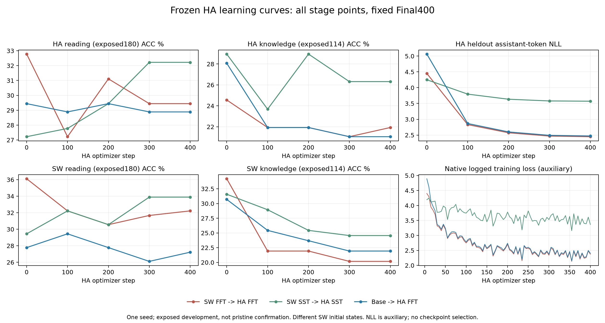

# Hausa阶段学习曲线：三条路线全部节点完成

更新：2026-11-03T15:05:20.032604+08:00。FFT、SST-NoRefresh和HA-only均完成各自起点、100/200/300/400步。共15个实际模型节点、13230条四选项评分和3840条heldout例评分；不是15次新训练。

## 1. 同一冻结协议

- 阅读180题×EN/SW/HA，按固定SHA顺序整段抽取，同ID/金标。900题历史已曝光；180明确重分类为事后开发诊断，720仅未用于本轮曲线，均不称历史未见。
- 知识114个原开发语义ID×三语言，**0-shot**。正式HA知识为14042题/5-shot；题目和few-shot均不同，不跨协议直接相减。
- HA heldout256例、30742个移位assistant监督token；与训练6400精确指令/答案对不重合。DatasetDict内部键train是缓存格式；统计按全部监督token加权，不统计prompt损失。
- 所有节点使用实际BF16导出提升FP32、eager/noTF32、同提示/评分。真实Base342条知识与旧FP32开发预测完全一致，最大选项差误差1.91e−6；540阅读输入/2160续写与实际官方Harness历史参数逐项相同。核心评分/统计5项CPU测试通过。
- 主训练13:03开始；新阅读队列于13:07:58、在任何新开发评分前冻结。该队列不由成绩选择，HA训练配方此前已从旧FFT复制；没有声称全部开发设计早于训练启动。

## 2. 完整轨迹

| Group | HA step | HA reading ACC | HA knowledge ACC | HA heldout NLL | SW reading ACC | SW knowledge ACC |
|---|---:|---:|---:|---:|---:|---:|
| fft | 0 | 32.78 | 24.56 | 4.4511 | 36.11 | 34.21 |
| fft | 100 | 27.22 | 21.93 | 2.8315 | 32.22 | 21.93 |
| fft | 200 | 31.11 | 21.93 | 2.5730 | 30.56 | 21.93 |
| fft | 300 | 29.44 | 21.05 | 2.4689 | 31.67 | 20.18 |
| fft | 400 | 29.44 | 21.93 | 2.4486 | 32.22 | 20.18 |
| sst | 0 | 27.22 | 28.95 | 4.2517 | 29.44 | 31.58 |
| sst | 100 | 27.78 | 23.68 | 3.7962 | 32.22 | 28.95 |
| sst | 200 | 29.44 | 28.95 | 3.6348 | 30.56 | 25.44 |
| sst | 300 | 32.22 | 26.32 | 3.5804 | 33.89 | 24.56 |
| sst | 400 | 32.22 | 26.32 | 3.5723 | 33.89 | 24.56 |
| ha_only | 0 | 29.44 | 28.07 | 5.0640 | 27.78 | 30.70 |
| ha_only | 100 | 28.89 | 21.93 | 2.8660 | 29.44 | 25.44 |
| ha_only | 200 | 29.44 | 21.93 | 2.5996 | 27.78 | 23.68 |
| ha_only | 300 | 28.89 | 21.05 | 2.4914 | 26.11 | 21.93 |
| ha_only | 400 | 28.89 | 21.05 | 2.4706 | 27.22 | 21.93 |

全部语言、正确答案原始续写logP、四选项归一化logP、margin、位置分布、训练loss和配对区间见[汇总JSON](../../results/next_stage/curves/analysis.json)。原始逐题留本地，公开哈希。

## 3. 概率与ACC须一起看

| 路线 | HA阅读正确选项归一化logP | HA阅读margin | HA知识正确选项归一化logP | HA知识margin |
|---|---:|---:|---:|---:|
| HA-only | -4.006→-1.804 | -2.942→-0.921 | -3.469→-1.808 | -2.090→-1.056 |
| SW FFT→HA FFT | -1.451→-1.761 | -0.450→-0.850 | -1.521→-1.660 | -0.523→-0.828 |
| SW SST→HA SST | -2.109→-1.651 | -1.266→-0.741 | -1.648→-1.661 | -0.646→-0.786 |

HA-only的NLL 5.0640→2.4706，顺序FFT为4.4511→2.4486，SST为4.2517→3.5723。三个训练目标均在改善；不能叫训练停滞。HA-only的概率校准改善也不等于ACC改善：知识开发28.07→21.05%，正式5-shot知识却26.25→27.52%。开发材料和few-shot不匹配是明确的解释边界，不能用0-shot开发下降替代正式结果。

FFT阅读的**原始**正确续写logP从−7.634变−5.640，但四选项相对logP及margin恶化。公共续写前缀及选项总概率也影响原始logP，不能单凭它宣布学会。

## 4. 是否曾学会后又退化？

在已保存的100步间隔开发节点中，FFT未出现明确HA阅读/知识峰值后再持续下滑；HA-only阅读基本持平，知识较起点下降；SST阅读开发提高，知识波动。这些小样本结果不证明“所有任务都从未学习”，也不排除100步前短暂变化；正式5-shot知识只有固定Final全量确认，未测其中途全量轨迹。SST开发阅读+5pp的区间跨0，且题目/精度不同，不与其旧正式全900变化混称一条曲线。

单个训练seed42；区间为固定模型下对题目的2000次配对重采样，非训练随机性区间，未多重校正。HA主要阅读对照按原段落cluster；知识按原题。开发材料已曝光，不称新独立确认；固定Final400，不据test选择checkpoint或配方。
