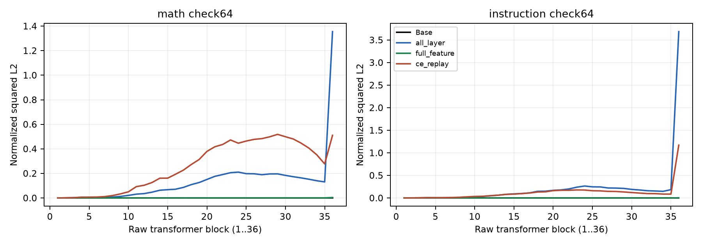
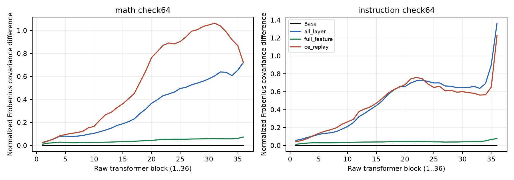
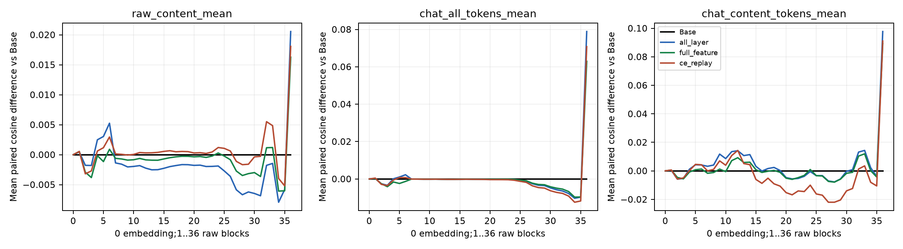
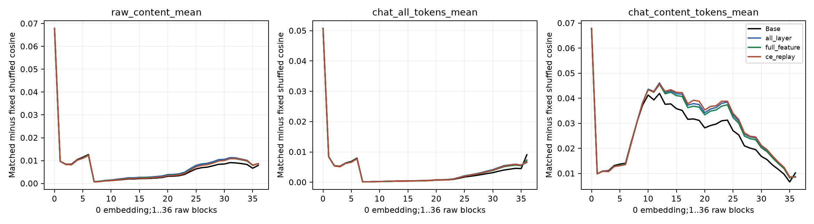

# 四模型表示机制复现与新增 benchmark 报告

## 结论

本轮使用 P2 `50640bb` 的四个既有固定端点，没有新增训练、改 Loss、搜索 lambda 或增加训练种子。`50640bb`是公开研究基线；服务器执行目录并非该提交的干净检出，执行身份以实际脚本、配置与资产SHA256为准，另记录本地checkout HEAD，不能用Git HEAD代替源码快照。

**全表示保持的下游优势得到新增 SW 推断和代码测评支持；尚未获得跨语言余弦结构提供独立额外解释的证据。** 它仍是强基线原型，不能把本轮结果称为新的动态 My Method 或顺序 CL 成功。

适配前模型是官方 **Qwen/Qwen3-4B**，revision `1cfa9a7208912126459214e8b04321603b3df60c`；表中 Base 表示适配前，不是另一个 Qwen3-4B-Base 产品。三个适配端点均为新 batch2、6400条目标样本、Final400。历史 batch1 LoRA 不替代主要对照。

## 1. 新增正式结果

单位为百分比。XNLI 为每语言5010题的原固定0-shot候选似然协议；HumanEval+ 为164题、greedy一次生成、真实隔离执行。

|任务|Base|普通LoRA|全表示保持|CE回放|
|---|---:|---:|---:|---:|
|XNLI SW ACC|33.19|42.22|44.25|33.45|
|XNLI EN ACC|49.24|71.06|70.34|35.27|
|HumanEval+ pass@1|78.05|60.37|74.39|62.80|
|HumanEval 原始测试 pass@1，辅助|84.76|65.24|80.49|69.51|

- 全表示保持相对普通LoRA：SW XNLI **+2.04** 个百分点，premise聚类配对95%区间 **[+1.02,+3.01]**；HumanEval+ **+14.02**，配对区间 **[+7.93,+20.12]**。
- 全表示保持相对Base：HumanEval+ **−3.66**，区间 **[−7.93,+1.22]**；仍有11道Base正确而它错误、5道反向改善。区间跨零不等于无遗忘或等价性证明。
- EN XNLI 全表示保持比普通LoRA低0.72点，区间跨零；其相对优势并非所有任务都成立。
- CE回放在EN推断、数学和代码上均有退化，但EN阅读仍提高，不能称为英语全面遗忘。

九项主要任务、GSM8K strict、IFEval instruction strict、57学科明细及全部区间见[结果总表](results.md)。原有P2分数不变，没有用新任务替换收益较小的Global-MMLU。

### XNLI 标签偏好仍须披露

固定题号均衡轮换后，Base的SW/EN由33.19/49.24变为36.99/64.93。全表示保持的SW/EN为44.95/72.91，普通LoRA为43.53/71.86。

因此，原协议的Base→适配增益部分包含格式/选项偏好变化。SW全表示保持相对普通LoRA的收益在这一固定轮换中仍为+1.42点，区间[+0.44,+2.44]；EN两者点估计次序反转。**不能据此宣称跨所有提示稳健，也不能选轮换中更好的成绩替换主表。** 原题已在历史研究使用，不称为全新未暴露测试。

SW按1669个相同premise文本群、EN按1670群重采样，保留同一前提下相关假设；不是把5010题全当相互独立。各类正确率、字母/语义预测分布、混淆矩阵见[偏好诊断](benchmarks/xnli_label_bias.json)。

### HumanEval+ 是执行结果，不是静态代理

当前Docker socket仍拒绝访问，复用此前已验证的隔离命名空间执行器。本轮重新通过无宿主数据路径、无网络、无capability、内核资源限额及禁止子进程越权的可信探针；164条官方参考实现全部通过后才执行656份模型代码。

使用官方EvalPlus0.3.1，明确保留 `find_zero` 成功计数修复。每进程4GiB、最多2进程、两并行隔离任务、120秒外层墙钟限制。不是不加限制的官方默认执行环境，也没有在宿主直接执行候选代码。

四组空代码和静态语法错误均为0，触及生成上限分别为2/1/1/2题。普通LoRA缺少markdown围栏较多，但官方sanitizer仍提取出有效Python，不能把其下降全部解释为围栏或截断。官方fast-check的fail无法进一步可靠区分运行异常和断言失败；不捏造细分类。普通LoRA有1题仅plus附加测试通过而base测试失败，主指标按base与plus均通过计算，为99/164，不是100/164。旧静态helper中的过时NOT_RUN说明不代表后续真实执行状态。

## 2. 旧英语表示保持是否泛化？

主要分析check128，数学/指令各64条，未参与P2训练；但已用于P1诊断，不能称为整个研究中从未查看。build128曾用于P2约束，只作暴露池描述。完全相同teacher-forced序列、固定答案预测位置、36层raw block输出；Base重提取与历史教师缓存差异为0，Base对自身漂移为0。

下表为36层均值，L2指归一化**平方**L2；协方差为本项目逐层样本协方差扩展的归一化Frobenius差异。

|模型|数学check L2|指令check L2|数学check协方差|指令check协方差|有效参数更新F范数|
|---|---:|---:|---:|---:|---:|
|普通LoRA|0.136516|0.216643|0.325388|0.495125|8.1092|
|全表示保持|0.000667|0.000608|0.041588|0.039186|8.0217|
|CE回放|0.259828|0.118590|0.561837|0.481358|8.8135|

全表示保持在未用于P2训练的样本上仍显著减小漂移。整体有效更新范数仅比普通LoRA小约1.08%，旧英语平方L2却小约两个数量级，提示**总参数范数不足以概括本轮功能变化**。这仍不等于已完成同范数干预，不能排除更新位置、方向、旧信息与优化路径等混杂。

### 协方差复现边界

[Two-Phase §4.4](https://aclanthology.org/2026.findings-acl.1595.pdf) 的公式将样本均值激活写成层×隐藏维度，再按层中心化，得到一个隐藏维×隐藏维协方差矩阵。它不能唯一确定图示的逐层曲线，矩阵L2范数口径也不应擅自替作者补全。

本轮分别报告：

1. **Paper-literal cross-layer algebra adaptation**：依公式跨36层构建，补充声明答案位置池化假设；每组一个矩阵，提供Frobenius和谱范数。并非完整原实验或原逐层图复现。
2. **Per-layer sample covariance extension**：每层以64条样本各自答案位置均值为观测，按样本维无偏中心化，报告原始/归一化Frobenius和谱范数。每层秩至多63，不代表完整高维总体分布。

低秩Gram实现通过了小规模稠密矩阵、平移、缩放及零差异对照。协方差漂移与L2总体同向，但本轮没有识别其独立预测或因果贡献。

## 3. 跨语言共享结构：有变化，但解释力不足

使用固定300条FLORES **dev** EN/SW句对，不用正式devtest；排除既知64条开发句、3条示例以及目标训练/旧英语池的精确规范化文本重叠。24条固定抽查发现三条术语/措辞疑点，全部300条仍保留，未按模型曲线筛选；这是助手抽查，不是母语人工认证或语义去污染证明。

按[LinguaMap §4.1.2](https://arxiv.org/pdf/2601.20009v2)的token平均、逐层余弦和总体标准差定义迁移到本模型。0为embedding，1..36为final norm前raw block；论文末层归一化细节不完全明确，这不是原模型/语料/原图数值的精确复制。池化FP32、统计FP64。

只有两种输入：裸内容、统一non-thinking chat。chat同次前向分别统计全部token与内容token；后者仍带有chat上下文影响，不能视为与裸文本只相差一个无效掩码。

主要反例：

- 以“各层平均余弦相对Base变化的绝对值，再跨36层平均”衡量裸文本曲线稳定性，普通LoRA为0.003487，全表示保持0.001871，**CE回放为0.001732**。CE在此更稳定，数学/EN推断/代码却明显更差；这个标量不能可靠排序四模型表现。
- 裸文本后12层的平均变化：普通LoRA−0.00290、全表示保持−0.00088；chat内容token口径则为+0.00807、+0.00639。解释对输入上下文与池化口径敏感，不能预设余弦越高越好。
- 第36层的裸文本余弦变化三种适配均为正，且共同模板影响更大；不能把末层尖峰直接称为语言知识获得或独立功能区域。
- 同一固定循环错配对照下，三种适配的“匹配减错配”曲线很接近，没有出现只在全表示保持中突出的跨语言信号。

英语L2保持差异很大，而跨语言余弦差异较小且受模板影响。**当前证据更支持旧英语表示保持这条解释线；尚不支持增加Cross-Lingual Cosine Loss。** 这也不是证明所有跨语言结构指标无用。

## 4. 关联、反例与下一步

完整提供五种预定信号×九任务的四模型描述性秩关联，不筛选有利系数，不给独立模型重复或因果p值。四模型共享Base、seed与目标训练，Base又天然锚定零漂移；36层、64例或300句均不能替代独立模型条件。不能据此证明协方差或跨语言指标有“超出总漂移”的稳定增量预测能力。

下一步最值得验证的具体假设是：**旧任务功能保持取决于更新怎样作用于旧输入，而不只是总更新量或跨语言平均余弦。** 应先做同旧数据、同教师信息、近等有效更新范数的方向/位置控制，再考虑功能选择性或动态表示约束。P1的rank8敏感方向此前额外解释不稳，这轮没有将其包装成已验证算法。

建议保留普通全表示保持为强基线；暂不增加新的跨语言损失，也不凭本轮曲线选择保护层。后续跨语言推广或顺序CL需要冻结单独计划。本轮没有启动这些后续训练。

## 5. 验证、成本与材料

- 80,160条XNLI主要/轮换预测、656条真实代码执行结果、36,864条旧英语逐例层漂移和133,200条跨语言逐对层余弦已独立复核。
- 所有既有权重、P2分数及历史负结果保留；翻译本轮NOT_RUN，不能声称已修复。Logit Lens是可选项，本轮NOT_RUN。
- 实际用两张核实空闲的3090，账号上限4；其他用户任务不操作。所有GPU工作已完成，没有占卡空进程或新训练。
- [完整分数](results.md)、[冻结协议](protocol.json)、[审计](audit.md)、[实际成本](cost_summary.json)、[原始特征来源哈希](mechanism/DONE.json)。
- 公开数值可复算bench成绩和层级汇总；协方差端到端复算需要保留于服务器的哈希特征缓存或重新提取，不谎称仅靠汇总CSV即可恢复全部高维统计。

限制：单SW、单训练seed42、四个关联端点；相同旧文本不代表教师信息或总训练计算等价；300句dev包含历史语料暴露；并非作者原模型完整复现，亦非多语言顺序持续学习验证。
