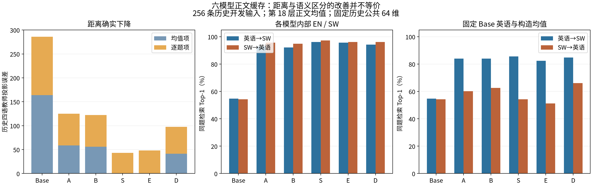
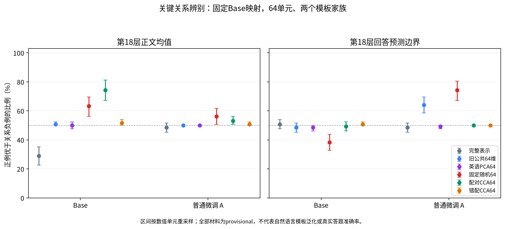

# S3-Align：共享子空间对齐与英语保持

本次更新归档 Qwen3-4B 的斯瓦希里语（SW）指令适配研究。研究问题是：共享子空间对齐能否改善目标语言能力，英语表示保持能否减少原有英语能力损伤，以及二者结合是否优于仅英语保持。

**发布状态：2026-11-16 阶段快照。** 历史 S3 消融和两轮机制分析已完成；最新 FULL-65K 的 T0、T1 已完成训练和共同核心测评，T2 双侧 CCA 仍待最终分数。这里不宣称整个实验已经完成，也不将代理指标改善当作正式任务收益。

## 从哪里开始读

| 内容 | 文件入口 | 范围 |
|---|---|---|
| 原 S3 消融完整报告 | [01_sft_20261115/report.md](01_sft_20261115/report.md) | 7 模型、91 项分数、195 组配对区间；包含数据、公式、提示与预算 |
| 共享空间、位置及功能干预 | [02_mechanism_20261115/report.md](02_mechanism_20261115/report.md) | 五语表示分析及 128 道阅读题上的 9,600 条干预记录的汇总 |
| 最新语义、关系、数学遗忘与匹配训练 | [03_mapping_20261116/report_draft.md](03_mapping_20261116/report_draft.md) | 六模型语义比较、64 单元关系诊断、256 题英语数学及 T0/T1 正式结果 |
| 原 S3 完整分数 | [scores.csv](01_sft_20261115/results/scores.csv) · [配对区间](01_sft_20261115/results/paired_changes.csv) | 历史 65k 协议，保留全部正负结果 |
| 新匹配训练分数 | [training_results.csv](03_mapping_20261116/analysis/training_results.csv) · [配对区间](03_mapping_20261116/analysis/training_paired_intervals.csv) | 本轮重新评测的 Base、T0、T1；T2 未出分 |
| 来源与内容校验 | [SOURCE_MANIFEST.json](SOURCE_MANIFEST.json) | 原文件与公开副本 SHA-256、复制时点及路径替换记录 |

每阶段分别提供必要代码、配置和结果。三个阶段的历史模型、教师、批量与评测身份不同；不能直接拼成一张仅改变方法的因果比较表。

## 最新正式成绩

T0 为英语表示保持基线；T1 在相同保持上加入统一坐标对齐；T2 在相同保持上加入双侧 CCA 对齐。新三组预设相同主训练预算：Bactrian-X SW 65,415 条、一轮 4,089 步、有效 batch 16、LoRA rank 16、seed 42。T0/T1 已验证主训练顺序和监督词元预算一致。辅助数据曝光和计算量另计，不宣称总计算预算完全相同。

下表为固定协议正式测评，单位为百分数，均越高越好。Belebele 为选择题准确率；GSM8K 为最终答案准确率；IFEval 为官方严格通过率。完整任务、few-shot、模板、框架和限制见阶段报告。

| 模型 | SW Belebele（900题） | EN GSM8K（1,319题） | IFEval 提示级 strict（541条） | IFEval 指令级 strict（834条） |
|---|---:|---:|---:|---:|
| 本轮 Base | 27.33 | 84.08 | 79.11 | 85.25 |
| T0 英语保持 | 65.56 | 83.09 | 79.48 | 85.13 |
| T1 统一坐标对齐＋保持 | 59.22 | 83.78 | 78.93 | 84.65 |
| T2 双侧 CCA＋保持 | 待完成 | 待完成 | 待完成 | 待完成 |

T1−T0 的阅读变化为 −6.33 个百分点，配对 95% 区间为 [−8.81, −3.77]；英语数学 +0.68、提示级指令遵循 −0.55 个百分点，两者区间均跨零。当前统一坐标对齐存在明确目标阅读代价，没有明确英语补偿收益。不能据此提前判断 T2。

Base 在 900 道阅读题中选择 A 达 825 次，而正确答案为 A 的只有 206 题；因此相对 Base 的大幅提高不能全部归因于语义理解增强。T1 相对 T0 在所有正确答案位置上均下降。没有根据测试成绩重新选择提示。配对区间只反映固定模型的样本不确定性，不涵盖训练种子变化，也未作多重比较校正。

## 分析实验得到了什么

1. **S3 不只是移动均值，但距离改善远大于已证实的任务收益。** 在 256 条历史开发输入、第18层正文均值及固定共享64维中，历史 S 的模型内部 EN→SW 同题检索为96.09%，普通微调 A 为92.97%；S−A 为3.13个百分点，区间 [0.39,5.86]。固定 Base 英语参照后的 SW→EN 检索却从60.16%降至54.30%。历史 A→S 对齐误差125.02→43.08，约71.6%的降幅来自均值项；该比例不是能力贡献比例。
2. **CCA 的关系信号局部有效，尚不稳定。** 固定 Base CCA 在 Base 正文的排序方向辨别为100%，减法顺序只有48.44%；普通微调 A 分别为56.25%和50%。A 的排序原表达正确32/32，关系反转后只有4/32。两个模板家族、64数值单元均为探索性材料，尚无母语复核；不能将模板内重采样区间当作跨语言现象泛化证明。随机和错配控制均保留。
3. **英语数学遗忘是真实内容错误为主，英语保持可以修复大部分。** 新256题诊断集 Base/A/B/E 正确数为228/212/230/227；A 的30道遗忘题中，助手复核为27道内容错误、1道歧义、2道格式问题。B/E 分别修复24/25道，但也引入新错误。该诊断来自 GSM8K 训练划分，经已知材料排除后冻结，不冒充独立正式测试。
4. **总表示漂移和局部参考概率不足以定位遗忘。** A 的第18层漂移在保持正确/遗忘两组约0.352/0.344；英语保持压到约0.055/0.054。局部教师强制概率改善不能替代自由生成正确率。

最值得进一步检验的是：约束能否保留改变答案的关键关系，并在微调后保持有效。正式方法价值仍由匹配训练后的固定下游任务判断，当前证据不支持仅提高整体 MSE 对齐权重，也不能否定所有共享子空间方法。

## 公开副本与服务器完整材料

本目录保留报告、图、汇总表、必要实现及科学配置；未上传模型权重、优化器状态、隐藏状态缓存、完整训练语料、完整逐题生成文本、账号运行管理记录或附件聊天。代码中的服务器根目录统一替换为 `/srv/research` 与 `/srv/storage`，这两个目录是占位符，不是可直接访问的服务器路径。

代码是审阅用的真实实现副本，仍依赖服务器数据和外部评测工程；不宣称下载本目录即可端到端复现。原始文件不变，源码检查只验证语法，没有重新运行训练或评测。报告提及的完整逐题文件和私有协议记录不一定包含在此公开副本中。

服务器上的对应目录尾部为：`outputs/sw_s3_handoff_20261115`、`outputs/s3_mechanism_handoff_20261115_v1`、`reproductions/s3_mapping_20261116`、`models/checkpoint/s3_mapping_20261116` 和 `logs/s3_mapping_20261116`。完整绝对路径单独交付给仓库所有者。
