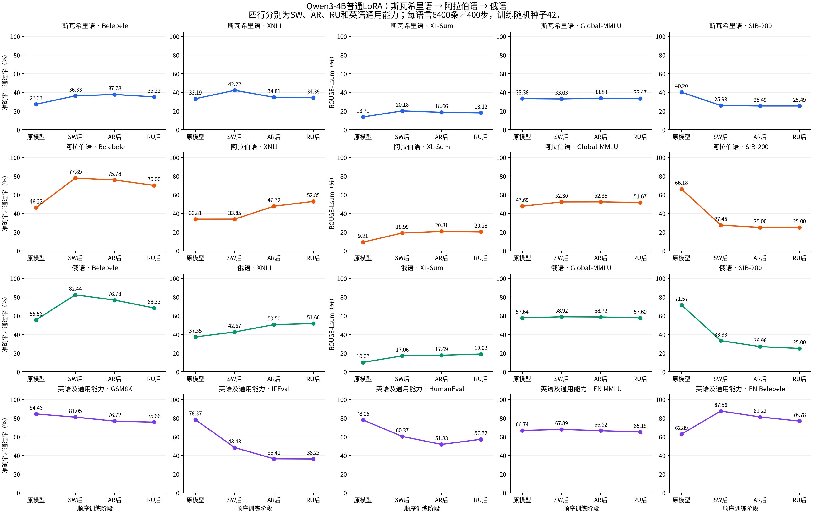

# 普通 LoRA：单语言有效，但 SW→AR→RU 的收益与遗忘并不按语言整齐排列

更新：2026-11-11。SW、AR、RU 分别指斯瓦希里语、阿拉伯语、俄语；EN 为英语。本页汇总已完成的正式测试，保留收益与负结果。所有数值来自实际逐题评分；截图只用于展示。

## 1. 研究问题、输入与控制变量

问题分为三项：独立训练一种语言是否改善该语言任务；顺序训练的收益是否出现在对应语言阶段；继续训练是否损伤已经获得的任务表现。

底座为 `Qwen/Qwen3-4B@1cfa9a7208912126459214e8b04321603b3df60c`，不是另一个 Base/2507 模型。普通 LoRA 为 rank16、alpha32、dropout0.05，覆盖全部36个 Transformer 层的 q/k/v/o/gate/up/down 投影。每种语言6400条、400个优化器步、单轮，micro-batch2×累积8＝有效batch16，长度2048，seed/data_seed42，BF16、SDPA、assistant-only loss、无packing，学习率1e-4、cosine、warmup0.05、AdamW、weight decay0、梯度裁剪1。固定Final，不因测试分数选择checkpoint。

每种语言的训练构成为阅读1920、原生摘要1280、指令摘要640、知识640、常识640、EN→目标语翻译640、目标语→EN翻译640；主要来自锁定Aya Collection及原生任务源。它包含双语翻译，不能将“未到AR/RU阶段”理解为完全没有跨语言监督。SW/AR/RU实际输入词元分别为2373891/2265373/2520204，回答监督词元324892/265783/305046；样本数与步数相等，词元预算不等。

独立 single 是各自从同一底座训练的 `sw_all/ar_all/ru_all`；不是旧micro1历史模型，也不是名为 `full` 的表示保护方法。顺序端点 W0=原模型，W1=SW后，W2=SW→AR后，W3=SW→AR→RU后。W1复用已核验的micro2普通SW LoRA；后续继续更新同一adapter，每换语言重建优化器和调度器，不增加adapter容量，无显式旧语言回放或保护。模型、数据与训练顺序身份见 [training_identity.json](training_identity.json)。

## 2. 测试、提示与计算方法

各端点使用相同题目、提示、聊天模板和评分。`protocol.json` 保存实际任务模板、候选顺序、few-shot、解码配置及数据来源锁；其中服务器路径已替换为占位路径。完整真实题面与模型输出保留在本地，本次公开聚合结果，不重新发布整套测试题。提示包装采用Qwen3 non-thinking聊天模板；Belebele为P/Q/A-D/Answer，候选A/B/C/D；XNLI为固定英文relation说明和A/B/C候选；SIB为固定英文主题分类指令和7个英文标签；MMLU使用固定各学科dev五例。摘要、数学、指令及代码的完整模板与解码见该协议文件及既有仓库冻结协议。

| 任务 | 每个端点的正式范围 | 主指标与实现 |
|---|---|---|
| Belebele | SW/AR/RU/EN各900题，0-shot | 正确率ACC；harness候选似然，本地提示/离线数据适配 |
| XNLI | 各目标语言5010题，0-shot | ACC；harness，本地固定提示与候选位置 |
| XL-Sum | SW987、AR4689、RU7780篇 | 逐篇ROUGE-Lsum均值；自写vLLM生成，调用ROUGE库 |
| Global-MMLU / EN MMLU | 各14042题、57学科，5-shot dev | ACC；harness上游任务、本地离线数据 |
| SIB-200 | 各204题，0-shot | 固定字符长度归一化似然ACC；raw ACC与macro-F1辅助 |
| GSM8K | EN1319题，5-shot train | flexible-extract最终答案ACC；strict-match辅助 |
| IFEval | EN541提示、834条指令，0-shot | strict提示级通过率；指令级strict辅助 |
| HumanEval+ | 官方v0.1.10全部164题，每题一次greedy | pass@1；自写生成/静态抽取与隔离EvalPlus真实执行 |

ACC为正确题数/总题数×100；IFEval提示级要求该提示所有指令均通过。ROUGE-Lsum是摘要序列重叠分数，独立列示，不与ACC混成总分，也不跨语言比较绝对大小。表中除摘要为ROUGE分外，均为百分数；分数差为百分点。

实际harness为0.4.14.dev0，上游commit `d6de81643928d653435c431bae19945d41d32520`。GSM8K/IFEval使用其上游任务及评分，本地路径与vLLM追踪包装；greedy、最多1280词元。摘要SW使用rouge-score0.1.2、默认ASCII词元/English Punkt分句；AR/RU使用XL-Sum上游afcd803加已冻结的native-tokenizer传递修正，不冒充未经修改的官方端到端。代码为1024词元、自写生成与官方EvalPlus0.3.1核心，含已记录的find_zero记账修正与隔离执行，164条canonical样例校准全部通过。

真实输出交叉复核：64条既有IFEval输出的提示/指令strict标记与钉死上游函数一致；摘要每语32条与原库比较，SW/AR一致，RU有2条因已记录的词元传递修正而不同。来源/配置与复核范围见 [protocol.json](protocol.json)，不能把本地模板适配称为全部任务的官方默认协议。

所有阶段对比都只改变被比较模型，题面与对应关系不变。先按题号和输入身份哈希对齐，再计算“后−前”。例如AR XNLI题490在W1→W2由A变B且金标B，是获得；SW XNLI题4284在W1→W2由B变A且金标B，是丢失。不同题配对或人为改前缀均未用于这些分数。95%区间为固定模型下2000次配对bootstrap：Belebele按篇章、XNLI按premise聚类，摘要按文章，其余按题；seed42，无多重比较修正，不代表训练种子不确定性。

## 3. 独立 single：有明确任务收益，也有代价

下表每格为“Base → 独立single（差值）”。三行各使用对应语言的全部正式测试，样本范围见上表。知识是Global-MMLU；SIB采用固定归一化主分。它回答单语言训练的效果，与顺序端点分开。

| 语言 | Belebele | XNLI | XL-Sum | Global-MMLU | SIB-200 |
|---|---|---|---|---|---|
| SW | 27.33 → 36.33 (+9.00) | 33.19 → 42.22 (+9.02) | 13.71 → 20.18 (+6.47) | 33.38 → 33.03 (-0.35) | 40.20 → 25.98 (-14.22) |
| AR | 46.22 → 80.67 (+34.44) | 33.81 → 36.93 (+3.11) | 9.21 → 20.83 (+11.62) | 47.69 → 52.29 (+4.60) | 66.18 → 25.00 (-41.18) |
| RU | 55.56 → 82.00 (+26.44) | 37.35 → 60.14 (+22.79) | 10.07 → 18.86 (+8.78) | 57.64 → 60.29 (+2.65) | 71.57 → 25.98 (-45.59) |

SW阅读+9.00、推理+9.02、摘要+6.47；AR阅读+34.44、摘要+11.62、知识+4.60；RU阅读+26.44、推理+22.79、摘要+8.78、知识+2.65。因此“single完全无效”与数据不符。但SW知识没有提高，三语SIB主分均下降，不能称全面语言能力提升。

单语言适配也已损伤通用任务：SW/AR/RU single的IFEval分别48.43/41.22/41.77，均低于Base78.37；数学为81.05/74.98/77.63，低于84.46；代码为60.37/60.37/57.32，低于78.05。单语言完整十项数值见 [single_scores.csv](single_scores.csv)。这些代价在首次适配时就存在，不能全部算作后续语言引起的遗忘。

## 4. 顺序曲线：很多涨点提前出现，对应阶段并非总有收益

图按SW、AR、RU、英语通用能力分四行；各点是全量正式分数。下表保留15项目标任务的完整数字。横向比较同一行，W0/W1/W2/W3分别为原模型/SW后/AR后/RU后。

| 语言 | 任务 | W0 | W1 | W2 | W3 |
|---|---|---|---|---|---|
| SW | Belebele | 27.33 | 36.33 | 37.78 | 35.22 |
| SW | XNLI | 33.19 | 42.22 | 34.81 | 34.39 |
| SW | XL-Sum | 13.71 | 20.18 | 18.66 | 18.12 |
| SW | Global-MMLU | 33.38 | 33.03 | 33.83 | 33.47 |
| SW | SIB-200 | 40.20 | 25.98 | 25.49 | 25.49 |
| AR | Belebele | 46.22 | 77.89 | 75.78 | 70.00 |
| AR | XNLI | 33.81 | 33.85 | 47.72 | 52.85 |
| AR | XL-Sum | 9.21 | 18.99 | 20.81 | 20.28 |
| AR | Global-MMLU | 47.69 | 52.30 | 52.36 | 51.67 |
| AR | SIB-200 | 66.18 | 27.45 | 25.00 | 25.00 |
| RU | Belebele | 55.56 | 82.44 | 76.78 | 68.33 |
| RU | XNLI | 37.35 | 42.67 | 50.50 | 51.66 |
| RU | XL-Sum | 10.07 | 17.06 | 17.69 | 19.02 |
| RU | Global-MMLU | 57.64 | 58.92 | 58.72 | 57.60 |
| RU | SIB-200 | 71.57 | 33.33 | 26.96 | 25.00 |

SW阶段结束时，AR阅读已从46.22到77.89（+31.67），RU从55.56到82.44（+26.89）；EN阅读也从62.89到87.56（+24.67）。AR自己的训练阶段阅读77.89→75.78，RU自己的阶段76.78→68.33。现象支持跨语言提前迁移/共享任务适配，但没有实验隔离“语言能力、任务格式、数据内容”等原因，不能据此断言具体机制。

对应语言阶段也有真实收益：AR XNLI +13.87、摘要+1.82；RU XNLI +1.16、摘要+1.32。因此“涨点都不在对应语言阶段”过于绝对；更准确的是**不同任务的涨点时机不一致**。

## 5. 遗忘存在，但按任务分化，不能只看Final是否高于Base

下表给出对应语言学习或旧任务保持的关键对比，范围与主表一致。负号表示分数下降，区间按第2节计算。完整全部6种阶段配对×20任务＝120组见 [paired_changes.csv](paired_changes.csv)。

| 语言 | 任务 | 阶段 | 差值 | 95%配对区间 |
|---|---|---|---|---|
| SW | XNLI | W1_SW → W3_SW_AR_RU | -7.82 | [-8.76, -6.88] |
| SW | XL-Sum | W1_SW → W3_SW_AR_RU | -2.06 | [-2.80, -1.29] |
| SW | Belebele | W1_SW → W3_SW_AR_RU | -1.11 | [-3.97, +1.88] |
| AR | Belebele | W2_SW_AR → W3_SW_AR_RU | -5.78 | [-7.98, -3.55] |
| AR | XNLI | W1_SW → W2_SW_AR | +13.87 | [+12.95, +14.93] |
| AR | XL-Sum | W1_SW → W2_SW_AR | +1.82 | [+1.52, +2.12] |
| RU | Belebele | W2_SW_AR → W3_SW_AR_RU | -8.44 | [-10.77, -6.22] |
| RU | XNLI | W2_SW_AR → W3_SW_AR_RU | +1.16 | [+0.20, +2.08] |
| RU | XL-Sum | W2_SW_AR → W3_SW_AR_RU | +1.32 | [+1.12, +1.52] |

SW XNLI从学习后的42.22降到最终34.39（−7.82），摘要20.18→18.12（−2.06），区间均不跨0，是清楚的任务表现遗忘。SW阅读36.33→35.22（−1.11）的区间跨0，不宜声称有明确下降；知识保持相对稳定。AR在RU阶段阅读−5.78，但XNLI反而+5.13，摘要−0.53。不能把这种混合轨迹压成“所有旧语言遗忘”或“几乎没有遗忘”。

RU在自己的阶段阅读下降是**新语言本阶段负增益**，不是“后来语言造成的RU遗忘”，因为RU之后没有新阶段。SW旧任务损失和AR旧任务损失则有明确的时间顺序。

## 6. 通用能力：首次适配损失与后续追加损失并存

下表五项为英语通用正式测试，样本量与主指标见第2节。仍不做跨任务总平均。

| 任务 | W0 | W1 | W2 | W3 |
|---|---|---|---|---|
| GSM8K | 84.46 | 81.05 | 76.72 | 75.66 |
| IFEval | 78.37 | 48.43 | 36.41 | 36.23 |
| HumanEval+ | 78.05 | 60.37 | 51.83 | 57.32 |
| EN MMLU | 66.74 | 67.89 | 66.52 | 65.18 |
| EN Belebele | 62.89 | 87.56 | 81.22 | 76.78 |

IFEval在SW阶段已下降29.94点，随后AR/RU阶段累计再降12.20；数学首次下降3.41点，随后再降5.38；代码首次下降17.68点，最终相对W1再低3.05。EN阅读虽最终比Base高13.89点，但相对W1峰值下降10.78点。Final高于Base与先前能力发生回退可以同时成立。

## 7. 与独立AR/RU single直接对照：是否值得继续顺序叠加

下表每格为“独立single / 顺序中对应语言刚训练完（顺序−独立）”。AR比较single与W2，RU比较single与W3；正式范围和协议相同。只是固定模型的观察差值，未在此新增配对置信区间；顺序端点还多接触前序语言数据，不是等总训练预算的因果比较。

| 语言 | Belebele | XNLI | XL-Sum | Global-MMLU | SIB-200 |
|---|---|---|---|---|---|
| AR | 80.67 / 75.78 (-4.89) | 36.93 / 47.72 (+10.80) | 20.83 / 20.81 (-0.02) | 52.29 / 52.36 (+0.08) | 25.00 / 25.00 (+0.00) |
| RU | 82.00 / 68.33 (-13.67) | 60.14 / 51.66 (-8.48) | 18.86 / 19.02 (+0.16) | 60.29 / 57.60 (-2.69) | 25.98 / 25.00 (-0.98) |

AR顺序后的阅读比独立AR低4.89点，XNLI却高10.80，摘要几乎相同（−0.02）；RU顺序后的阅读比独立RU低13.67、XNLI低8.48、知识低2.69，摘要仅高0.16。顺序训练没有稳定改善新语言的五项任务，也没有统一的保持优势。SW与W1是同一个adapter，不是独立重复实验。

## 8. 两项评分敏感性及结论边界

**SIB不能直接解释为主题语义能力整体消失。** 每语204题最大类占51题（25%）；最终AR/RU归一化主分25%，预测全部集中到science/technology。相同似然的未归一化辅助ACC为SW54.41、AR34.31、RU65.20，明显不同于主分SW25.49/AR25/RU25。其标签长度归一化与类别偏好敏感性很强；固定主分完整保留，不能事后换较高的分数宣布成功，也不宜把这项崩塌当作干净的语言遗忘证据。

**GSM8K的格式敏感性也很强。** Base的flexible/strict为84.46/61.03，Final为75.66/23.35。当前主指标flexible沿11月9日5+5协议冻结，strict另列；不可与更早采用strict为主的协议混用。提取器分歧不自动证明推理正确或错误。辅助分数及24组配对变化随附CSV。

只做一个顺序、一个训练seed；训练内容/先后/累计预算未正交隔离，不能证明一种遗忘机制，也不能据此预测其他顺序。测试题已在此前实验中暴露，本轮用于固定协议报告与错误分析，未用于选择提示、训练参数或checkpoint。没有新增语言顺序、混合训练或多seed结果，不冒充已经完成的控制实验。

**研究判断：single在多项实际任务上有效，但有显著能力取舍；当前普通LoRA顺序基线呈现提前迁移、任务特异的遗忘和本阶段负增益。它不是一条干净的“学哪种语言就整体涨、接着整体忘”的曲线。现有证据不足以把这个设置当作展示方法优越性的强持续学习基准，也不足以说顺序训练没有遗忘。** 当前结果不理想，应完整保留，而不是依据已暴露测试反复调设置制造预期曲线。

## 文件与可追溯性

- `scores.csv`：四端点×20项＝80个主分，含样本数；其中30个既有分数重新逐题核验、50个新分数由40个新测评作业产生。
- `single_scores.csv`：三语Base与独立普通LoRA各十项，来自既有正式5+5结果，不混入历史micro1与表示保护方法。
- `paired_changes.csv`：120组主分配对变化与区间、题目身份哈希。
- `auxiliary_scores.csv` / `auxiliary_paired_changes.csv`：36个辅助分数与24组配对变化，主辅角色固定。
- `protocol.json`：实际框架/任务配置、提示模板、数据锁与真实输出交叉核对范围；本地路径为占位值，源码/数据哈希保留。
- `training_identity.json`：底座与三阶段最终adapter哈希、实际词元和训练审计。
- `artifact_manifest.json`：上述公开文件的SHA256及源文件身份。所有原始逐题输出、完整提示与本地审计继续留存。

所有训练与正式测评已完成，本次仅CPU结果整理，不启动新训练或恢复任何暂缓实验。
